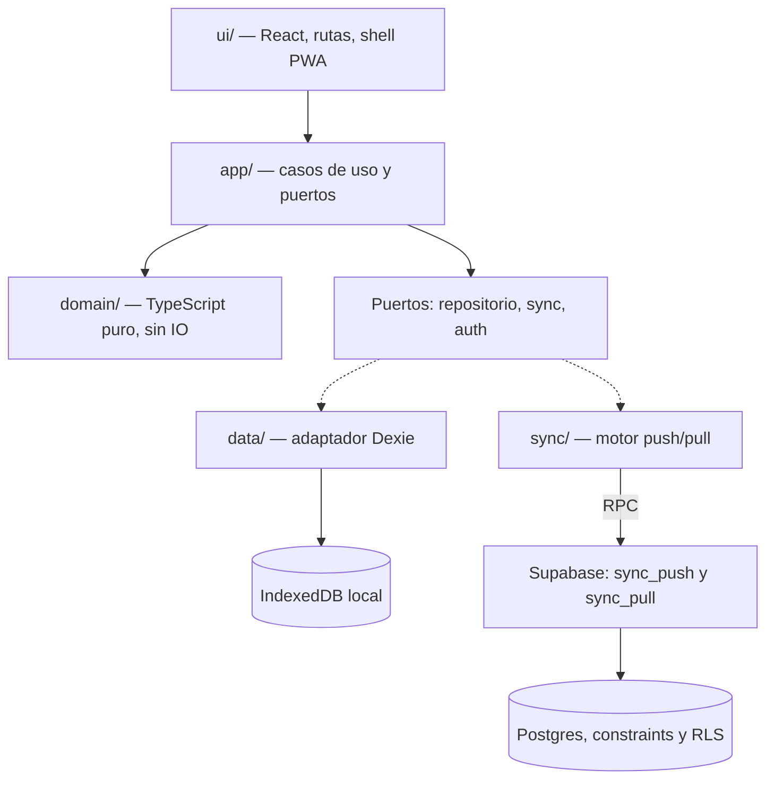
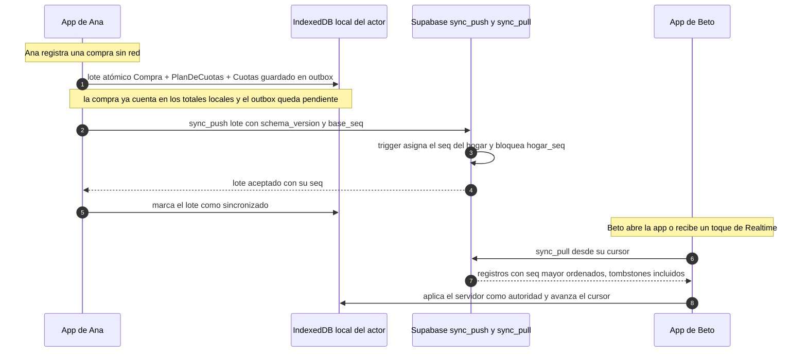

# Arquitectura de hogar-app

Este documento fija las decisiones técnicas de la fase 1: principios, stack, capas, sincronización entre miembros, privacidad de los gastos personales, exportación y respaldo, autenticación, riesgos y las decisiones que Santiago tomó el 22 nov 2026. El modelo de datos (entidades, campos e invariantes I1–I23) vive en [data-model.md](data-model.md) y los números trabajados en [examples.md](examples.md). El negocio manda desde [domain.md](domain.md).

**En una línea:** una PWA offline-first que guarda hechos en el teléfono, replica a Postgres con un protocolo propio pequeño y auditable, y calcula lo derivado en el dispositivo con las filas que el actor puede ver.

## 1. Contexto

### Qué es

Una aplicación mobile-first (PWA) para manejar las finanzas de un hogar compartido en pesos colombianos. Registra lo que se gasta, lo que se debe y lo que aporta cada miembro, sin inventar deudas entre ellos.

### Usuarios

Un hogar de dos o más miembros (típicamente una pareja). Cada miembro usa su propio teléfono, muchas veces sin señal, y cualquiera puede registrar un movimiento del otro. El uso típico es en el momento: la compra del mercado, la cuota que vence, la transferencia al fondo común.

### Los cuatro núcleos

| Núcleo | Qué resuelve | Entidades que lo sostienen |
| --- | --- | --- |
| Compra rápida | Registrar un gasto en la menor cantidad de toques | `Compra`, `Categoria`, `MedioDePago`, `PlanDeCuotas`, `Cuota` |
| Obligaciones del mes | Lo que hay que pagar este mes: cuotas, créditos, servicios, suscripciones | `Obligacion`, `Cuota`, `CostoFinanciero`, `PagoDeDeuda` |
| Balance de pareja | Cuánto aportó cada miembro, con aporte libre y sin deuda automática | `Aporte`, `Ingreso`, `Compra`, `PagoDeDeuda` |
| Despensa de mascotas | Comida, insumos y gastos recurrentes de las mascotas | `Mascota`, `ItemDespensa`, `NivelDespensa`, `Compra` |

### Estado

Fase 1: solo diseño (flujos, mockups y estos documentos). No hay código de producto. Los cálculos de esta fase se verifican con `python3` sobre los ejemplos, no con tests de aplicación. CI, protección de rama y despliegue los opera Kiroi, no los agentes (decisión 8 del 22 nov 2026): este documento no afirma que exista un pipeline, solo qué debe verificar cuando exista.

### Documentos

| Documento | Rol |
| --- | --- |
| [domain.md](domain.md) | Fuente de verdad del negocio |
| [data-model.md](data-model.md) | Entidades, campos, tipos, relaciones e invariantes I1–I23 |
| [examples.md](examples.md) | Ejemplos trabajados con números en COP y sus totales del mes |
| [decisiones-2026-11-22.md](decisiones-2026-11-22.md) | Decisiones de Santiago y nombres canónicos de la ronda 2 |
| [dian-qr.md](dian-qr.md) | Investigación del QR de factura electrónica DIAN (Anexo Técnico FEV 1.9) |
| [AGENTS.md](../AGENTS.md) | Reglas de trabajo para agentes y semáforo de PR |

## 2. Principios

Siete principios de los que se derivan todas las decisiones siguientes.

| # | Principio | Qué obliga en el diseño |
| --- | --- | --- |
| P1 | **Offline-first** | Registrar, editar y ver lo derivado de las filas visibles funciona sin red. Ninguna pantalla de registro depende del servidor. La única lectura de red es la descarga de un export (§9); sin red se muestra como pendiente, nunca bloquea el trabajo |
| P2 | **Montos enteros en COP** | `bigint` en Postgres, `number` entero seguro en TS con el tipo de marca `Pesos`. Nunca centavos ni coma flotante en el dinero |
| P3 | **Sin doble conteo** | Consumo, pago de deuda y costo financiero nunca se suman entre sí: son tres conceptos distintos |
| P4 | **Nada derivable se guarda** | Saldos, totales del mes, estado de cuotas, aportes, nivel de despensa y próxima compra se calculan en el dispositivo con las filas que el actor puede ver. El servidor no calcula saldos, aportes ni totales. Solo se guardan hechos |
| P5 | **El consumo del hogar es del hogar; el personal es de su dueño; el aporte es del miembro** | Una `Compra` del hogar no se atribuye a un miembro (solo lleva `registrado_por`). Una compra personal lleva `miembro_id`, la ve solo su dueño y nunca aporta al hogar. El aporte sale de un medio de pago con dueño |
| P6 | **Aporte libre** | Ninguna entidad referencia a un miembro como acreedor y ningún cálculo produce "X le debe a Y" |
| P7 | **Fechas civiles** | Todo en `America/Bogota`; el mes contable sale de la fecha civil `YYYY-MM-DD`, nunca de un `timestamptz` |

Única excepción al entero (P2): al multiplicar por una tasa se redondea al peso más cercano, mitades hacia arriba, **una vez por cuota**. Las tasas se calculan en coma flotante y solo se redondea el interés final.

Ejemplo del principio P3: un mercado de $300.000 a 3 cuotas suma $300.000 al gasto una sola vez, en la fecha de la compra; las cuotas son pagos de deuda y los intereses son costo financiero.

## 3. Stack propuesto

### Elección

| Componente | Elección | Razón |
| --- | --- | --- |
| Frontend | TypeScript estricto + React + Vite | Ecosistema amplio, arranque rápido, tipos que protegen las invariantes de dinero |
| Shell offline | PWA con `vite-plugin-pwa` (Workbox) | El requisito es PWA: instalable, cachea el shell y permite trabajar sin red |
| Rutas | React Router | Estándar, sin servidor que renderice |
| Estilos | Tailwind CSS (salvo que los mockups de `design/mockups` pidan otra cosa) | Mobile-first por defecto y poca superficie de CSS propio |
| Validación de bordes | Zod | Un solo esquema de validación en formularios y en la frontera del lote |
| Almacenamiento local | IndexedDB vía Dexie | Tablas espejo del servidor + `outbox` + cursor de sync; transacciones locales para el lote atómico |
| Backend | Supabase (Postgres + Auth + RLS + RPC en SQL/PL/pgSQL + Storage + Realtime + pg_cron), región `us-east-1` | Base relacional con constraints reales, auth resuelta, exportación programada y sin servidor propio |
| Hosting | Cloudflare Pages | Estático, gratis, CDN global |
| Tests (fase 2) | Vitest + fast-check, Playwright, pruebas SQL de RLS y constraints (`pgTAP` o `supabase test db`) | Propiedades de dinero, e2e móvil y verificación de las reglas en la base |

### Alternativas descartadas

| Alternativa | Por qué se descartó |
| --- | --- |
| Firebase / Firestore | Offline nativo, pero NoSQL sin FKs, CHECK ni únicos para invariantes de dinero; las sumas por mes cuestan lecturas; lock-in |
| PocketBase en un VPS | Simple y barato, pero exige operar servidor, backups y TLS; el sync offline habría que escribirlo igual |
| Cloudflare Workers + D1 | Más barato y sin pausa, pero auth hecha a mano (riesgo de seguridad) y más código propio |
| Motores local-first (PowerSync, ElectricSQL, Zero/Replicache, Triplit, InstantDB, Jazz) | Resuelven el sync pero suman un servicio o una dependencia pesada. Para ~200 registros/mes de un hogar, un protocolo propio de ~300 líneas es más simple y auditable. PowerSync queda como plan B si el sync propio se complica |
| Next.js / SSR | No hay nada que renderizar en servidor; agrega costo y complejidad |
| Svelte / SvelteKit | Bundle menor, pero menor fluidez de los agentes y del ecosistema; la diferencia de peso no justifica el cambio |
| React Native / Flutter | Tiendas de apps y builds nativos; el requisito es PWA |

### Costo esperado

USD 0/mes en los planes gratuitos (Supabase free + Cloudflare Pages). El plan gratuito se acepta (decisión D4, §11): la pausa por inactividad se mitiga con la exportación semanal automática a Storage y con las réplicas locales completas (§9). Supabase Pro (USD 25/mes) solo si más adelante se quieren backups gestionados; ver riesgo R2.

## 4. Capas

Arquitectura hexagonal con la dependencia hacia adentro: `ui` conoce `app`, `app` conoce `domain`, y `domain` no conoce a nadie. `data` y `sync` implementan puertos definidos por `app`.

| Capa | Responsabilidad | Prohibido |
| --- | --- | --- |
| `domain/` | Tipos (`Pesos`, `FechaCivil`, `Mes`), entidades, invariantes, cálculos (tasas, plan de cuotas, FIFO, saldos, totales del mes, aportes, próxima compra de despensa) | IO, React, Dexie, red, `Date.now()` para decidir el mes |
| `app/` | Casos de uso: `registrarCompra`, `registrarPagoDeDeuda`, `registrarAporte`, etc. Define los puertos | Conocer Dexie o Supabase concretos |
| `data/` | Adaptador Dexie: repositorio local, `outbox`, cursor | Reglas de negocio |
| `sync/` | Motor push/pull contra las RPC | Calcular derivados |
| `ui/` | React, rutas, shell PWA | Hablar con `data/` o `sync/` directamente |
| Servidor | Migraciones SQL: esquema, constraints, RLS, RPC `sync_push`/`sync_pull`, invitaciones, lock por pasivo y exportación programada | Lógica de negocio propia: toda fórmula es la misma función pura de `domain/` reproducida en SQL solo para la exportación |

**La única excepción a «el servidor no calcula».** La lógica de cálculos vive en `domain/`; el servidor la reproduce en SQL solo para la **exportación (§9)**, que vuelca hechos aplicando el mismo predicado de visibilidad que RLS y no incluye derivados. Comparte fixtures con `domain/` para que no derive (R4).

### Lote atómico

Cada caso de uso arma un **lote atómico**: todos los registros de una intención, calculados en `domain/`, y lo escribe en una sola transacción Dexie junto con su entrada en el `outbox`. Una compra financiada a 3 cuotas genera en un solo lote la `Compra`, el `PlanDeCuotas`, las `Cuota` y los `CostoFinanciero` calculados. Una compra de despensa arrastra su `NivelDespensa(100)`, y marcar un ingreso recibido crea o actualiza el `RecepcionIngreso` del periodo. Un lote entra completo o no entra, tanto en el teléfono como en el servidor; reintentar no duplica.

El lote declara su actor: una compra personal y sus filas dependientes (pasivo personal, subtipo, plan, cuotas, pagos y costos) solo viajan en un lote de su dueño. Un lote que mezcla una compra del hogar con una personal del mismo actor es válido; las filas personales de otro miembro se rechazan (§5.9).

## 5. Sincronización entre miembros

### 5.1 Identidad de los registros

Los ids son **UUIDv7 generados en el cliente**. Crear nunca choca: no hay secuencias de id ni coordinación previa.

Toda tabla replicada lleva las mismas columnas de sync:

| Columna | Tipo | Para qué |
| --- | --- | --- |
| `id` | `uuid` | Identidad generada en el cliente |
| `hogar_id` | `uuid` | Tenencia (salvo en `Hogar`) |
| `creado_en` | `timestamptz` | Informativo, reloj del cliente |
| `actualizado_en` | `timestamptz` | Informativo, reloj del cliente |
| `eliminado_en` | `timestamptz null` | Tombstone; nunca hay borrado físico |
| `actualizado_por` | `uuid → Miembro` | Quién hizo el último cambio |
| `seq` | `bigint` | Orden de réplica, asignado por el servidor |

### 5.2 `seq` por hogar y el orden de commit

`seq` es un contador monotónico **por hogar**, guardado en la tabla solo-servidor `hogar_seq(hogar_id, ultimo_seq)`. Un trigger `BEFORE INSERT/UPDATE` hace `UPDATE hogar_seq SET ultimo_seq = ultimo_seq + 1 ... RETURNING`, lo que **bloquea la fila del hogar hasta el commit**.

Por qué no una secuencia global: una secuencia asigna el número al insertar, pero los commits no ocurren en ese orden. Un pull que ya leyó hasta `seq = 100` puede recibir después una fila con `seq = 97` confirmada tarde; el cursor ya pasó de 97 y esa fila no llega nunca. Con el contador por hogar, el segundo escritor del mismo hogar espera el lock hasta el commit del primero: **el orden de `seq` coincide con el orden de commit** y un cursor es seguro. Hogares distintos no se bloquean entre sí.

### 5.3 Push

La RPC `sync_push(lote)` aplica un lote (una intención) en una sola transacción: todo o nada. Cada lote lleva un `lote_id` (UUIDv7 del cliente); el servidor guarda los `lote_id` aplicados con su resultado en la tabla solo-servidor `lote_aplicado`. Si llega un `lote_id` ya aplicado (el cliente perdió la respuesta y reintenta), devuelve el resultado guardado sin volver a evaluar `base_seq`: un reintento nunca se confunde con un conflicto.

| Caso | `base_seq` | Resultado |
| --- | --- | --- |
| Registro nuevo | `null` | Insert idempotente: si el id ya existe con el mismo contenido, no-op; reintentar no duplica |
| Actualización o tombstone | El `seq` que el cliente vio | Update, si coincide con el `seq` actual del servidor |
| Actualización vieja | Distinto del actual | Lote rechazado con `conflicto`; devuelve la versión del servidor |
| Unicidad rota | Cualquiera | Lote rechazado con `duplicado` |
| Fila personal de otro miembro | Cualquiera | Lote rechazado con `no_autorizado`; nunca se trata como conflicto |

### 5.4 Pull

`sync_pull(desde_seq, limite)` devuelve los registros del hogar con `seq > desde_seq`, ordenados por `seq`, tombstones incluidos. El cliente los aplica y avanza el cursor: **el servidor es la autoridad**.

El pull **no es un canal de privilegio**: devuelve exactamente lo que el actor puede ver. Las filas compartidas del hogar llegan completas; una compra personal y sus filas dependientes llegan solo a su dueño. La forma barata de garantizarlo es que el pull sea `SECURITY INVOKER` sobre vistas protegidas por RLS, de modo que la política sea la única autoridad. Si por el cursor o por los tombstones tiene que ser `SECURITY DEFINER`, reaplica el mismo predicado de visibilidad fila por fila y un test de paridad verifica que pull y RLS devuelven el mismo conjunto (§5.9).

### 5.5 Conflictos y duplicados

Nunca hay *last write wins*. Un dato de dinero no se sobrescribe en silencio:

- **Conflicto de versión:** el lote se rechaza y el cliente conserva su cambio como borrador en conflicto; el usuario decide. El servidor devuelve la versión vigente para que la pantalla muestre ambas. Un conflicto solo se muestra sobre filas que el actor puede ver.
- **Duplicado duro:** dos miembros pagaron offline la misma obligación del mismo periodo; el único `(obligacion_id, periodo)` entre compras no eliminadas rechaza el lote (I11). En deuda, dos pagos completos de la misma cuota chocan con el único parcial de `cuota_id` (I20), y un abono que dejaría el saldo del pasivo negativo se rechaza bajo el lock del pasivo (§5.7).
- **Avisos de posible duplicado:** son dos y distintos (uno entre miembros tras un pull, otro inmediato antes de guardar), se definen en [data-model.md](data-model.md) §3.7.1 y son avisos de UI, nunca restricciones. El aviso entre miembros solo considera compras del hogar: las personales de otro miembro no se ven.

### 5.6 Disparadores de sincronización

| Momento | Acción |
| --- | --- |
| Al abrir la app | Vaciar `outbox` y hacer pull |
| Al volver la pestaña a foco | Igual |
| Al recuperar red | Igual |
| Después de un push | Pull inmediato |
| Aviso de Supabase Realtime | Pull; el aviso lleva solo `(hogar_id, ultimo_seq)` en un canal del hogar, nunca filas (§5.9) |

En iOS no existe Background Sync: el `outbox` solo se vacía con la app abierta. Por eso el push ocurre temprano y el estado del `outbox` es visible en la UI.

### 5.7 Validación en el servidor y permisos

- `sync_push` es `SECURITY DEFINER` y verifica, registro por registro, dos cosas: membresía activa de `auth.uid()` en el `hogar_id` y propiedad de toda fila personal mediante el mismo alcance de §5.9 (dueño de la `Compra` o del `Pasivo` del que depende la fila). En cambios se comprueban la fila vigente y la propuesta; una fila personal ajena se rechaza con `no_autorizado` sin exponer sus datos.
- Los clientes **no** escriben tablas directamente; solo tienen `SELECT` por RLS de membresía y de propiedad de lo personal.
- Postgres valida con FKs, CHECK, únicos parciales (`WHERE eliminado_en IS NULL`) y triggers diferidos para las reglas entre filas: capital del plan = monto de la compra; si el plan es `sin_calendario`, cero cuotas; en los demás sistemas, cuotas contiguas `1..n_cuotas` cuya suma de capital es el capital del plan.
- **Deuda bajo lock.** En la misma transacción del lote, `sync_push` bloquea el pasivo (`SELECT ... FOR UPDATE` o advisory lock por `pasivo_id`), recalcula el FIFO con las filas del lote y las ya confirmadas, y rechaza el lote si alguna fecha histórica quedaría con saldo negativo; el exceso explícito va como `PagoDeDeuda.tipo='saldo_a_favor'`. Dos pagos offline de la misma cuota se serializan: el segundo ve al primero. Es la regla I20 y la misma que valida `domain/`.
- El servidor no calcula **ningún estado normal de la app**: saldos, aportes y totales se derivan en `domain/` con las filas visibles del actor. La única excepción, que no persiste nada, es la exportación (§9), que comparte fixtures con el dominio (R4).

### 5.8 Versionado del esquema

El lote lleva `schema_version`. Una versión vieja se rechaza con `actualizar_app` y el service worker fuerza la actualización. Dexie migra el esquema local por versiones. Un cliente viejo puede seguir leyendo y registrando offline, pero su `outbox` espera hasta que la app se actualice.

### 5.9 Privacidad de compras personales y datos dependientes

Decisión D1 (§11). «Una compra personal la ve solo su dueño» es una regla de visibilidad, no una etiqueta de UI: se aplica igual en la base, en el push y el pull, en los conflictos, en Realtime, en Storage y en el índice local. Un control que se implemente en una sola capa es un control que se puede saltar por otra.

**Qué es dato dependiente.** Una fila es personal si su ámbito es personal ([data-model.md](data-model.md) §8) o si cuelga de una compra o de un pasivo personal: el `Pasivo` personal y su subtipo, `PlanDeCuotas`, `Cuota`, `PagoDeDeuda`, `CostoFinanciero` y el `NivelDespensa` que generó una compra personal. El dueño se resuelve por `Compra.miembro_id` o `Pasivo.owner_miembro_id` según el origen; la observación de una compra usa su `compra_id`. Un nivel compartido de despensa solo usa hechos compartidos: una observación personal no modifica la alerta compartida.

**Qué no cambia al guardar.** Una compra sincronizada conserva su ámbito y dueño. Para reclasificarla, se anula en su alcance original y se crea otra; el pull no retira copias por un cambio de visibilidad (I18). Guardar una compra personal tampoco crea ni modifica filas compartidas como `AliasComercio` o `ItemDespensa.monto_habitual` (I23).

#### 5.9.1 Una sola definición de visibilidad

El predicado `puede_ver(actor, fila)` vive en una única función SQL y lo usan las políticas RLS, el pull y el export personal. El export compartido no lo relaja: aplica un alcance hogar aún más estricto, sin ninguna fila personal. Duplicar el predicado es la forma típica de abrir un agujero, así que hay uno solo.

| Camino | Cómo se protege | Verificación (fase 2) |
| --- | --- | --- |
| RLS de lectura | `puede_ver` en cada tabla; el rol no exime de la propiedad | `pgTAP` o `supabase test db`: otro miembro y el admin reciben 0 filas personales ajenas |
| Escritura | Solo `sync_push`, `SECURITY DEFINER`, con membresía activa y propiedad de cada fila personal | Lote con una compra personal ajena se rechaza con `no_autorizado` |
| Pull | Mismo predicado; si `sync_pull` es `SECURITY DEFINER`, reaplica `puede_ver` fila por fila | El conjunto del pull es idéntico al de RLS para el mismo actor |
| Conflictos | Solo se muestran versiones de filas visibles; una fila personal ajena se rechaza antes y nunca llega a borrador | Un lote en conflicto no crea borrador de fila personal ajena |
| Realtime | El aviso del hogar transporta `(hogar_id, ultimo_seq)`, sin payload de filas; lo personal no se difunde | Un miembro suscrito al canal del hogar no recibe datos de compras personales del otro |
| Storage | Bucket privado con prefijos por dueño y URLs firmadas de vida corta (§9.2) | Un miembro no puede leer ni listar `personal/<hogar>/<otro>/` |
| Índice local | Base Dexie abierta por `(hogar_id, actor)` (§9.3) | Cambiar de sesión no expone filas del actor anterior |

Realtime solo notifica: el aviso del hogar lleva el `seq` y el cliente hace pull, que es la autoridad y aplica el predicado de visibilidad. No se usa `postgres_changes` como fuente de datos: aunque RLS filtraría las filas entregadas, el dato siempre llega por pull.

Storage lo opera la misma función de exportación: el job semanal corre con service role y por eso **salta** las políticas de Storage. La garantía no es la política sino la generación: el export compartido se construye sin filas personales (§9.1) y un test lo afirma. La política de Storage es la segunda barrera, no la única.

### 5.10 Pasivos de un solo ámbito

`Pasivo.ambito` (`enum('hogar','personal')`, default `'hogar'`) es un campo del esquema de esta arquitectura, no un nombre impuesto por el acta: lo exige la privacidad de D1 y no cambia ninguna regla de negocio.

Cada `Pasivo` es un **libro lógico de un solo ámbito**, también cuando el plástico es uno solo. Una tarjeta con compras del hogar y compras personales se modela como dos `Pasivo`: el del hogar, compartido, y el personal de su dueño. El dueño del libro personal es `owner_miembro_id` y coincide con el `miembro_id` de sus compras; del libro cuelgan el subtipo, los planes, las cuotas, los `PagoDeDeuda`, los `CostoFinanciero` y sus metadatos, todos visibles solo para el dueño (§5.9). El libro del hogar sigue compartido y pagable por cualquier miembro.

Cada `PagoDeDeuda` apunta a un solo `pasivo_id` y por lo tanto a un solo ámbito. Si una transferencia bancaria cubre los dos libros, se registran **dos pagos**, uno por libro, con las porciones que el usuario identifique; el monto completo no se registra dos veces. Si el usuario no puede asignar las porciones, la app no reparte ni prorratea: pide dividir la operación y no la registra en el libro compartido.

Consecuencia para el balance: los cargos y los pagos de un libro son todos del mismo ámbito, así que el aporte de un pago no depende de compras personales ocultas. El servidor no calcula aportes ni devuelve agregados: el balance se deriva en el cliente con las filas que el actor puede ver, sin lectura de red adicional (P1, P4).

**No inferencia.** Dos escenarios que difieren solo en hechos personales del actor A producen, para otro actor B, el mismo conjunto de filas compartidas con los mismos montos, el mismo export compartido, el mismo balance del hogar y los mismos totales del hogar; la RLS le devuelve a B las mismas filas y ningún total compartido cambia. El cursor, los `seq` y los avisos globales de sync pueden reflejar que hubo actividad, nunca montos. Como ningún pago compartido cubre un cargo personal, no hay resta que revele el monto de una compra personal.

### 5.11 Flujo completo

## 6. Autenticación del hogar

### Ingreso sin contraseña

Supabase Auth con código OTP o enlace mágico por correo; Google opcional. No hay contraseñas que administrar ni recuperar.

### Creación e invitación

| Paso | Qué pasa |
| --- | --- |
| Crear hogar | El primer usuario crea `Hogar` y su `Miembro` con `rol=admin` en una RPC atómica que también crea `hogar_seq` y las categorías por defecto |
| Invitar | Un admin genera una invitación: token aleatorio de un solo uso, guardado como hash, vence en 7 días, en la tabla solo-servidor `invitacion` |
| Canjear | El invitado inicia sesión y la canjea; se crea su `Miembro` o se vincula a un `Miembro` existente sin cuenta (`usuario_id` null) |

### Roles

| Acción | `admin` | `miembro` |
| --- | --- | --- |
| Leer y escribir todos los registros financieros del hogar | Sí | Sí |
| Leer y escribir sus propias compras personales y sus filas dependientes | Sí | Sí |
| Leer compras personales de otro miembro (incluido el admin) | No | No |
| Registrar un movimiento por el otro | Sí | Sí |
| Invitar miembros | Sí | No |
| Desactivar miembros | Sí | No |
| Renombrar el hogar | Sí | No |
| Descargar el export del hogar (no incluye ninguna fila personal) | Sí | Sí |
| Descargar su propio export personal | Sí | Sí |

El rol no da visibilidad sobre lo personal ajeno: la privacidad es de la fila, no del rol. Un admin no puede leer ni exportar las compras personales de otro miembro (§5.9, §9).

Desactivar un miembro no borra sus registros: el histórico queda intacto y sus movimientos siguen contando.

### Offline y alcance de la fase 1

La sesión se persiste; sin red se trabaja con la sesión en caché. Si el refresh token venció, el `outbox` se conserva y se pide login al reconectar. La réplica local se abre por actor y por hogar (§9.3): dos miembros en el mismo teléfono nunca comparten la misma base ni ven lo personal del otro. Los datos locales no tienen cifrado propio en fase 1 (ver riesgo R7), así que el alcance por actor no protege contra alguien que abra el teléfono desbloqueado. En fase 1 un usuario pertenece a un solo hogar; la tabla `Miembro` ya permite varios en el futuro.

## 7. Totales y definiciones clave

Resumen para leer el resto del documento; las definiciones exactas, las reglas de cálculo (tasas, reparto de capital, FIFO, fechas de tarjeta) y los invariantes I1–I23 están en [data-model.md](data-model.md), secciones 8 a 10.

| Concepto | Definición en una línea | Invariantes |
| --- | --- | --- |
| Gasto del mes del hogar | Σ `Compra.monto_total` del hogar con fecha en el mes + Σ `CostoFinanciero.monto` del hogar con fecha de causación en el mes. Excluye lo personal | I2, I4, I18 |
| Gasto personal de un miembro | Compras personales de ese miembro más los costos de su ámbito; solo lo ve su dueño y nunca entra al hogar, ni con el interruptor `incluir_personales` prendido, que es una vista | I18 |
| Aportes del mes de un miembro | Salidas de caja desde medios de ese miembro que cubren cargos del hogar (compras de contado, pagos de deuda de pasivos del hogar, costos pagados directo) + Σ `Aporte` con origen en sus medios. Una compra personal, una compra financiada por desembolso y un pasivo personal no aportan | I6, I17, I18, I19 |
| Balance de pareja | Los aportes por miembro en pesos y en porcentaje del total, incluido el fondo común; nunca una fila de diferencia | I7 |
| Ingreso del mes de un miembro | Fijos vigentes en el mes, con `monto_recibido` si el recibo dice `recibido=true` y el esperado si no, más variables con fecha en el mes | I22 |
| Obligaciones del mes | Cuotas con vencimiento en el mes (capital más sus costos con `cuota_id`) + costos cargados sin `cuota_id` causados en el mes + obligaciones recurrentes; es una agenda, no se suma al gasto y se lee por `periodo`, no por `fecha` | I3, I10 |
| Saldo de un pasivo | Capital de sus planes + costos cargados − pagos, a una fecha; **nunca negativo**: un abono que lo haría negativo se rechaza y el exceso va como saldo a favor explícito | I10, I20 |

Las cuotas se cuentan como pagos de deuda y los intereses como costo financiero; el consumo se cuenta una sola vez, en la fecha de la compra. Cada `Pasivo` es un libro de un solo ámbito (§5.10) y cada pago pertenece a uno solo: no se reparte entre ámbitos ni se registra dos veces. El **costo financiero es un balde aparte**, no una categoría de consumo (I4): no se suma a `monto_total` ni se reparte por categoría. Los porcentajes se redondean solo al mostrarse y nunca se guardan.

**Dos vistas que no se reconcilian por mes.** La agenda de obligaciones se lee por el `periodo` de la obligación y el gasto por la `fecha` de la compra: el recibo de noviembre pagado el 2 de diciembre aparece pagado en noviembre y suma al gasto de diciembre. Es intencional y la UI lo dice junto a las tres métricas del mes ([domain.md](domain.md) y [data-model.md](data-model.md) §8).

## 8. Factura electrónica DIAN (QR)

La investigación que sostiene esta sección está en [dian-qr.md](dian-qr.md). El objetivo es que registrar un gasto real cueste dos toques en vez de transcribir cifras, sin romper P1 (offline-first) ni P4 (nada derivable se guarda).

### 8.1 Qué trae el QR

El QR impreso de una factura electrónica (Anexo Técnico FEV 1.9, num. 11.7) se emite en dos formatos y el parser acepta ambos:

| Formato | Contenido | Qué se puede precargar |
| --- | --- | --- |
| Campos | `NumFac`, `FecFac`, `HorFac`, `NitFac`, `DocAdq`, `ValFac`, `ValIva`, `ValOtroIm`, `ValTolFac`, `CUFE`/`CUDE` y la URL del catálogo | NIT del comercio, fecha, total, IVA y CUFE/CUDE |
| Solo URL | La URL de `catalogo-vpfe.dian.gov.co`, con el CUFE dentro de la URL | El CUFE, si la URL lo trae; el resto lo completa el usuario o el OCR |

El QR **nunca** trae los ítems de la factura: solo la cabecera y la identidad del documento (§8.5).

### 8.2 Flujo y capas

| Paso | Dónde vive | Qué pasa |
| --- | --- | --- |
| Leer el QR | `ui/` | La cámara entrega el texto decodificado; nada más |
| Interpretarlo | `domain/` | Parser puro de los dos formatos: campos o solo URL, con la extracción del CUFE |
| Precargar | `app/` | Caso de uso `precargarCompraDesdeFactura`: arma el borrador de `Compra` |
| Confirmar | `ui/` | El usuario revisa, completa categoría y medio de pago, y guarda |

El camino corre completo en el cliente y **offline**: no hay ninguna petición HTTP en el flujo, así que un fallo de la DIAN no bloquea registrar un gasto.

Se precargan **NIT del comercio, fecha, total, IVA y CUFE/CUDE**, siempre como propuesta editable que el usuario confirma; nada se guarda sin confirmación. El total ya incluye el IVA y el IVA se guarda solo como dato informativo: nunca se suma aparte al gasto (P3, I2, I4).

Fallbacks, en este orden: OCR del tiquete impreso (a pedido, con todos los campos editables) y entrada manual, que sigue siendo el camino base.

### 8.3 Lo que la app no hace

La app **no consulta ni scrapea el catálogo de la DIAN**. El catálogo tiene captcha y desde julio de 2026 exige NIT, así que automatizarlo es frágil, va contra los términos del servicio y mete una dependencia de red en un flujo que debe ser offline.

Lo único que se ofrece es un botón "Verificar en la DIAN" que abre la URL oficial en el navegador para verificación manual: un enlace, no una integración. La app no guarda el resultado del catálogo.

### 8.4 Deduplicación

El escaneo solo busca coincidencias en compras del hogar y personales del mismo miembro. `Compra.cufe` es único entre no eliminadas por índice: `(hogar_id, cufe)` para hogar y `(hogar_id, miembro_id, cufe)` para personal. Una coincidencia visible en el otro ámbito puede avisar, pero no bloquea. Las compras personales ajenas no afectan el aviso ni la respuesta del guardado o la sincronización. Ver [data-model.md](data-model.md) §3.7. Si una factura se reparte en varias compras por categoría, solo la de mayor `monto_total` lleva el `cufe` (y el `iva`); las demás quedan en `null`.

### 8.5 Fase 2: ítems desde el correo

El detalle de líneas no entra en fase 1: el QR no lo trae y el tiquete obliga a OCR. En fase 2 el miembro reenvía la factura por correo (ZIP con XML UBL y PDF) y la ingesta obtiene los ítems cuando la factura sale a nombre del miembro; esas compras entran con `origen='correo'`.

### 8.6 Riesgos

| Riesgo | Efecto | Mitigación |
| --- | --- | --- |
| QR ilegible, dañado o borroso | No hay precarga y el usuario transcribe a mano | Fallback OCR y entrada manual; el escaneo nunca es obligatorio para guardar |
| CUFE ausente en el formato solo-URL (la URL no lo trae) | Sin `cufe` no hay deduplicación automática y la verificación manual depende del enlace | Se guarda la compra con `cufe` nulo y se avisa en la UI: la compra queda válida, sin dedupe |
| Facturas POS (tirilla que no es factura electrónica) | No hay QR ni CUFE que leer | Queda el tiquete: OCR o manual, con `origen='ocr'` o `origen='manual'` |

## 9. Exportación y respaldo

Decisión D4 (§11): se acepta Supabase gratis y el respaldo no depende de que alguien se acuerde. La copia del hogar se genera sola cada semana y cada dispositivo mantiene una réplica local completa del alcance que su sesión puede ver.

### 9.1 Qué se exporta

- **Hechos, no derivados.** Las tablas replicadas con sus columnas de sync (§5.1): ids, fechas, montos y tombstones. Saldos, aportes, niveles de despensa, totales y estados no viajan: se recalculan con [data-model.md](data-model.md) §8. Un export no es una segunda fuente de verdad.
- **Dos archivos descargables por miembro, nunca mezclados:**
  - **Hogar** (`hogar/<hogar_id>/<AAAA-MM-DD>/`): un archivo común a todos los miembros, con las filas compartidas y sus dependientes. No incluye ninguna fila personal, ni siquiera la de quien descarga.
  - **Personal** (`personal/<hogar_id>/<miembro_id>/<AAAA-MM-DD>/`): un archivo con solo las filas personales de ese miembro y sus dependientes. No incluye filas compartidas ni personales ajenas.
- **Formato.** Cada archivo es un ZIP con el JSON de todas las filas de su alcance y un CSV por tabla. Ambas representaciones se generan a partir de las mismas filas.
- **Alcance por hogar y por actor.** El archivo compartido se genera una sola vez por hogar y fecha, sin depender del actor. Para generar el personal, el actor es explícito: se seleccionan solo filas de ámbito personal y se aplica `puede_ver` (§5.9). No hay una lista de tablas copiada a mano.

### 9.2 Cómo se genera y cómo se descarga

| Disparador | Qué corre | Qué obtiene el actor |
| --- | --- | --- |
| Semanal (`pg_cron`) | `exportar_hogar(hogar_id)`: el compartido una vez y un archivo personal por miembro activo, cada uno en su prefijo | Nada automático: los archivos quedan en Storage, privados |
| "Exportar ahora" (Ajustes) | La misma función y las mismas reglas, con la fecha de hoy | Dos URLs firmadas, una para el archivo del hogar y otra para el personal propio |

Semanal y a pedido son **el mismo camino**: cambia el disparador, no el generador ni las reglas de alcance. El botón no puede pedir el personal de otro miembro ni el export de otro hogar.

- Bucket **privado**, sin URLs públicas; la descarga usa una URL firmada de vida corta.
- Política de Storage por prefijo: el actor solo puede leer `hogar/<su hogar>/` y `personal/<su hogar>/<su miembro>/`; no puede listar ni leer otros prefijos.
- El job usa service role y **salta** las políticas de Storage. La garantía de que el compartido no lleva personales es la generación (§9.1) más un test que lo afirma (R9); la política es la segunda barrera, no la única.
- La retención la fija la migración (se conservan los últimos exports por prefijo y el mismo job borra los viejos); borrar un archivo de export no toca ningún dato.
- "Exportar ahora" necesita red. Sin red queda la réplica local (§9.3); el export del servidor no es el único respaldo.

### 9.3 Copia local en IndexedDB

Cada dispositivo guarda una **réplica completa autorizada** de su hogar más lo que todavía no se sincronizó.

- **Alcance del actor, no del dispositivo.** La base Dexie se abre con nombre y claves que incluyen `hogar_id` y el `miembro_id` del actor: filas compartidas + sus propias filas personales y dependientes + su `outbox`. Cambiar de sesión cierra esa base y abre otra; dos miembros en el mismo teléfono nunca comparten stores. Las preferencias locales (`incluir_personales`, último medio de pago) viven en el mismo espacio con clave por actor y no se replican ([data-model.md](data-model.md) §1.3).
- **Pendientes incluidos.** El `outbox` con lotes sin confirmar forma parte de la réplica: los totales locales son optimistas y el estado pendiente se muestra (P1, R1). Nada pendiente sale del dispositivo antes del push.
- **Qué no guarda.** Ni derivados persistidos (P4), ni archivos de export: se piden y se muestran, no se archivan como verdad.
- **Límite.** Sin cifrado local en fase 1 (R7). El alcance por actor evita mezclar miembros; no protege contra abrir el teléfono desbloqueado.

## 10. Riesgos

| # | Riesgo | Impacto | Mitigación |
| --- | --- | --- | --- |
| R1 | Safari/iOS desaloja el almacenamiento de una PWA que no está instalada | Se pierden registros locales que aún no se sincronizaron | Instalar en la pantalla de inicio, pedir `navigator.storage.persist()`, sincronizar temprano (al abrir y al volver a foco) y mostrar el `outbox` pendiente de forma visible |
| R2 | Supabase gratuito pausa el proyecto tras 7 días sin actividad y no ofrece backups descargables | El primer acceso tras la pausa es lento o frágil; no hay respaldo externo si el proyecto se pierde | Réplicas offline completas en cada dispositivo, exportación semanal automática a Storage descargable desde Ajustes (§9) y decisión D4: se acepta el plan gratuito |
| R3 | Conflictos de edición simultánea | Lotes rechazados y trabajo duplicado | Política explícita sin *last write wins*: borrador en conflicto visible y decisión del usuario; con dos miembros la frecuencia esperada es baja |
| R4 | Deriva entre las constraints PL/pgSQL y el dominio en TypeScript | El servidor acepta lo que el dominio rechaza, o al revés; el export difiere de la app | Fixtures JSON compartidos que se corren en fase 2 contra las constraints, el FIFO y el export |
| R5 | El interés estimado no coincide con el extracto del banco | Totales que no cuadran con la realidad | El interés calculado nace como `origen='calculado'` y es editable; al corregirlo pasa a `origen='manual'`. El extracto manda y el saldo es "según la app" |
| R6 | Reloj del cliente desfasado | Orden incorrecto de eventos y totales raros | El orden lo fija `seq` del servidor; `creado_en` y `actualizado_en` son informativos y no ordenan ni calculan |
| R7 | Datos locales sin cifrar | Quien acceda al teléfono desbloqueado ve las finanzas del hogar | Riesgo aceptado en fase 1; depende del bloqueo del dispositivo. Cifrar el almacenamiento local queda como decisión nueva para una fase posterior |
| R8 | Cliente viejo después de un cambio de esquema | Escrituras con campos que el servidor ya no acepta | `schema_version` en el lote, rechazo con `actualizar_app`, service worker que fuerza la actualización y `outbox` conservado hasta actualizar |
| R9 | Fuga de compras personales por un camino lateral | Otro miembro, un enlace de Storage o un aviso de Realtime expone datos personales | Un solo `puede_ver` (§5.9), RLS, push con propiedad por fila, pull con el mismo predicado, aviso Realtime sin payload, bucket privado con prefijos y export compartido sin personales con test que lo afirma; los libros personales son de un solo ámbito (§5.10) y no hay agregado que los revele |
| R10 | Réplica local mezclada entre miembros en un mismo teléfono | Un miembro ve lo personal del otro en el dispositivo | Base Dexie por `(hogar_id, actor)`, cierre al cambiar de sesión y preferencias por actor (§9.3); sin cifrado local (R7) |
| R11 | Retiros y reembolsos desde el fondo común no modelados | El saldo del fondo en la app se separa del banco y no hay registro que lo explique | Aceptado en D6: se mantiene el default de fase 1 y se revisa más adelante con una entidad propia; no se simula con una compra ni con un aporte negativo |

## 11. Decisiones tomadas (22 nov 2026)

Reemplazan las preguntas abiertas de la ronda 1. Fuente: [decisiones-2026-11-22.md](decisiones-2026-11-22.md). El detalle de negocio está en [domain.md](domain.md) y los campos en [data-model.md](data-model.md): acá queda solo la consecuencia técnica.

| # | Decisión | Consecuencia técnica |
| --- | --- | --- |
| D1 | Gastos del hogar **y** personales: `Compra.ambito ∈ {hogar, personal}`, dueño en `miembro_id`, visibilidad solo para el dueño; reportes y balance excluyen lo personal y `incluir_personales` es una preferencia local de vista, apagada | RLS y `puede_ver` por fila, push con propiedad, pull filtrado, dos archivos de exportación por miembro, Realtime sin payload e índice local por actor (§5.9, §9); una compra personal nunca es aporte (I6, I18); cada `Pasivo` es un libro de un solo ámbito y un pago cubre un solo libro (§5.10) |
| D2 | Todos los miembros ven los ingresos del otro; `Hogar.mostrar_pct_ingreso = false` por defecto | No cambia la RLS de `Ingreso`; el balance muestra pesos y % del total aportado y agrega el % del ingreso propio solo si el hogar prende el interruptor |
| D3 | Mes calendario | Una sola ventana para gasto, aportes e ingresos; la agenda se lee por `periodo` y el gasto por `fecha`, sin reconciliación por mes (§7) |
| D4 | Se acepta Supabase gratis con exportación automática semanal JSON+CSV a Storage, botón "Exportar ahora" y réplica local completa | Función programada y botón comparten generador y alcance; bucket privado con prefijos por hogar y dueño; IndexedDB por actor (§9) |
| D5 | Préstamo en efectivo: el desembolso se registra una sola vez como plan `origen='desembolso'` y las compras con esa plata llevan `financiada_por_pasivo_id`; no suman aporte | El capital no se duplica, la compra suma al gasto una vez y el aporte aparece al pagar el préstamo (I19); un pasivo no mezcla ámbitos |
| D6 | Retiros y reembolsos desde el fondo común no se modelan. **No es una decisión nueva de Santiago**: se mantiene el default de la fase 1 y se revisa más adelante | Menos entidades; si alguien retira plata del fondo, el saldo de la app se separa del banco y no hay registro que lo explique (riesgo aceptado) |
| D7 | Compras a 1 cuota sin tasa por defecto: el formulario trae "Sin tasa" | No se crean costos calculados; el interés se registra a mano como `CostoFinanciero` en su fecha de causación |

**Sin preguntas abiertas que bloqueen la fase 1.** Q1–Q5 y Q7 quedan cerradas; **Q6 se mantiene con el default de la fase 1 (D6), no como decisión nueva de Santiago**. Un cambio de estas reglas vuelve como decisión explícita, no como default silencioso.

**Operación.** CI, protección de rama y despliegue los hace Kiroi (decisión 8 del archivo de decisiones); ningún agente los configura y este documento no afirma que ya existan. Los mockups viven en `design/mockups`.
