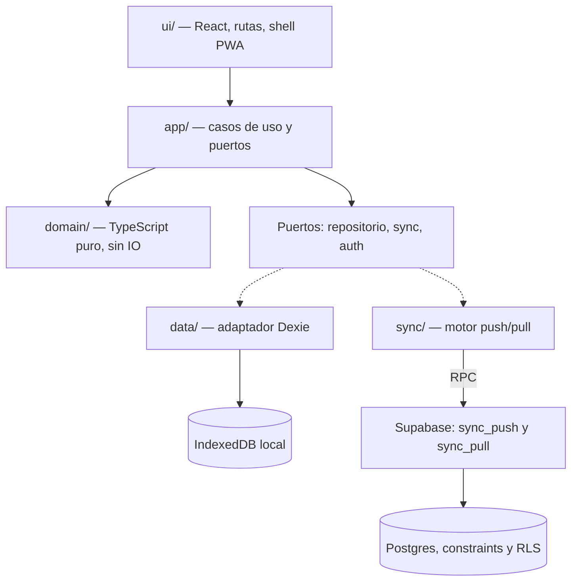
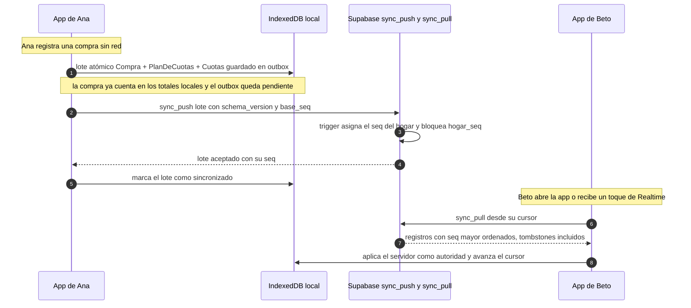

# Arquitectura de hogar-app

Este documento fija las decisiones técnicas de la fase 1: principios, stack, capas, sincronización entre miembros, autenticación, riesgos y las preguntas que Santiago debe cerrar. El modelo de datos (entidades, campos e invariantes I1–I17) vive en [data-model.md](data-model.md) y los números trabajados en [examples.md](examples.md). El negocio manda desde [domain.md](domain.md).

**En una línea:** una PWA offline-first que guarda hechos en el teléfono, replica a Postgres con un protocolo propio pequeño y auditable, y calcula todo lo derivado en el dispositivo.

## 1. Contexto

### Qué es

Una aplicación mobile-first (PWA) para manejar las finanzas de un hogar compartido en pesos colombianos. Registra lo que se gasta, lo que se debe y lo que aporta cada miembro, sin inventar deudas entre ellos.

### Usuarios

Un hogar de dos o más miembros (típicamente una pareja). Cada miembro usa su propio teléfono, muchas veces sin señal, y cualquiera puede registrar un movimiento del otro. El uso típico es en el momento: la compra del mercado, la cuota que vence, la transferencia al fondo común.

### Los cuatro núcleos

| Núcleo | Qué resuelve | Entidades que lo sostienen |
| --- | --- | --- |
| Compra rápida | Registrar un gasto en la menor cantidad de toques | `Compra`, `Categoria`, `MedioDePago`, `PlanDeCuotas`, `Cuota` |
| Obligaciones del mes | Lo que hay que pagar este mes: cuotas, créditos, servicios, suscripciones | `Obligacion`, `Cuota`, `CostoFinanciero`, `PagoDeDeuda` |
| Balance de pareja | Cuánto aportó cada miembro, con aporte libre y sin deuda automática | `Aporte`, `Ingreso`, `Compra`, `PagoDeDeuda` |
| Despensa de mascotas | Comida, insumos y gastos recurrentes de las mascotas | `Mascota`, `ItemDespensa`, `Compra` |

### Estado

Fase 1: solo diseño (flujos, mockups y estos documentos). No hay código de producto. Los cálculos de esta fase se verifican con `python3` sobre los ejemplos, no con tests de aplicación.

### Documentos

| Documento | Rol |
| --- | --- |
| [domain.md](domain.md) | Fuente de verdad del negocio |
| [data-model.md](data-model.md) | Entidades, campos, tipos, relaciones e invariantes I1–I17 |
| [examples.md](examples.md) | Ejemplos trabajados con números en COP y sus totales del mes |
| [AGENTS.md](../AGENTS.md) | Reglas de trabajo para agentes y semáforo de PR |

## 2. Principios

Siete principios de los que se derivan todas las decisiones siguientes.

| # | Principio | Qué obliga en el diseño |
| --- | --- | --- |
| P1 | **Offline-first** | La app funciona completa sin red: registrar, ver totales, editar. El servidor solo replica; no hay pantalla que dependa de una petición |
| P2 | **Montos enteros en COP** | `bigint` en Postgres, `number` entero seguro en TS con el tipo de marca `Pesos`. Nunca centavos ni coma flotante en el dinero |
| P3 | **Sin doble conteo** | Consumo, pago de deuda y costo financiero nunca se suman entre sí: son tres conceptos distintos |
| P4 | **Nada derivable se guarda** | Saldos, totales del mes, estado de cuotas, aportes y próxima compra de despensa se calculan en el dispositivo. Solo se guardan hechos |
| P5 | **El consumo es del hogar; el aporte es del miembro** | `Compra` no se atribuye a un miembro (solo lleva `registrado_por`). El aporte sale de un medio de pago con dueño |
| P6 | **Aporte libre** | Ninguna entidad referencia a un miembro como acreedor y ningún cálculo produce "X le debe a Y" |
| P7 | **Fechas civiles** | Todo en `America/Bogota`; el mes contable sale de la fecha civil `YYYY-MM-DD`, nunca de un `timestamptz` |

Única excepción al entero (P2): al multiplicar por una tasa se redondea al peso más cercano, mitades hacia arriba, **una vez por cuota**. Las tasas se calculan en coma flotante y solo se redondea el interés final.

Ejemplo del principio P3: un mercado de $300.000 a 3 cuotas suma $300.000 al gasto una sola vez, en la fecha de la compra; las cuotas son pagos de deuda y los intereses son costo financiero.

## 3. Stack propuesto

### Elección

| Componente | Elección | Razón |
| --- | --- | --- |
| Frontend | TypeScript estricto + React + Vite | Ecosistema amplio, arranque rápido, tipos que protegen las invariantes de dinero |
| Shell offline | PWA con `vite-plugin-pwa` (Workbox) | El requisito es PWA: instalable, cachea el shell y permite trabajar sin red |
| Rutas | React Router | Estándar, sin servidor que renderice |
| Estilos | Tailwind CSS (salvo que los mockups de `design/flujos-nucleos` pidan otra cosa) | Mobile-first por defecto y poca superficie de CSS propio |
| Validación de bordes | Zod | Un solo esquema de validación en formularios y en la frontera del lote |
| Almacenamiento local | IndexedDB vía Dexie | Tablas espejo del servidor + `outbox` + cursor de sync; transacciones locales para el lote atómico |
| Backend | Supabase (Postgres + Auth + RLS + RPC en SQL/PL/pgSQL), región `us-east-1` | Base relacional con constraints reales, auth resuelta y sin servidor propio |
| Hosting | Cloudflare Pages | Estático, gratis, CDN global |
| Tests (fase 2) | Vitest + fast-check, Playwright, pruebas SQL de RLS y constraints (`pgTAP` o `supabase test db`) | Propiedades de dinero, e2e móvil y verificación de las reglas en la base |

### Alternativas descartadas

| Alternativa | Por qué se descartó |
| --- | --- |
| Firebase / Firestore | Offline nativo, pero NoSQL sin FKs, CHECK ni únicos para invariantes de dinero; las sumas por mes cuestan lecturas; lock-in |
| PocketBase en un VPS | Simple y barato, pero exige operar servidor, backups y TLS; el sync offline habría que escribirlo igual |
| Cloudflare Workers + D1 | Más barato y sin pausa, pero auth hecha a mano (riesgo de seguridad) y más código propio |
| Motores local-first (PowerSync, ElectricSQL, Zero/Replicache, Triplit, InstantDB, Jazz) | Resuelven el sync pero suman un servicio o una dependencia pesada. Para ~200 registros/mes de un hogar, un protocolo propio de ~300 líneas es más simple y auditable. PowerSync queda como plan B si el sync propio se complica |
| Next.js / SSR | No hay nada que renderizar en servidor; agrega costo y complejidad |
| Svelte / SvelteKit | Bundle menor, pero menor fluidez de los agentes y del ecosistema; la diferencia de peso no justifica el cambio |
| React Native / Flutter | Tiendas de apps y builds nativos; el requisito es PWA |

### Costo esperado

USD 0/mes en los planes gratuitos (Supabase free + Cloudflare Pages). Supabase Pro (USD 25/mes) solo si la pausa por inactividad o los backups lo exigen; ver riesgo R2 y la decisión Q4.

## 4. Capas

Arquitectura hexagonal con la dependencia hacia adentro: `ui` conoce `app`, `app` conoce `domain`, y `domain` no conoce a nadie. `data` y `sync` implementan puertos definidos por `app`.

| Capa | Responsabilidad | Prohibido |
| --- | --- | --- |
| `domain/` | Tipos (`Pesos`, `FechaCivil`, `Mes`), entidades, invariantes, cálculos (tasas, plan de cuotas, FIFO, saldos, totales del mes, aportes, próxima compra de despensa) | IO, React, Dexie, red, `Date.now()` para decidir el mes |
| `app/` | Casos de uso: `registrarCompra`, `registrarPagoDeDeuda`, `registrarAporte`, etc. Define los puertos | Conocer Dexie o Supabase concretos |
| `data/` | Adaptador Dexie: repositorio local, `outbox`, cursor | Reglas de negocio |
| `sync/` | Motor push/pull contra las RPC | Calcular derivados |
| `ui/` | React, rutas, shell PWA | Hablar con `data/` o `sync/` directamente |
| Servidor | Migraciones SQL: esquema, constraints, RLS, RPC `sync_push`/`sync_pull`, invitaciones | Lógica de cálculos |

### Lote atómico

Cada caso de uso arma un **lote atómico**: todos los registros de una intención, calculados en `domain/`, y lo escribe en una sola transacción Dexie junto con su entrada en el `outbox`. Una compra financiada a 3 cuotas genera en un solo lote la `Compra`, el `PlanDeCuotas`, las `Cuota` y los `CostoFinanciero` calculados. Un lote entra completo o no entra, tanto en el teléfono como en el servidor; reintentar no duplica.

## 5. Sincronización entre miembros

### 5.1 Identidad de los registros

Los ids son **UUIDv7 generados en el cliente**. Crear nunca choca: no hay secuencias de id ni coordinación previa.

Toda tabla replicada lleva las mismas columnas de sync:

| Columna | Tipo | Para qué |
| --- | --- | --- |
| `id` | `uuid` | Identidad generada en el cliente |
| `hogar_id` | `uuid` | Tenencia (salvo en `Hogar`) |
| `creado_en` | `timestamptz` | Informativo, reloj del cliente |
| `actualizado_en` | `timestamptz` | Informativo, reloj del cliente |
| `eliminado_en` | `timestamptz null` | Tombstone; nunca hay borrado físico |
| `actualizado_por` | `uuid → Miembro` | Quién hizo el último cambio |
| `seq` | `bigint` | Orden de réplica, asignado por el servidor |

### 5.2 `seq` por hogar y el orden de commit

`seq` es un contador monotónico **por hogar**, guardado en la tabla solo-servidor `hogar_seq(hogar_id, ultimo_seq)`. Un trigger `BEFORE INSERT/UPDATE` hace `UPDATE hogar_seq SET ultimo_seq = ultimo_seq + 1 ... RETURNING`, lo que **bloquea la fila del hogar hasta el commit**.

Por qué no una secuencia global: una secuencia asigna el número al insertar, pero los commits no ocurren en ese orden. Un pull que ya leyó hasta `seq = 100` puede recibir después una fila con `seq = 97` confirmada tarde; el cursor ya pasó de 97 y esa fila no llega nunca. Con el contador por hogar, el segundo escritor del mismo hogar espera el lock hasta el commit del primero: **el orden de `seq` coincide con el orden de commit** y un cursor es seguro. Hogares distintos no se bloquean entre sí.

### 5.3 Push

La RPC `sync_push(lote)` aplica un lote (una intención) en una sola transacción: todo o nada. Cada lote lleva un `lote_id` (UUIDv7 del cliente); el servidor guarda los `lote_id` aplicados con su resultado en la tabla solo-servidor `lote_aplicado`. Si llega un `lote_id` ya aplicado (el cliente perdió la respuesta y reintenta), devuelve el resultado guardado sin volver a evaluar `base_seq`: un reintento nunca se confunde con un conflicto.

| Caso | `base_seq` | Resultado |
| --- | --- | --- |
| Registro nuevo | `null` | Insert idempotente: si el id ya existe con el mismo contenido, no-op; reintentar no duplica |
| Actualización o tombstone | El `seq` que el cliente vio | Update, si coincide con el `seq` actual del servidor |
| Actualización vieja | Distinto del actual | Lote rechazado con `conflicto`; devuelve la versión del servidor |
| Unicidad rota | Cualquiera | Lote rechazado con `duplicado` |

### 5.4 Pull

`sync_pull(desde_seq, limite)` devuelve los registros del hogar con `seq > desde_seq`, ordenados por `seq`, tombstones incluidos. El cliente los aplica y avanza el cursor: **el servidor es la autoridad**.

### 5.5 Conflictos y duplicados

Nunca hay *last write wins*. Un dato de dinero no se sobrescribe en silencio:

- **Conflicto de versión:** el lote se rechaza y el cliente conserva su cambio como borrador en conflicto; el usuario decide. El servidor devuelve la versión vigente para que la pantalla muestre ambas.
- **Duplicado:** por ejemplo, dos miembros pagaron offline la misma obligación del mismo periodo. El único `(obligacion_id, periodo)` entre compras no eliminadas rechaza el lote; el cliente muestra el conflicto y el usuario borra el suyo o le quita la obligación.
- **Posible compra repetida:** dos miembros pueden registrar offline la misma compra sin obligación (por ejemplo, el mismo mercado). No hay único que lo impida, a propósito: dos compras iguales el mismo día pueden ser reales (dos cafés). Regla de fase 1: después de un pull, el cliente marca como "posible duplicado" las compras de otro miembro con la misma `fecha`, `monto_total` y `categoria_id` que una propia, y pide al usuario confirmar o borrar una. Es un aviso de UI, no una restricción: nunca se borra nada automáticamente.

### 5.6 Disparadores de sincronización

| Momento | Acción |
| --- | --- |
| Al abrir la app | Vaciar `outbox` y hacer pull |
| Al volver la pestaña a foco | Igual |
| Al recuperar red | Igual |
| Después de un push | Pull inmediato |
| Aviso de Supabase Realtime | Pull (Realtime solo avisa; no transporta datos) |

En iOS no existe Background Sync: el `outbox` solo se vacía con la app abierta. Por eso el push ocurre temprano y el estado del `outbox` es visible en la UI.

### 5.7 Validación en el servidor y permisos

- `sync_push` es `SECURITY DEFINER` y verifica membresía en cada registro: `auth.uid()` debe ser un `Miembro` activo del `hogar_id`.
- Los clientes **no** escriben tablas directamente; solo tienen `SELECT` por RLS de membresía.
- Postgres valida con FKs, CHECK, únicos parciales (`WHERE eliminado_en IS NULL`) y triggers diferidos para las reglas entre filas: capital del plan = monto de la compra; si el plan es `sin_calendario`, cero cuotas; en los demás sistemas, cuotas contiguas `1..n_cuotas` cuya suma de capital es el capital del plan.
- El servidor no calcula nada: la lógica de cálculos vive solo en `domain/`.

### 5.8 Versionado del esquema

El lote lleva `schema_version`. Una versión vieja se rechaza con `actualizar_app` y el service worker fuerza la actualización. Dexie migra el esquema local por versiones. Un cliente viejo puede seguir leyendo y registrando offline, pero su `outbox` espera hasta que la app se actualice.

### 5.9 Flujo completo

## 6. Autenticación del hogar

### Ingreso sin contraseña

Supabase Auth con código OTP o enlace mágico por correo; Google opcional. No hay contraseñas que administrar ni recuperar.

### Creación e invitación

| Paso | Qué pasa |
| --- | --- |
| Crear hogar | El primer usuario crea `Hogar` y su `Miembro` con `rol=admin` en una RPC atómica que también crea `hogar_seq` y las categorías por defecto |
| Invitar | Un admin genera una invitación: token aleatorio de un solo uso, guardado como hash, vence en 7 días, en la tabla solo-servidor `invitacion` |
| Canjear | El invitado inicia sesión y la canjea; se crea su `Miembro` o se vincula a un `Miembro` existente sin cuenta (`usuario_id` null) |

### Roles

| Acción | `admin` | `miembro` |
| --- | --- | --- |
| Leer y escribir todos los registros financieros del hogar | Sí | Sí |
| Registrar un movimiento por el otro | Sí | Sí |
| Invitar miembros | Sí | No |
| Desactivar miembros | Sí | No |
| Renombrar el hogar | Sí | No |

Desactivar un miembro no borra sus registros: el histórico queda intacto y sus movimientos siguen contando.

### Offline y alcance de la fase 1

La sesión se persiste; sin red se trabaja con la sesión en caché. Si el refresh token venció, el `outbox` se conserva y se pide login al reconectar. Los datos locales no tienen cifrado propio en fase 1 (ver riesgo R7). En fase 1 un usuario pertenece a un solo hogar; la tabla `Miembro` ya permite varios en el futuro.

## 7. Totales y definiciones clave

Resumen para leer el resto del documento; las definiciones exactas, las reglas de cálculo (tasas, reparto de capital, FIFO, fechas de tarjeta) y los invariantes I1–I17 están en [data-model.md](data-model.md), secciones 8 a 10.

| Concepto | Definición en una línea | Invariantes |
| --- | --- | --- |
| Gasto del mes | Σ `Compra.monto_total` con fecha en el mes + Σ `CostoFinanciero.monto` con fecha de causación en el mes | I2, I4 |
| Aportes del mes de un miembro | Σ salidas de caja desde medios de ese miembro (compras de contado, pagos de deuda, costos pagados directo) + Σ `Aporte` con origen en sus medios | I6, I17 |
| Balance de pareja | Los aportes por miembro en pesos y en porcentaje del total; nunca una fila de diferencia | I7 |
| Ingreso del mes de un miembro | Fijos vigentes en el mes + variables con fecha en el mes | — |
| Obligaciones del mes | Cuotas con vencimiento en el mes (capital más sus costos con `cuota_id`) + costos cargados sin `cuota_id` causados en el mes + obligaciones recurrentes; es una agenda, no se suma al gasto | I3, I10 |
| Saldo de un pasivo | Capital de sus planes + costos cargados − pagos, a una fecha; puede ser negativo | I10 |

Las cuotas se cuentan como pagos de deuda y los intereses como costo financiero; el consumo se cuenta una sola vez, en la fecha de la compra. Los porcentajes se redondean solo al mostrarse y nunca se guardan.

## 8. Riesgos

| # | Riesgo | Impacto | Mitigación |
| --- | --- | --- | --- |
| R1 | Safari/iOS desaloja el almacenamiento de una PWA que no está instalada | Se pierden registros locales que aún no se sincronizaron | Instalar en la pantalla de inicio, pedir `navigator.storage.persist()`, sincronizar temprano (al abrir y al volver a foco) y mostrar el `outbox` pendiente de forma visible |
| R2 | Supabase gratuito pausa el proyecto tras 7 días sin actividad y no ofrece backups descargables | El primer acceso tras la pausa es lento o frágil; no hay respaldo externo si el proyecto se pierde | Réplicas offline completas en cada dispositivo, export periódico del hogar (JSON) como respaldo y decisión Q4: aceptar, pagar Pro (USD 25/mes) o exportar |
| R3 | Conflictos de edición simultánea | Lotes rechazados y trabajo duplicado | Política explícita sin *last write wins*: borrador en conflicto visible y decisión del usuario; con dos miembros la frecuencia esperada es baja |
| R4 | Deriva entre las constraints PL/pgSQL y el dominio en TypeScript | El servidor acepta lo que el dominio rechaza, o al revés | Fixtures JSON compartidos que se corren contra ambos lados en fase 2 |
| R5 | El interés estimado no coincide con el extracto del banco | Totales que no cuadran con la realidad | El interés calculado nace como `origen='calculado'` y es editable; al corregirlo pasa a `origen='manual'`. El extracto manda y el saldo es "según la app" |
| R6 | Reloj del cliente desfasado | Orden incorrecto de eventos y totales raros | El orden lo fija `seq` del servidor; `creado_en` y `actualizado_en` son informativos y no ordenan ni calculan |
| R7 | Datos locales sin cifrar | Quien acceda al teléfono desbloqueado ve las finanzas del hogar | Riesgo aceptado en fase 1; depende del bloqueo del dispositivo. Cifrar el almacenamiento local queda como decisión nueva para una fase posterior |
| R8 | Cliente viejo después de un cambio de esquema | Escrituras con campos que el servidor ya no acepta | `schema_version` en el lote, rechazo con `actualizar_app`, service worker que fuerza la actualización y `outbox` conservado hasta actualizar |

## 9. Decisiones abiertas para Santiago

Cada pregunta trae el default de la fase 1 y la consecuencia de cada opción. Los defaults que ya se tomaron están reflejados en el modelo; Q2 no cambia el esquema.

### Q1 — ¿Solo gastos del hogar o también personales?

Afecta los aportes cuando una tarjeta mezcla gastos de ambos.

**Default fase 1:** solo gastos del hogar; el pago registrado es la parte del hogar.

| Opción | Consecuencia |
| --- | --- |
| Solo hogar (default) | Modelo y aportes simples; el saldo de la app puede diferir del extracto de la tarjeta, porque los gastos personales no se registran |
| Incluir personales | Hay que definir si un gasto personal es consumo del hogar (no) y cómo se reparte un pago de tarjeta mixto (prorrateo); agrega un campo de ámbito en `Compra` y reglas de asignación, con riesgo de doble conteo |

### Q2 — ¿Los miembros ven los ingresos del otro?

**Default fase 1:** todos los miembros ven todos los ingresos del hogar (RLS por membresía, igual que el resto de tablas) y el "% de su ingreso" del balance viene apagado hasta que el hogar lo active. El modelo ya guarda los ingresos por miembro (`Ingreso.miembro_id`), así que cambiar a "solo el propio" es un cambio de UI y de RLS, no de esquema.

| Opción | Consecuencia |
| --- | --- |
| Todos ven todo | El "% de su ingreso" del balance es comparable entre miembros y la conversación sobre aportes es transparente |
| Solo el propio | El balance muestra pesos y % del total de aportes, pero no el % del ingreso del otro ni el ingreso en pesos; requiere políticas RLS que filtren `Ingreso` por miembro y una UI que oculte lo que no corresponde |

### Q3 — ¿Mes calendario o ciclo desde el día de pago?

**Default fase 1:** mes calendario.

| Opción | Consecuencia |
| --- | --- |
| Mes calendario (default) | Coincide con la fecha civil y con las definiciones de totales de la sección 7; un solo "mes" para todo el hogar |
| Ciclo desde el día de pago | Cada tarjeta tendría su propio periodo; los aportes de los miembros dejarían de ser comparables en una misma ventana y habría que redefinir gasto, aportes e ingresos del mes |

### Q4 — Supabase gratuito: ¿aceptar la pausa, pagar Pro o exportar?

**Default fase 1:** aceptar el plan gratuito con réplicas offline y export manual como respaldo.

| Opción | Consecuencia |
| --- | --- |
| Aceptar la pausa (default) | USD 0/mes; tras 7 días sin actividad el proyecto se pausa y el primer acceso puede demorar o requerir reactivación desde el panel. Los teléfonos siguen trabajando offline |
| Pagar Pro (USD 25/mes) | Sin pausa y con backups gestionados de retención corta; agrega un costo fijo mensual a un proyecto de dos usuarios |
| Exportar | Un respaldo JSON del hogar bajo demanda; USD 0/mes, pero depende de que alguien lo ejecute y no protege contra la pérdida del proyecto entre exports |

### Q5 — Préstamos desembolsados en efectivo

Si un préstamo se registra como `saldo_inicial` y además se compran cosas de contado con esa plata, el aporte se cuenta dos veces.

**Default fase 1:** registrar esas compras como financiadas por el pasivo.

| Opción | Consecuencia |
| --- | --- |
| Compras financiadas por el pasivo (default) | La identidad de conservación cierra y el saldo del pasivo refleja lo que falta pagar; exige que el usuario entienda que la plata del préstamo no es un medio de pago propio |
| Tratar el desembolso como ingreso del miembro | Aparece plata que no viene de un ingreso real y se rompe la regla de que el ingreso solo es denominador del porcentaje |
| No modelar el préstamo hasta gastarlo | Se pierde el saldo del pasivo y las obligaciones del mes quedan incompletas |

### Q6 — Retiros y reembolsos desde el fondo común

**Default fase 1:** no se modelan.

| Opción | Consecuencia |
| --- | --- |
| No modelarlos (default) | Menos entidades; si alguien retira plata del fondo para sí, el saldo de la app se separa del banco y no hay registro que lo explique |
| Modelarlos | Requiere una entidad nueva y decidir si el retiro reduce el aporte del miembro o es solo una salida del fondo; toca los totales de aportes y el balance |

### Q7 — Interés en compras a 1 cuota

**Default fase 1:** sin tasa.

| Opción | Consecuencia |
| --- | --- |
| Sin tasa por defecto (default) | No se crean costos calculados; el usuario registra el interés como costo manual cuando lo conoce, y el gasto aparece en su fecha de causación |
| Tasa del pasivo por defecto | El interés de una cuota única es aproximadamente el de un mes y puede sorprender; además el banco casi siempre cobra distinto, así que el usuario terminaría editando el monto de todos modos |
