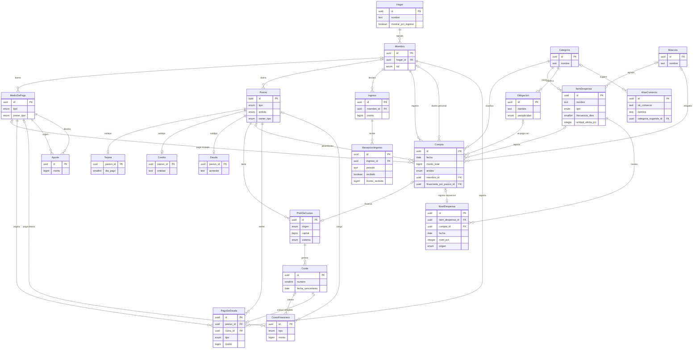

# Modelo de datos

Entidades, campos, relaciones e invariantes del hogar. Es la referencia para las migraciones SQL del servidor y para los tipos del dominio. El contexto está en `docs/architecture.md` y el negocio en [domain.md](domain.md); aquí solo se traduce ese negocio a estructura y no se duplican sus reglas. Los nombres de entidades (`PascalCase`) y de campos (`snake_case` sin tildes) son exactos: cambiarlos obliga a cambiar migraciones, tipos y sincronización a la vez.

## 1. Propósito y convenciones

El modelo guarda **hechos**, no resultados. Un consumo, un pago o un costo ocurrieron en una fecha y se registran una vez; saldos, estados de cuota y totales del mes se derivan en el dispositivo (§8). Eso permite que dos miembros trabajen sin conexión y reconcilien sin discutir cifras guardadas.

### 1.1 Tipos lógicos

| Tipo | Uso |
| --- | --- |
| `uuid` | Identificadores UUIDv7 generados en el cliente: crear nunca choca |
| `text` | Texto libre o patrón validado con CHECK (`moneda`, `periodo`, `mes_inicio`) |
| `date` | Fecha civil `YYYY-MM-DD`, sin hora ni zona. Base del mes contable |
| `timestamptz` | Solo columnas de sincronización. Nunca define el mes de un movimiento |
| `bigint` | Pesos enteros. En TypeScript, entero seguro con el tipo de marca `Pesos` |
| `smallint` | Días `1..31`, número de cuota, frecuencias cortas |
| `integer` | Órdenes de presentación y tasas en partes por millón |
| `boolean` | Banderas de vigencia (`activo`, `activa`) |
| `enum(...)` | Conjuntos cerrados; `enum` de Postgres o `text` con CHECK |

- Todo monto es un entero en COP, sin centavos. Formato `$300.000`. Se redondea solo al multiplicar por una tasa: `redondear(x)` = peso más cercano, mitades hacia arriba, una vez por cuota.
- Porcentajes con coma decimal (`56,7 %`), redondeados solo al mostrarse. Fechas civiles en `America/Bogota`; el mes contable sale de la fecha civil, nunca de un `timestamptz`.

### 1.2 Columnas de sincronización

Presentes en **toda tabla replicada**; no se repiten en las tablas de §3.

| Columna | Tipo | Nulo | Regla / notas |
| --- | --- | --- | --- |
| `id` | `uuid` | no | PK. UUIDv7 del cliente |
| `hogar_id` | `uuid` | no | FK → `Hogar(id)`. Ausente solo en `Hogar` |
| `creado_en` | `timestamptz` | no | Reloj del cliente. Informativo |
| `actualizado_en` | `timestamptz` | no | Reloj del cliente. Informativo, no ordena nada |
| `eliminado_en` | `timestamptz` | sí | Tombstone. `null` = vigente |
| `actualizado_por` | `uuid` | no | FK → `Miembro(id)` del mismo hogar |
| `seq` | `bigint` | no | Asignado por el servidor, monotónico **por hogar** |

Excepción: los subtipos `Tarjeta`, `Credito` y `Deuda` no tienen `id` propio; su PK es `pasivo_id` (FK → `Pasivo(id)`) y llevan el resto de columnas de sincronización. Se crean en el mismo lote que su `Pasivo`.

`seq` sale de la tabla solo-servidor del carril de la fila —`hogar_seq(hogar_id, ultimo_seq)` o `personal_seq(hogar_id, miembro_id, ultimo_seq)` (§1.3)—: un trigger `BEFORE INSERT/UPDATE` incrementa y bloquea el contador de ese carril hasta el commit, así el orden de `seq` coincide con el de commit y un pull no se salta filas confirmadas. `seq` solo es comparable dentro de su carril. El cliente envía por registro un `base_seq` (el `seq` que vio, `null` si es nuevo) y por lote un `lote_id` (UUIDv7 del cliente) y un `schema_version`; ninguno es columna de las tablas replicadas. El servidor guarda cada `lote_id` aplicado con su resultado en la tabla solo-servidor `lote_aplicado`; reenviar un lote ya aplicado (por ejemplo, tras perder la respuesta) devuelve el resultado guardado sin volver a evaluar `base_seq`, así un reintento de una actualización no se confunde con un conflicto.

### 1.3 Tombstones y tablas solo-servidor

Nada se borra físicamente: eliminar es escribir `eliminado_en`. El pull transporta esas filas y el cliente las aplica; un registro eliminado no cuenta en totales, saldos ni unicidad funcional. Cuatro tablas no se replican: `hogar_seq` (`hogar_id`, `ultimo_seq`, carril compartido del orden del servidor), `personal_seq` (`hogar_id`, `miembro_id`, `ultimo_seq`, carril privado de cada dueño), `lote_aplicado` (`hogar_id`, `lote_id`, resultado; idempotencia de reintentos) e `invitacion` (token de un solo uso guardado como hash, vencimiento a 7 días; es un secreto, el cliente nunca lo lee).

**Preferencias locales del dispositivo (no replicadas).** No son entidades ni columnas del servidor y nunca son autoridad: `incluir_personales` (vista del balance y reportes, apagada por defecto) y `ultimo_medio_de_pago_id` por miembro, para precargar la compra rápida. Se guardan en IndexedDB/localStorage del teléfono; no viajan en el lote y no alteran ningún cálculo de aportes.

## 2. Glosario corto

| Término | Significado |
| --- | --- |
| **Pasivo** | Supertipo de todo lo que se debe: `Tarjeta`, `Credito`, `Deuda`. `PagoDeDeuda` abona a cualquiera. Cada `Pasivo` es un libro de un solo ámbito (`ambito`), aunque el plástico sea uno |
| **Deuda** | Pasivo informal o no bancario (almacén, familiar). Su `acreedor` es siempre texto externo |
| **Desembolso** | Capital de un préstamo en efectivo, registrado una vez como plan `origen='desembolso'`; no es compra, gasto ni aporte |
| **Saldo a favor** | Exceso explícito de un pago (`PagoDeDeuda.tipo='saldo_a_favor'`), separado del capital y del costo financiero |
| **Nivel de despensa** | Hecho observado (`NivelDespensa`) del nivel de un artículo; el nivel actual, los días y la alerta se derivan |
| **Consumo** | El gasto real. Lo registra `Compra`, una vez, por `monto_total` |
| **aporte** (minúscula) | Concepto: toda salida de dinero desde un medio de un miembro con destino al hogar |
| **Aporte** (entidad) | Una de las cuatro fuentes del concepto: la transferencia de un miembro a un medio del hogar |

## 3. Entidades

Cada entidad lleva las columnas de §1.2. Los campos listados son canónicos: no se agregan, renombran ni eliminan.

### 3.1 Hogar

Raíz de tenencia y frontera de aislamiento entre hogares. **No es** presupuesto ni contabilidad: solo el contenedor.

| Campo | Tipo | Nulo | Regla / notas |
| --- | --- | --- | --- |
| `id` | `uuid` | no | PK. Única entidad sin `hogar_id` |
| `nombre` | `text` | no | Nombre visible |
| `moneda` | `text` | no | CHECK `moneda = 'COP'` |
| `zona_horaria` | `text` | no | CHECK `zona_horaria = 'America/Bogota'` |
| `mostrar_pct_ingreso` | `boolean` | no | Default `false`. Prende la vista "% de su ingreso" del balance; no cambia aportes ni ingresos |

### 3.2 Miembro

Persona del hogar, con o sin cuenta de autenticación. **No es** un usuario de Auth: puede existir con `usuario_id` nulo y vincularse después.

| Campo | Tipo | Nulo | Regla / notas |
| --- | --- | --- | --- |
| `id` | `uuid` | no | PK |
| `hogar_id` | `uuid` | no | FK → `Hogar(id)` |
| `nombre` | `text` | no | Nombre visible |
| `usuario_id` | `uuid` | sí | Id de Auth. `null` = miembro sin cuenta |
| `rol` | `enum('admin','miembro')` | no | Solo `admin` invita, desactiva y renombra el hogar |
| `activo` | `boolean` | no | Desactivar no borra sus registros |

Único parcial `(hogar_id, usuario_id)` donde `usuario_id IS NOT NULL AND eliminado_en IS NULL`.

### 3.3 Ingreso

Ingreso declarado de un miembro, fijo o variable, en una tabla con discriminador. **No es** gasto ni aporte: solo alimenta el denominador de "% de su ingreso".

| Campo | Tipo | Nulo | Regla / notas |
| --- | --- | --- | --- |
| `miembro_id` | `uuid` | no | FK → `Miembro(id)` |
| `tipo` | `enum('fijo','variable')` | no | Discriminador |
| `serie_id` | `uuid` | sí | Identifica la **serie** de un ingreso fijo: un UUID estable elegido en el alta (por ejemplo, el `id` de la primera versión) que todas las versiones comparten. Obligatorio si `tipo='fijo'`; `null` si `variable` |
| `descripcion` | `text` | no | "Salario", "Freelance", "Arriendo recibido" |
| `monto` | `bigint` | no | CHECK `monto > 0` |
| `dia_esperado` | `smallint` | sí | `1..31`. Obligatorio si `tipo='fijo'` |
| `vigente_desde` | `date` | sí | Obligatorio si `tipo='fijo'` |
| `vigente_hasta` | `date` | sí | `fijo`; si existe, `≥ vigente_desde` |
| `fecha` | `date` | sí | Obligatorio si `tipo='variable'`; `null` si `fijo` |

CHECK compuesto: `fijo` exige `dia_esperado`, `vigente_desde` y `serie_id` no nulos y `fecha` nula; `variable` exige `fecha` no nula y los campos de fijo nulos. `Ingreso` declara `UNIQUE (id, serie_id)` para la FK compuesta de §3.3.1.

**Una serie de versiones, no filas sueltas.** Cambiar monto o día de un ingreso fijo es cerrar la versión en curso (`vigente_hasta`) y crear otra con el mismo `serie_id` y `vigente_desde` igual al día siguiente. Las vigencias de una serie son **inclusivas y contiguas**: `vigente_hasta + 1 día = siguiente.vigente_desde`, sin solapes ni huecos, y a lo sumo una versión abierta (`vigente_hasta` nula). Un trigger diferido lo valida en el mismo lote. La serie empieza en el `vigente_desde` de su primera versión y termina donde se cierra la última; solo se cierra la última. El importe del mes se resuelve **por serie y mes calendario** (§8): un cambio de una serie ya existente que empieza a mitad de mes rige desde el mes siguiente; si la serie **arranca** a mitad de mes, aplica en el mes del arranque (regla del último día de §8). Si una serie **arranca y se cierra dentro del mismo mes** —cierre terminal, sin versión siguiente—, ese cierre se toma como vigente hasta el último día civil de ese mes para la selección: el mes del arranque aporta una sola vez. La regla no toca los cambios internos al mes (siempre que exista versión siguiente) ni los cierres en un mes posterior al del arranque.

#### 3.3.1 RecepcionIngreso

Recibo mensual de un ingreso fijo. **No** es un ingreso nuevo ni cambia `Ingreso.monto`: registra si el periodo llegó y por cuánto. Si no existe fila para el periodo, el balance usa el monto esperado ("esperado").

| Campo | Tipo | Nulo | Regla / notas |
| --- | --- | --- | --- |
| `ingreso_id` | `uuid` | no | FK compuesta `(ingreso_id, serie_id)` → `Ingreso(id, serie_id)`. Puede apuntar a cualquier versión de la serie; la versión referenciada debe ser `tipo='fijo'` (CHECK/trigger) |
| `serie_id` | `uuid` | no | Serie de la versión referenciada. La **asigna el servidor** desde `Ingreso.serie_id` y es **inmutable**; el cliente no puede reclamar otra: la FK compuesta la valida contra la fila real |
| `periodo` | `text` | no | `'YYYY-MM'`. Único parcial `(serie_id, periodo) WHERE eliminado_en IS NULL`. Solo meses en que la serie tiene versión aplicable (§8) |
| `recibido` | `boolean` | no | Default `false` |
| `monto_recibido` | `bigint` | sí | CHECK `monto_recibido > 0`. `null` con `recibido=true` = llegó el monto esperado |
| `fecha_recepcion` | `date` | sí | Obligatoria si `recibido=true` |
| `registrado_por` | `uuid` | no | FK → `Miembro(id)`. Quien registró el recibo |

CHECK: `recibido=false` ⇔ `monto_recibido` y `fecha_recepcion` ambos nulos; `recibido=true` exige `fecha_recepcion` no nula. Solo se admite en ingresos `tipo='fijo'` (trigger o función de dominio) y solo para un mes **activo** de la serie: `version(serie, periodo) != null` (§8), validado en el servidor; un `periodo` anterior al arranque o posterior al cierre se rechaza. El único es por **serie**: para `2026-11` existe un solo recibo aunque la serie tenga dos versiones ese mes, y un segundo recibo que apunte a la otra versión se rechaza. Un recibo **nunca** cambia la versión aplicable ni el mes: su precedencia es solo sobre el importe de ese mes activo.

### 3.4 Categoria

Clasificación de consumos; se siembran Mercado, Servicios, Arriendo, Transporte, Salud, Mascotas, Hogar y electrodomésticos, Entretenimiento y Otros. La categoría sembrada es **Arriendo**; "Consumo Vivienda" es solo una agrupación de la UI. **No** agrupa deudas ni obligaciones: solo clasifica `Compra` y etiqueta `ItemDespensa` y `Obligacion`.

| Campo | Tipo | Nulo | Regla / notas |
| --- | --- | --- | --- |
| `nombre` | `text` | no | Único `(hogar_id, lower(nombre))` entre no eliminadas |
| `icono` | `text` | sí | Identificador de ícono |
| `orden` | `integer` | no | Orden de presentación |
| `activa` | `boolean` | no | Se archiva, no se borra si está en uso |

### 3.5 MedioDePago

De dónde sale dinero de contado: efectivo, ahorros, corriente, débito, Nequi, Daviplata. **No es** un pasivo: una tarjeta de crédito es deuda; la UI los muestra juntos.

| Campo | Tipo | Nulo | Regla / notas |
| --- | --- | --- | --- |
| `nombre` | `text` | no | Nombre visible |
| `tipo` | `enum('efectivo','cuenta')` | no | `cuenta` cubre ahorros, corriente, débito y billeteras |
| `owner_tipo` | `enum('miembro','hogar')` | no | Ver §4 |
| `owner_miembro_id` | `uuid` | sí | FK → `Miembro(id)`. Coherencia con `owner_tipo` (I8) |
| `activo` | `boolean` | no | Se archiva para retirarlo de la UI |

### 3.6 Pasivo (supertipo)

Todo lo que se debe. Herencia por tabla de clase: `Pasivo` guarda lo común y cada subtipo guarda lo suyo con `pasivo_id` como PK y FK. **No** guarda saldo (es derivado, §8). Cada `Pasivo` es un **libro lógico de un solo ámbito**: no existe un pasivo mixto; una tarjeta con gastos del hogar y personales se modela como dos `Pasivo`. El capital entra por `PlanDeCuotas`: `origen='compra'` para consumo financiado, `origen='saldo_inicial'` para deuda previa y `origen='desembolso'` para el capital de un préstamo en efectivo; `saldo_inicial` y `desembolso` no son lo mismo (§3.8). CHECK de tasa: `(tasa_tipo IS NULL) = (tasa_ppm IS NULL)`; `tasa_ppm` es la tasa por defecto de planes nuevos y cada plan copia la vigente al crearse.

| Campo | Tipo | Nulo | Regla / notas |
| --- | --- | --- | --- |
| `tipo` | `enum('tarjeta','credito','deuda')` | no | Exige exactamente una fila de subtipo coherente |
| `nombre` | `text` | no | "Visa Ana", "Préstamo nevera" |
| `ambito` | `enum('hogar','personal')` | no | Default `'hogar'`. El libro es de un solo ámbito; `personal` exige `owner_tipo='miembro'`, `owner_miembro_id` no nulo e igual al `miembro_id` de sus compras. Inmutable con hechos vinculados (I18) |
| `owner_tipo` | `enum('miembro','hogar')` | no | Ver §4 |
| `owner_miembro_id` | `uuid` | sí | FK → `Miembro(id)`. Coherencia con `owner_tipo` (I8) |
| `tasa_tipo` | `enum('EA','MV')` | sí | Sin tasa no se calculan intereses |
| `tasa_ppm` | `integer` | sí | Partes por millón: 28 % E.A. = `280000` |
| `activo` | `boolean` | no | Archivar no borra historia |

#### 3.6.1 Tarjeta

Subtipo con ciclo de facturación. **No** es un medio de pago ni tiene saldo propio: su deuda vive en planes y cuotas. Una tarjeta física con compras de ambos ámbitos son dos `Pasivo` (dos libros) con los mismos `ultimos_4`: el plástico es uno, la deuda se lleva aparte.

| Campo | Tipo | Nulo | Regla / notas |
| --- | --- | --- | --- |
| `pasivo_id` | `uuid` | no | PK y FK → `Pasivo(id)` con `tipo='tarjeta'` |
| `franquicia` | `text` | sí | Visa, Mastercard, etc. |
| `ultimos_4` | `text` | sí | Últimos cuatro dígitos |
| `dia_corte` | `smallint` | no | `1..31` |
| `dia_pago` | `smallint` | no | `1..31`; determina el vencimiento de cuotas (§9) |
| `cupo` | `bigint` | sí | Informativo; no se valida contra saldo |

#### 3.6.2 Credito

Subtipo bancario. **No** distingue consumo de capital: la compra se registra aparte, como `Compra` financiada, plan `saldo_inicial` o plan `desembolso` de un préstamo en efectivo.

| Campo | Tipo | Nulo | Regla / notas |
| --- | --- | --- | --- |
| `pasivo_id` | `uuid` | no | PK y FK → `Pasivo(id)` con `tipo='credito'` |
| `entidad` | `text` | no | Banco o financiera |
| `referencia` | `text` | sí | Número de obligación |

#### 3.6.3 Deuda

Pasivo informal o no bancario. **No** es una relación entre miembros: aunque sea de Ana, Beto puede pagarla y solo sube el aporte de Beto, siempre que el libro sea del hogar. Un libro personal solo lo ve y lo registra su dueño y no aporta.

| Campo | Tipo | Nulo | Regla / notas |
| --- | --- | --- | --- |
| `pasivo_id` | `uuid` | no | PK y FK → `Pasivo(id)` con `tipo='deuda'` |
| `acreedor` | `text` | no | Nombre externo. Nunca un `Miembro` (I7) |

### 3.7 Compra (Consumo)

El gasto real: una vez, en la fecha de la compra, por su valor total, sea de contado o financiada. **No** se atribuye a un miembro por consumo: `registrado_por` es quien digitó y `miembro_id` solo identifica al dueño de una compra personal. Tampoco sabe cuánto se ha pagado.

| Campo | Tipo | Nulo | Regla / notas |
| --- | --- | --- | --- |
| `fecha` | `date` | no | Fecha civil del consumo |
| `descripcion` | `text` | no | Texto libre |
| `monto_total` | `bigint` | no | CHECK `monto_total > 0` |
| `categoria_id` | `uuid` | no | FK → `Categoria(id)` |
| `ambito` | `enum('hogar','personal')` | no | Default `'hogar'`. Una compra personal no suma al gasto del hogar ni a los aportes por defecto |
| `miembro_id` | `uuid` | sí | FK → `Miembro(id)`. Dueño y visibilidad de una compra personal; obligatorio si `ambito='personal'` y `null` si `ambito='hogar'` |
| `pago_tipo` | `enum('contado','financiado')` | no | Discriminador de la forma de pago: contado (medio o desembolso) o plan de cuotas |
| `medio_de_pago_id` | `uuid` | sí | FK → `MedioDePago(id)`. En `contado`, exactamente uno de `medio_de_pago_id` o `financiada_por_pasivo_id`; `null` si `financiado` |
| `financiada_por_pasivo_id` | `uuid` | sí | FK → `Pasivo(id)`. La compra se pagó con el desembolso de un préstamo en efectivo: no crea plan, no suma capital y no es aporte. Exige `pago_tipo='contado'`, `medio_de_pago_id` nulo y plan `origen='desembolso'` con `fecha_inicio ≤ Compra.fecha` (I19) |
| `registrado_por` | `uuid` | no | FK → `Miembro(id)`. Quien digitó, no quien consume |
| `mascota_id` | `uuid` | sí | FK → `Mascota(id)`. Etiqueta opcional para el desglose por mascota; no crea gasto propio ni cambia la categoría de la compra (I26) |
| `item_despensa_id` | `uuid` | sí | FK → `ItemDespensa(id)` |
| `obligacion_id` | `uuid` | sí | FK → `Obligacion(id)`. Solo para `ambito='hogar'`: una compra personal nunca liquida una instancia compartida |
| `periodo` | `text` | sí | `'YYYY-MM'`; presente si y solo si hay `obligacion_id`. Es el mes de la instancia de la obligación, no el del pago: el recibo de noviembre pagado el 2 de diciembre lleva `periodo='2026-11'` y cuenta en el gasto de diciembre (por `fecha`) |
| `cufe` | `text` | sí | CUFE/CUDE de la factura electrónica DIAN si se escaneó. Dos únicos parciales entre no eliminadas: `(hogar_id, cufe)` para compras del hogar y `(hogar_id, miembro_id, cufe)` para personales. Un duplicado solo se rechaza dentro del mismo alcance de visibilidad. Si una factura se reparte en varias compras (una por categoría), solo la de mayor `monto_total` lleva el `cufe`; las demás quedan en `null` |
| `nit_comercio` | `text` | sí | NIT del emisor tal como viene en el QR (`NitFac`), sin normalizar el dígito de verificación. `null` si la compra no viene de una factura. Nunca se guarda `DocAdq`: el documento del adquiriente es dato personal |
| `iva` | `bigint` | sí | CHECK `iva >= 0`. IVA incluido en `monto_total` (`ValIva`), informativo: nunca se suma aparte (I2, I4). `null` si no se conoce o si la compra no lleva el `cufe` de la factura |
| `origen` | `enum('manual','qr','ocr','correo')` | no | Procedencia del registro: digitado, escaneado del QR, leído por OCR del tiquete o ingestado desde un correo de factura (fase 2). Default `'manual'` |

Una categoría por compra en fase 1: un tiquete mixto se registra como dos compras. Coherencia de mascota: si el `ItemDespensa` tiene `mascota_id`, la compra lleva ese mismo `mascota_id` (el caso de uso lo copia; trigger diferido lo valida); si el ítem es de todas las mascotas, `mascota_id` es libre. `financiado` ⇔ exactamente un `PlanDeCuotas` con `compra_id`; `contado` ⇔ sin plan y con exactamente uno de `medio_de_pago_id` o `financiada_por_pasivo_id` (I3). Una compra personal exige `miembro_id`; una del hogar lo deja nulo. Una compra personal nunca es aporte, aunque la vista tenga `incluir_personales=true`.

Una vez sincronizada la compra, `ambito` y `miembro_id` son inmutables (I18). Para reclasificarla, se anula la original con un tombstone en su alcance original y se crea otra con un ID nuevo en el alcance de destino. Así, quien ya recibió una compra del hogar puede recibir su anulación; reclasificarla no borra retroactivamente lo que ya vio.

**Compra financiada por un préstamo en efectivo.** `financiada_por_pasivo_id` no es un plan de cuotas: el capital ya se registró una vez en el plan `origen='desembolso'` del pasivo (§3.8). La compra solo consume esos fondos y suma al gasto. Reglas, validadas en el mismo lote (trigger diferido o función de dominio):

- El pasivo debe tener al menos un plan `origen='desembolso'`; en fase 1, el pasivo es `Credito` o `Deuda`, no `Tarjeta`.
- `Compra.fecha` no puede ser anterior al `fecha_inicio` del desembolso que la financia.
- La suma acumulada de compras vinculadas al pasivo con `fecha ≤ d` no puede superar la suma de capital de sus planes `desembolso` con `fecha_inicio ≤ d` (I19).
- La compra no lleva `medio_de_pago_id` y no crea ningún `PlanDeCuotas` con su `compra_id`.
- Todas las compras vinculadas a un mismo pasivo tienen el `ambito` del pasivo y, si es personal, el mismo `miembro_id`. Una compra de otro ámbito se rechaza; si el préstamo financia compras del hogar y personales, se separa en dos pasivos. Así el plan de desembolso tiene un único ámbito y el pago no se atribuye a medias.
- Una compra personal solo se puede financiar con un pasivo `ambito='personal'` del mismo `miembro_id`; una compra del hogar, con un pasivo `ambito='hogar'`. La misma regla vale para un plan `origen='compra'` (I18).
- Un pasivo con solo `saldo_inicial` no sirve para `financiada_por_pasivo_id`: el saldo inicial es deuda previa, no plata desembolsada.

#### 3.7.1 Avisos de posible duplicado (UI, no constraints)

Hay dos avisos distintos; ninguno borra ni rechaza automáticamente. El rechazo duro por obligación es el único `(obligacion_id, periodo)` de I11.

| Aviso | Cuándo se muestra | Qué hace el usuario |
| --- | --- | --- |
| **Posible duplicado entre miembros** | Después de un pull, una compra del hogar de otro miembro tiene la misma `fecha`, `monto_total` y `categoria_id` que una propia; no aplica a compras personales de otro miembro, que no se ven | Confirma que son dos compras reales o borra la suya |
| **Posible duplicado inmediato** | Antes de guardar, el mismo usuario ya registró en el mismo dispositivo una compra con el mismo `monto_total`, `categoria_id` y `medio_de_pago_id` hace menos de 60 segundos | Confirma o descarta el borrador |

**Ítems de factura: fase 2.** `Compra` no guarda líneas de detalle en fase 1. El QR de la DIAN nunca las trae ([architecture.md](architecture.md) §8) y el detalle solo aparece cuando la factura llega a nombre del miembro: la entidad `ItemCompra` (una línea por producto, con su propio monto dentro de `monto_total`) entra junto con la ingesta de correos de factura (ZIP con XML UBL y PDF). Hasta entonces, un tiquete mixto se resuelve partiéndolo en varias `Compra` por categoría, sin detalle de producto.

### 3.8 PlanDeCuotas

Calendario de capital de un pasivo. Todo capital que un pasivo debe viene de exactamente un plan. **No** es un pasivo: es parte de uno; una tarjeta puede tener varios planes de compra más un `saldo_inicial`; un préstamo en efectivo tiene un plan `desembolso`.

| Campo | Tipo | Nulo | Regla / notas |
| --- | --- | --- | --- |
| `pasivo_id` | `uuid` | no | FK → `Pasivo(id)` |
| `origen` | `enum('compra','saldo_inicial','desembolso')` | no | Procedencia del capital: compra financiada, deuda previa o giro de un préstamo en efectivo |
| `compra_id` | `uuid` | sí | FK → `Compra(id)`. Único entre no eliminadas; obligatorio solo si `origen='compra'` |
| `fecha_inicio` | `date` | no | Fecha de la compra (`compra`), fecha desde la que se registra el saldo (`saldo_inicial`) o fecha del giro (`desembolso`) |
| `capital` | `bigint` | no | CHECK `capital > 0` |
| `sistema` | `enum('capital_fijo','cuota_fija','sin_calendario')` | no | Ver §9 |
| `n_cuotas` | `smallint` | sí | `> 0`. Nulo si y solo si `sin_calendario` |
| `fecha_primera_cuota` | `date` | sí | Nulo si y solo si `sin_calendario` |
| `tasa_tipo` | `enum('EA','MV')` | sí | Copia de la tasa vigente al crear |
| `tasa_ppm` | `integer` | sí | `null` = sin intereses calculados |

CHECK de origen: `compra` exige `compra_id` no nulo; `saldo_inicial` y `desembolso` lo exigen nulo. CHECK de calendario: `n_cuotas` y `fecha_primera_cuota` ambos nulos o ambos presentes. `origen='compra'` implica `capital = Compra.monto_total` y `fecha_inicio = Compra.fecha` (trigger diferido). `sin_calendario` vale con cualquier origen: una compra financiada por una deuda sin calendario (por ejemplo, un préstamo familiar que se abona cuando se puede) tiene plan y cero cuotas.

**Los tres orígenes no se mezclan.**

- `compra`: plan de una compra financiada; `compra_id` apunta a esa compra y el capital es su `monto_total`.
- `saldo_inicial`: deuda previa que ya existía; no hay compra ni desembolso detrás. Es el origen que usa el alta mínima de §3.8.1. No sirve para vincular compras con `financiada_por_pasivo_id`.
- `desembolso`: capital de un préstamo en efectivo, registrado una vez en la fecha del giro. No hay compra: las compras que gastan esa plata se vinculan por `Compra.financiada_por_pasivo_id` (§3.7) y no crean otro capital. En fase 1, solo en pasivos `Credito` o `Deuda`; no en `Tarjeta`.

Todo plan comparte el ámbito de su `Pasivo`; en un plan `origen='compra'`, `Compra.ambito` y `Compra.miembro_id` deben coincidir con el libro. Un plan no cambia de pasivo ni de ámbito: si hace falta otro ámbito, se crea otro libro.

El ámbito de un plan `desembolso` es el de su `Pasivo`, no se infiere del dueño ni de la primera compra. Todas las compras vinculadas deben tener ese mismo `ambito` y, si es personal, el mismo `miembro_id`; una compra de otro ámbito se rechaza y el caso se modela como dos pasivos. Sin compras vinculadas el libro ya tiene ámbito declarado. `Pasivo.ambito` y el dueño de un libro personal son inmutables cuando el pasivo tiene hechos vinculados (planes, compras, pagos o costos), para no reescribir visibilidad ni aportes históricos.

#### 3.8.1 Alta mínima de un pasivo con saldo inicial

El formulario mínimo de un pasivo nuevo pide solo: `tipo`, `nombre`, dueño (`owner_tipo` y `owner_miembro_id`), los campos obligatorios del subtipo (`dia_corte`/`dia_pago` en tarjeta; `entidad` en crédito; `acreedor` en deuda), tasa opcional (sin tasa por defecto) y, si el usuario lo conoce, un **saldo inicial** con su fecha. El libro nace con `ambito='hogar'`; si el usuario elige `personal`, el dueño debe ser un miembro y el pasivo no puede tener compras del hogar.

- Si el saldo inicial es mayor que cero, el mismo lote crea un `PlanDeCuotas` con `origen='saldo_inicial'`, `capital` igual a ese monto, `fecha_inicio` igual a la fecha indicada (o la de hoy) y `sistema='sin_calendario'` por defecto, sin cuotas. No se inventan cuotas ni una fecha de primera cuota que el usuario no dio.
- Si el usuario conoce el calendario, el alta puede pedir `n_cuotas` y `fecha_primera_cuota`; en ese caso el plan usa `capital_fijo` y genera las cuotas contiguas de §9. Un plan `sin_calendario` se puede completar después mientras no tenga pagos (§9).
- El saldo inicial **no** es un desembolso: no financia compras nuevas y se mantiene separado en la conservación (§8).
- **Precedencia FIFO.** El capital de un plan `sin_calendario` es un cargo en su `fecha_inicio`, no al final de la cola. Por eso un saldo inicial con fecha más antigua se cubre antes que las compras posteriores; si empata en fecha, el desempate de §8 decide por `fecha_inicio` del plan y por `id`.

### 3.9 Cuota

Porción de capital con vencimiento. **No** guarda intereses (su interés es un `CostoFinanciero` con `cuota_id`) ni estado (se deriva por FIFO). Regla por plan, validada con trigger diferido (abarca varias filas): si `sistema='sin_calendario'`, el plan tiene cero cuotas; en los demás sistemas, tiene cuotas contiguas `1..n_cuotas` cuya suma de `capital` es `plan.capital`.

| Campo | Tipo | Nulo | Regla / notas |
| --- | --- | --- | --- |
| `plan_id` | `uuid` | no | FK → `PlanDeCuotas(id)` |
| `numero` | `smallint` | no | `1..n` contiguo. Único `(plan_id, numero)` |
| `fecha_vencimiento` | `date` | no | Fecha civil de pago |
| `capital` | `bigint` | no | CHECK `capital > 0` |

### 3.10 PagoDeDeuda

Salida de dinero que abona a un pasivo. **No** es consumo: un pago nunca suma al gasto. La asignación a cuotas es FIFO derivada (§8); `cuota_id` es un enlace declarativo opcional, no la asignación.

| Campo | Tipo | Nulo | Regla / notas |
| --- | --- | --- | --- |
| `pasivo_id` | `uuid` | no | FK → `Pasivo(id)` |
| `tipo` | `enum('abono','saldo_a_favor')` | no | Default `'abono'`. `saldo_a_favor` es el exceso explícito que no reduce capital ni costo |
| `cuota_id` | `uuid` | sí | FK → `Cuota(id)`. Solo con `tipo='abono'`, del mismo pasivo y si el pago cubre esa cuota completa; no cambia el FIFO |
| `medio_de_pago_id` | `uuid` | no | FK → `MedioDePago(id)`. De dónde salió el dinero |
| `monto` | `bigint` | no | CHECK `monto > 0` |
| `fecha` | `date` | no | Fecha civil del pago |
| `nota` | `text` | sí | Texto libre |
| `registrado_por` | `uuid` | no | FK → `Miembro(id)` |

El aportante es el dueño del medio cuando es un miembro; si el medio es del hogar, la salida es del fondo común y no es aporte de nadie. El pago pertenece a un solo `Pasivo` y por lo tanto a un solo ámbito: el de un libro del hogar es aporte completo de quien paga; el de un libro personal no aporta (I6, I18).

**Una transferencia, dos libros.** Si una transferencia bancaria cubre dos libros —por ejemplo el del hogar y el personal de la misma tarjeta—, se registran dos `PagoDeDeuda`, uno por `pasivo_id`, con los montos que el usuario identifique. El monto total no se duplica: la suma de los dos pagos es lo que salió de la cuenta. La app no prorratea, no reparte por FIFO entre libros ni inventa una porción. Si el usuario no puede asignar los montos, el pago no se registra en el libro compartido; se pide dividirlo antes de guardar.

**Enlace de cuota completa.** Un pago parcial no lleva `cuota_id`; un pago que cubre una cuota completa puede llevarlo. Único parcial `(cuota_id)` donde `cuota_id IS NOT NULL`, `tipo='abono'` y `eliminado_en IS NULL`: no puede haber dos pagos completos enlazados a la misma cuota (I20). El enlace se valida con el FIFO vigente en el mismo lote: la cuota declarada debe quedar cubierta por ese pago; el enlace no reasigna nada.

**Sobrepago y saldo a favor.** Un pago `abono` que dejaría el saldo del pasivo por debajo de cero se rechaza con el aviso "posible pago duplicado o sobrepago". La app propone dividirlo en dos filas del mismo lote: el `abono` que cubre lo debido y un `saldo_a_favor` por el exceso. Una fila `saldo_a_favor` no reduce capital ni costos, no es `CostoFinanciero` y no se aplica retroactivamente: queda como crédito para cargos futuros. No es aporte mientras no cubra un cargo; cuando cubre un cargo del hogar, el monto aplicado es aporte del dueño del medio en el mes de ese cargo. En un pasivo personal nunca es aporte del hogar. Con varios créditos y varios cargos el orden es determinista (§8): FIFO por `(fecha, id)` del crédito y, dentro de cada crédito, el mismo orden de cargos, así dos implementaciones atribuyen el mismo monto a la misma persona (I10).

**Nunca negativo.** El saldo derivado de un pasivo no puede ser negativo en ninguna fecha histórica. La validación se ejecuta en la misma transacción que aplica el lote (`sync_push`), bloqueando el pasivo (por ejemplo `SELECT ... FOR UPDATE` o un advisory lock por `pasivo_id`) y recalculando con las filas del lote y las ya confirmadas. Dos pagos offline de la misma cuota se serializan: el segundo ve el primero y se rechaza o se registra como saldo a favor. La validación local de `domain/` es la misma; el servidor es la autoridad (I20).

### 3.11 CostoFinanciero

Intereses, cuota de manejo, seguros, mora, comisiones, GMF: gasto en un balde separado del consumo. **No** es una categoría de consumo y no se suma a `monto_total` (I4).

| Campo | Tipo | Nulo | Regla / notas |
| --- | --- | --- | --- |
| `tipo` | `enum('interes','cuota_manejo','seguro','mora','comision','gmf','otro')` | no | Clasificación |
| `monto` | `bigint` | no | CHECK `monto > 0` |
| `fecha_causacion` | `date` | no | Fecha en que se causa; ordena el gasto del mes |
| `pasivo_id` | `uuid` | sí | FK → `Pasivo(id)`. Costo cargado a la deuda |
| `medio_de_pago_id` | `uuid` | sí | FK → `MedioDePago(id)`. Costo pagado directo |
| `cuota_id` | `uuid` | sí | FK → `Cuota(id)`. Exige `pasivo_id` = pasivo del plan de esa cuota |
| `origen` | `enum('calculado','manual')` | no | `calculado` = lo generó la app; `manual` = lo dicta el extracto |
| `descripcion` | `text` | sí | Texto libre |
| `registrado_por` | `uuid` | no | FK → `Miembro(id)`. Quien lo digitó o quien creó el lote que lo calculó |

CHECK: exactamente uno de `pasivo_id` / `medio_de_pago_id` (I5). Único `(cuota_id)` para `tipo='interes' AND origen='calculado'`. La coherencia `cuota_id` ↔ `pasivo_id` se valida con trigger diferido. Un costo cargado al pasivo se paga luego con `PagoDeDeuda`; los intereses calculados son estimación editable y al corregirlos pasan a `origen='manual'`. Un sobrepago **no** es un `CostoFinanciero`: va como `PagoDeDeuda.tipo='saldo_a_favor'` (§3.10).

El ámbito del costo es el de su pasivo: con `cuota_id` hereda el de la cuota; con `pasivo_id` hereda el del pasivo, que es único. Pagado directo con `medio_de_pago_id` se considera del hogar. Un costo personal se vincula a una cuota o pasivo personal, no se registra como costo directo.

### 3.12 Aporte (entidad)

Transferencia de un miembro a un medio del hogar, por ejemplo a la cuenta común; origen con dueño miembro y destino con dueño hogar (I17, validado con trigger diferido o función de dominio porque depende de filas de `MedioDePago`). **No** es la única forma de aportar: es una de cuatro fuentes (con compras de contado, pagos de deuda y costos pagados directo desde medios del miembro).

| Campo | Tipo | Nulo | Regla / notas |
| --- | --- | --- | --- |
| `medio_origen_id` | `uuid` | no | FK → `MedioDePago(id)` con dueño `miembro` |
| `medio_destino_id` | `uuid` | no | FK → `MedioDePago(id)` con dueño `hogar` |
| `monto` | `bigint` | no | CHECK `monto > 0` |
| `fecha` | `date` | no | Fecha civil |
| `nota` | `text` | sí | Texto libre |
| `registrado_por` | `uuid` | no | FK → `Miembro(id)`. Quien lo digitó; el aportante es el dueño de `medio_origen_id` |

### 3.13 Mascota

Animal del hogar; agrupa compras y recordatorios de despensa. **No** tiene gasto propio ni columna de gasto: la tarjeta "Mascotas" del hogar suma `Compra.monto_total` con `ambito='hogar'` y categoría **Mascotas**, cada compra una sola vez; `mascota_id` es una etiqueta opcional que solo habilita el desglose por mascota y nunca agrega compras de otras categorías al total. Las compras personales no entran en la vista compartida: su dueño las ve en su vista personal (§8, I26).

| Campo | Tipo | Nulo | Regla / notas |
| --- | --- | --- | --- |
| `nombre` | `text` | no | Nombre de la mascota |
| `especie` | `enum('perro','gato','otro')` | no | |
| `fecha_nacimiento` | `date` | sí | Informativa |
| `activa` | `boolean` | no | |

### 3.14 ItemDespensa

Artículo de reposición periódica (concentrado, aseo). **No** es gasto ni obligación: no tiene vencimiento, no suma al mes y no se paga; solo produce nivel derivado y "próxima compra estimada" (§8).

| Campo | Tipo | Nulo | Regla / notas |
| --- | --- | --- | --- |
| `mascota_id` | `uuid` | sí | FK → `Mascota(id)`. `null` = sirve a todas las mascotas |
| `nombre` | `text` | no | "Concentrado 15 kg" |
| `tipo` | `enum('comida','higiene','salud','otro')` | no | Default `'otro'` para ítems existentes |
| `categoria_id` | `uuid` | no | FK → `Categoria(id)`. Categoría sugerida |
| `frecuencia_dias` | `smallint` | sí | `> 0`. Nulo = sin recordatorio ni estimación de días |
| `umbral_alerta_pct` | `integer` | no | CHECK `0..100`; default `20`. Alerta cuando el nivel derivado es menor o igual |
| `monto_habitual` | `bigint` | sí | Referencia de precio compartida, no gasto. Una compra personal nunca lo actualiza (I23) |
| `activo` | `boolean` | no | |

#### 3.14.1 NivelDespensa

Hecho observado del nivel de un artículo en una fecha. **No** guarda el nivel actual, la alerta ni la próxima compra: esos son derivados (§8). Una compra del artículo registra nivel 100.

| Campo | Tipo | Nulo | Regla / notas |
| --- | --- | --- | --- |
| `item_despensa_id` | `uuid` | no | FK → `ItemDespensa(id)` |
| `fecha` | `date` | no | Fecha de la observación |
| `compra_id` | `uuid` | sí | FK → `Compra(id)`. Presente si y solo si `origen='compra'`; único entre observaciones activas. La compra debe ser del mismo ítem y del mismo ámbito y dueño que la observación, así el dueño siempre se resuelve por `compra_id`. Vincula observación, ciclo de vida y visibilidad |
| `nivel_pct` | `integer` | no | CHECK `0..100` |
| `origen` | `enum('compra','ajuste')` | no | `compra` = lo generó una compra del artículo; `ajuste` = lo digitó el usuario |

CHECK: `(origen='compra') = (compra_id IS NOT NULL)` — ni una observación de compra sin `compra_id` ni un `ajuste` con `compra_id`; `origen='compra'` implica `nivel_pct=100`; un `ajuste` puede usar cualquier valor `0..100`. La compra con `item_despensa_id` y su `NivelDespensa(origen='compra', compra_id=Compra.id, fecha=Compra.fecha, nivel_pct=100)` entran en el mismo lote atómico; si la compra se edita o elimina, la observación se edita o elimina en el mismo lote. Un `ajuste` es un hecho compartido, en un lote propio, y no crea ni modifica compras. El cálculo compartido usa solo observaciones compartidas; una observación generada por compra personal solo se ve por su dueño. Varias observaciones por fecha son válidas: el desempate es `(fecha, id)`.

### 3.15 Obligacion

Plantilla de cobro recurrente que no es deuda: servicios, arriendo, suscripciones. **No** es un pasivo: no genera saldo ni intereses. Pagarla es crear una `Compra` con `obligacion_id` y `periodo`; único `(obligacion_id, periodo)` entre compras no eliminadas (I11).

| Campo | Tipo | Nulo | Regla / notas |
| --- | --- | --- | --- |
| `nombre` | `text` | no | "Energía", "Arriendo" |
| `categoria_id` | `uuid` | no | FK → `Categoria(id)` |
| `monto_estimado` | `bigint` | sí | Referencia para la agenda |
| `dia_vencimiento` | `smallint` | no | `1..31` |
| `periodicidad` | `enum('mensual','bimestral','trimestral','anual')` | no | Genera las instancias esperadas |
| `mes_inicio` | `text` | no | `'YYYY-MM'`, primer periodo |
| `medio_sugerido_id` | `uuid` | sí | FK → `MedioDePago(id)`. Solo sugerencia |
| `activa` | `boolean` | no | |

### 3.16 AliasComercio

Nombre y categoría sugerida para un NIT de comercio ya conocido. **No** es una compra ni un medio de pago: solo precarga el borrador de la compra rápida. Se sincroniza entre dispositivos; no es preferencia local.

| Campo | Tipo | Nulo | Regla / notas |
| --- | --- | --- | --- |
| `nit_comercio` | `text` | no | NIT tal como llega del QR; único `(hogar_id, nit_comercio)` entre no eliminadas |
| `nombre` | `text` | no | Nombre visible del comercio |
| `categoria_sugerida_id` | `uuid` | sí | FK → `Categoria(id)`. Categoría propuesta al precargar |

Un borrador personal puede usar el alias como sugerencia, pero al guardar una compra personal no se crea ni se actualiza ningún `AliasComercio` (I23). La preferencia del **último medio de pago usado** es local del dispositivo por miembro (§1.3), no una columna de `AliasComercio`.

## 4. Propiedad (owner polimórfico)

`Pasivo` y `MedioDePago` tienen dueño polimórfico con `owner_tipo` y `owner_miembro_id`: el dueño puede ser un miembro o el hogar completo.

**Coherencia estructural (I8).** El esquema impone siempre y sin excepciones `(owner_tipo = 'miembro' AND owner_miembro_id IS NOT NULL) OR (owner_tipo = 'hogar' AND owner_miembro_id IS NULL)`.

La FK de `owner_miembro_id` es compuesta por `(hogar_id, owner_miembro_id)` hacia `Miembro(hogar_id, id)`, de modo que un dueño nunca pertenece a otro hogar (I14). Este CHECK dice **cómo se representa** el dueño, no qué dueños son válidos por tipo.

**Política de fase 1.** "Qué dueño admite cada tipo" vive en la función de dominio `ownersPermitidos(tipo)` y en la validación de `sync_push`:

| Entidad / tipo | Dueños permitidos en fase 1 |
| --- | --- |
| `Tarjeta` | `miembro` |
| `Credito` | `miembro` |
| `Deuda` | `miembro` u `hogar` |
| `MedioDePago` (cualquier tipo) | `miembro` u `hogar` |

Habilitar tarjetas o créditos compartidos es un cambio de código en `ownersPermitidos(tipo)`: sin migración, sin reescritura de datos y sin columnas nuevas, porque `owner_tipo` ya acepta `'hogar'` y solo la política lo impide hoy. Un CHECK de esquema no podría hacerlo sin una migración cada vez que la política cambie, y mezclaría representación con decisión de producto; por eso la política se valida en el servidor (autoridad) y en el dominio (falla temprano en la UI).

**Inmutabilidad del dueño de un medio (I9).** Los aportes históricos se derivan del medio (§8): si el dueño cambiara, los aportes de meses pasados cambiarían retroactivamente y dos miembros verían balances distintos según cuándo abrieron la app. Para "cambiar de dueño" se crea otro medio y se archiva el viejo. Como un CHECK no puede comparar con la fila anterior, I9 se valida en `sync_push` (rechazo si `owner_tipo` u `owner_miembro_id` difieren del valor guardado) y opcionalmente con un trigger `BEFORE UPDATE`.

El dueño de un `Pasivo` del hogar puede cambiar: el saldo no depende de quién figura como dueño y los aportes se derivan del medio con que se paga, no del pasivo. Pero `ambito` es inmutable desde que el libro tiene hechos vinculados (planes, compras, pagos o costos), y en un libro personal el dueño también lo es, porque define la visibilidad y debe coincidir con `Compra.miembro_id`; para cambiar de dueño se crea otro pasivo. Corregir el dueño de un libro del hogar no reescribe historia de aportes.

`Compra.miembro_id` **no** es un owner polimórfico: solo identifica al dueño de una compra personal y su visibilidad; no cambia la propiedad de pasivos o medios. Un plan `desembolso` de fase 1 solo existe en `Credito` o `Deuda`; una `Tarjeta` no es un préstamo en efectivo.

## 5. Aporte libre

El modelo no puede expresar deuda entre miembros; la propiedad (`owner_*`) describe de quién es el pasivo, no quién debe cubrirlo. Se sostiene en tres piezas:

1. **Ninguna entidad referencia a un miembro como acreedor.** `Deuda.acreedor` es texto externo ("Almacén El Hogar"), no un `Miembro`. No hay tabla de préstamos entre miembros ni saldos por pareja ni fila de compensación.
2. **Ningún cálculo devuelve montos adeudados entre miembros.** El balance de pareja muestra pesos y porcentajes por miembro; no hay diferencia, compensación ni "X le debe a Y" (I7).
3. **Pagar el pasivo de otro solo mueve dos cifras.** Si Beto paga la tarjeta de Ana, sube el aporte de Beto y baja el saldo del pasivo de Ana. Ana no queda debiendo nada; el gasto del mes no cambia (I2, I6).

Como el aporte es libre, la app registra lo que cada uno puso y nunca lo que cada uno "debería" poner.

**Lo que no es aporte.** Una compra personal pagada con un medio de un miembro no es aporte del hogar, ni siquiera con `incluir_personales` prendido. Una compra pagada con el desembolso de un préstamo tampoco lo es: la plata no salió de un medio del miembro. Un pago a un libro personal no es aporte del hogar; uno a un libro del hogar aporta completo, aunque el pasivo sea de un miembro (I6, I18). El saldo a favor no aplicado tampoco es aporte hasta que cubre un cargo del hogar.

**Fondo común.** El `Aporte` transfiere de un medio del miembro a un medio del hogar y suma al balance de pareja. Lo que después sale del medio del hogar es una salida del fondo común, no un aporte de nadie; el modelo no la convierte en deuda entre miembros.

## 6. Relaciones

| Relación | Cardinalidad | Notas |
| --- | --- | --- |
| `Hogar` → `Miembro` | 1 : N | Todo miembro pertenece a un hogar |
| `Miembro` → `Ingreso` | 1 : N | Cada ingreso declara su miembro |
| `Ingreso` → `RecepcionIngreso` | 1 : N | Un recibo por periodo; máximo uno `(serie_id, periodo)` |
| `Miembro` → `MedioDePago` | 0..1 : N | Solo si `owner_tipo='miembro'` |
| `Miembro` → `Pasivo` | 0..1 : N | Solo si `owner_tipo='miembro'`; un libro personal exige además `ambito='personal'` |
| `Miembro` → `Compra` | 0..1 : N | Vía `miembro_id`, solo compras personales |
| `Miembro` → `Compra` / `PagoDeDeuda` / `CostoFinanciero` / `Aporte` | 1 : N | Vía `registrado_por` |
| `Pasivo` → `Tarjeta` / `Credito` / `Deuda` | 1 : 0..1 | Exactamente un subtipo, el que indica `tipo` |
| `Pasivo` → `PlanDeCuotas` | 1 : N | Planes de compra, saldo inicial o desembolso |
| `Compra` → `PlanDeCuotas` | 1 : 0..1 | Una compra financiada tiene exactamente un plan; una compra con `financiada_por_pasivo_id` no tiene |
| `Pasivo` → `Compra` | 0..1 : N | Vía `financiada_por_pasivo_id`: compras pagadas con el desembolso, todas con el `ambito` y el dueño del pasivo |
| `PlanDeCuotas` → `Cuota` | 1 : N | `0..N` si `sin_calendario`; `1..n` en los demás |
| `Pasivo` → `PagoDeDeuda` | 1 : N | El pago abona a un solo pasivo (un solo libro y un solo ámbito); `cuota_id` es un enlace opcional |
| `Cuota` → `PagoDeDeuda` | 0..1 : 0..1 | Enlace declarativo a una cuota cubierta completa; único por cuota |
| `Pasivo` → `CostoFinanciero` | 0..1 : N | Costos cargados a la deuda |
| `Cuota` → `CostoFinanciero` | 0..1 : N | Interés calculado (máximo uno) o ajustes manuales |
| `MedioDePago` → `Compra` | 0..1 : N | Solo compras de contado con medio; no las pagadas con desembolso |
| `MedioDePago` → `PagoDeDeuda` | 1 : N | Origen del dinero |
| `MedioDePago` → `CostoFinanciero` | 0..1 : N | Costos pagados directo |
| `MedioDePago` → `Aporte` | 1 : N | Dos roles: `medio_origen_id` y `medio_destino_id` |
| `Categoria` → `Compra` / `ItemDespensa` / `Obligacion` | 1 : N | Clasificación y categoría sugerida |
| `Categoria` → `AliasComercio` | 0..1 : N | Categoría sugerida por NIT |
| `Mascota` → `Compra` | 0..1 : N | Etiqueta opcional |
| `Mascota` → `ItemDespensa` | 0..1 : N | Nulo si el ítem sirve a todas las mascotas |
| `ItemDespensa` → `Compra` | 0..1 : N | Reposición del artículo |
| `ItemDespensa` → `NivelDespensa` | 1 : N | Observaciones de nivel; la compra crea una |
| `Obligacion` → `Compra` | 1 : N | Máximo una compra por `(obligacion_id, periodo)` |

## 7. Diagrama

Los atributos del diagrama son ilustrativos (solo claves y campos principales); la lista completa y canónica está en §3.



El diagrama omite la relación `hogar_id → Hogar` de cada entidad y solo dibuja la de `Miembro`. Esa relación existe en todas las tablas replicadas (I14) y se documenta en §6; dibujarla en cada entidad haría el diagrama ilegible sin agregar información.

## 8. Datos derivados (nunca guardados)

Todo esto se calcula en el dispositivo a partir de los hechos. No existe columna, tabla ni caché persistente: guardarlos abriría la puerta a que dos dispositivos muestren cifras distintas.

**Saldo de un pasivo a la fecha `d`.** Es el "saldo según la app", no el extracto del banco, y **nunca es negativo** (I20). Un `abono` que lo haría negativo se rechaza; el exceso explícito va como `saldo_a_favor` (§3.10).

```
saldo(d) = Σ capital de planes (fecha_inicio ≤ d) + Σ CostoFinanciero cargados (fecha_causacion ≤ d)
           − Σ PagoDeDeuda(tipo='abono', fecha ≤ d)
           − Σ saldo_a_favor aplicado a cargos (fecha ≤ d)

saldo_a_favor_no_aplicado(d) = Σ PagoDeDeuda(tipo='saldo_a_favor', fecha ≤ d)
                               − Σ saldo_a_favor aplicado a cargos (fecha ≤ d)
```

Un `abono` se aplica completo porque se rechaza si excede el saldo. El saldo a favor solo cubre cargos **posteriores** a su fecha: nunca reescribe el saldo de meses pasados. Si no hay cargos futuros, queda como crédito no aplicado y se resta en la conservación.

**Orden determinista de los saldos a favor.** Con varios créditos y varios cargos, la aplicación es FIFO por `(fecha, id)` del crédito y, dentro de cada crédito, por el mismo orden de cargos del FIFO de abajo; cada crédito solo cubre cargos posteriores a su fecha. El monto aplicado se atribuye al dueño del medio del `saldo_a_favor`, en el mes de ese cargo. Dos implementaciones producen la misma atribución: no hay otra regla (I10).

**Estado de cada cuota (FIFO).** Los pagos acumulados del pasivo cubren **todos los cargos programados —vencidos y futuros—** en orden cronológico estricto: cada cuota como `capital + sus costos con cuota_id` (fecha = `fecha_vencimiento`), cada costo cargado sin `cuota_id` (fecha = `fecha_causacion`) y el capital de un plan `sin_calendario` como un cargo en su `fecha_inicio` (no al final de la cola). Desempate en la misma fecha: primero los costos sin cuota, luego por `fecha_inicio` del plan y por `numero` (el capital `sin_calendario` usa `numero=0`); a igualdad total, por `id`. Cada cuota queda `pagada`, `parcial` (con su restante), `pendiente` o `vencida` según `fecha_vencimiento` frente a la fecha de consulta.

El FIFO no filtra por "exigible": adelantar cuotas futuras es válido mientras el pago no exceda la suma de cargos programados, y solo ese exceso se propone como `saldo_a_favor` (ejemplo h). Un pago parcial no lleva `cuota_id` y tampoco cambia el orden.

**Ámbito de cargos y pagos.** Cada `Pasivo` es un libro de un solo ámbito, así que el ámbito de sus cargos y pagos es el del pasivo (I18).

```
ambito(pasivo) = Pasivo.ambito
ambito(plan)   = ambito(pasivo)
ambito(cuota)  = ambito(plan)

ambito(costo con cuota_id) = ambito(cuota)
ambito(costo con pasivo_id) = ambito(pasivo)
ambito(costo pagado directo con medio_de_pago_id) = 'hogar'
```

Un pago desde un medio de un miembro se reparte FIFO entre los cargos **de su propio libro**, que son todos del mismo ámbito; el reparto FIFO decide qué cuota se cubre, nunca qué porción es aporte. Un pago a un libro del hogar es aporte completo de quien paga; un pago a un libro personal no aporta, y una compra personal nunca aporta. Una tarjeta física con planes de ambos ámbitos son dos pasivos (dos libros): el pago se divide en dos pagos identificados por el usuario, uno por libro. Un préstamo en efectivo tampoco mezcla ámbitos: si financia compras de ambos, se separa en dos pasivos.

**Gasto del mes.** Desglose por categoría (compras) más el balde fijo "Costo financiero". Nunca incluye `PagoDeDeuda` ni `Aporte`.

```
gasto_hogar(mes) = Σ Compra.monto_total (ambito='hogar', fecha en el mes)
                 + Σ CostoFinanciero.monto (ambito='hogar', fecha_causacion en el mes)

gasto_personal(M, mes) = Σ Compra.monto_total (ambito='personal', miembro_id=M, fecha en el mes)
                       + Σ CostoFinanciero.monto (ámbito personal atribuido a M, fecha_causacion en el mes)
```

`gasto_hogar` es el gasto canónico del hogar y excluye lo personal. La vista `incluir_personales` puede sumar el `gasto_personal` visible, pero no cambia los aportes. Un costo personal se atribuye a `M` por el `miembro_id` de la compra de su plan o, si el plan no tiene compra, por `owner_miembro_id` del pasivo, que en un libro personal es el mismo miembro. La conservación de §8 es de todos los ámbitos: suma hogar y personales.

**Total de mascotas.** La tarjeta "Mascotas" del hogar es una vista de categoría, no una entidad ni un segundo gasto:

```
total_mascotas(mes) = Σ Compra.monto_total (ambito='hogar', categoria='Mascotas', fecha en el mes)
desglose_por_mascota(mascota, mes) = Σ de esas mismas compras con mascota_id = mascota
sin_etiqueta(mes)                  = Σ de esas mismas compras con mascota_id nulo
```

Cada compra suma una vez, en su fecha, por `monto_total`; el desglose solo reparte compras de la categoría Mascotas y su suma es el total. Una compra de otra categoría con `mascota_id` (etiqueta mal puesta) no entra al total de mascotas ni al desglose: sigue contando en su categoría. Las compras personales nunca entran en la vista compartida; el dueño las ve en su vista personal. `Mascota` no guarda gasto (I26).

**Aportes del mes del miembro `M`.** Financiar no es aportar; lo que sale de medios del hogar es "salidas del fondo común", informativo, y no es aporte de nadie.

```
aportes(M) = Σ compras de contado ambito='hogar' desde medios de M
           + Σ PagoDeDeuda(tipo='abono', desde medios de M, pasivo ambito='hogar')
           + Σ PagoDeDeuda(tipo='saldo_a_favor') aplicado a cargos del hogar en el mes
           + Σ CostoFinanciero ambito='hogar' pagados directo desde medios de M
           + Σ Aporte con origen en medios de M
```

Las compras personales, las compras pagadas con `financiada_por_pasivo_id` y los pagos a libros personales no suman. Un `saldo_a_favor` no aplicado no es aporte; cuando cubre un cargo del hogar, el monto aplicado es aporte del dueño del medio en el mes de ese cargo. Un pago desde un medio del hogar no es aporte de ningún miembro.

**Ingreso del mes de `M`.** Una serie de ingreso fijo aporta **exactamente un importe por mes calendario**. El recibo manda sobre el esperado, pero no cambia el monto declarado.

```
version(serie, mes):
  p = primer día del mes; u = último día del mes
  ref = p si serie.inicio <= p; si no: u      # el día 1 decide; si arranca a mitad de mes, el último día
  fin_sel = serie.fin
  # cierre terminal dentro del mes del arranque: vale hasta el último día civil de ESE mes
  si serie.fin != null y serie.inicio y serie.fin caen en el mismo mes:
    fin_sel = último día del mes de serie.inicio
  si serie.inicio > u o (fin_sel != null y fin_sel < p): ninguna   # fuera de la serie
  la versión cuyo rango [vigente_desde, vigente_hasta o fin_sel] contiene ref

esperado(serie, mes) = version(serie, mes).monto        # 0 si no hay versión aplicable
recibo(serie, periodo) = RecepcionIngreso con recibido=true, único por (serie, periodo)

monto_fijo(serie, mes) = 0                                si no hay version(serie, mes)
                          COALESCE(recibo.monto_recibido,
                                   esperado(serie, mes)) si hay recibo(serie, mes)
                          esperado(serie, mes)            si no hay recibo

monto_fijo(M, mes) = Σ_series de M monto_fijo(serie, mes)
ingreso(M, mes) = monto_fijo(M, mes) + Σ ingresos variables con fecha en el mes
```

El mes lo decide **el día 1**, nunca el día de pago: un cambio de monto o de día con `vigente_desde` a mitad de mes rige desde el mes siguiente, porque el día 1 de ese mes todavía cae en la versión anterior. Si la serie **arranca** a mitad de mes no hay versión para el día 1 y aplica la vigente el último día. Un cierre a mitad de mes no borra el mes en curso: el día 1 ya estaba cubierto. Si la serie **arranca y se cierra en el mismo mes**, ese cierre terminal se toma como vigente hasta el último día civil de ese mes, así el mes del arranque tiene exactamente una versión aplicable; un cambio interno al mes (con versión siguiente) no se ve afectado, ni tampoco un cierre en un mes posterior al del arranque. Meses anteriores al inicio de la serie y posteriores a su cierre aportan `0`.

**Precedencia del recibo.** Un recibo solo puede existir para un mes **activo** de la serie (`version(serie, periodo) != null`); el servidor rechaza un `periodo` fuera de la serie y un `serie_id` que no sea el de la versión referenciada. Cuando existe, gana **primero** sobre el esperado de la versión aplicable, y solo sobre el importe: nunca cambia la versión aplicable ni el mes. Por eso ninguna regla de "no hay versión" puede ignorar un recibo válido: si hay recibo, hay mes activo.

Estado de la fila del mes: "recibido" si `recibido=true`; "esperado" si no hay `RecepcionIngreso` o `recibido=false`. Un `monto_recibido` distinto solo cambia el ingreso del mes, no `Ingreso.monto`.

**Obligaciones del mes.** Cuotas con `fecha_vencimiento` en el mes (capital más sus costos con `cuota_id`) y costos cargados **sin `cuota_id`** causados en el mes, con su estado FIFO, más las instancias de `Obligacion` del mes (pagada si existe una `Compra` con su `obligacion_id` y `periodo`). Es una agenda: no se suma al gasto.

La agenda se lee por `periodo` de la obligación y el gasto por `fecha` de la compra. Un recibo de noviembre pagado el 2 de diciembre aparece pagado en la agenda de noviembre y suma al gasto de diciembre; las dos vistas no se reconcilian por mes y es intencional.

**Despensa con nivel.** El nivel es un hecho observado; el resto se deriva y nunca se guarda.

```
observacion = NivelDespensa compartido más reciente por (fecha, id); null si no hay ninguno
nivel_actual = observacion.nivel_pct si hay observacion; si no: null

vida_util_dias = si nivel_actual != null y frecuencia_dias != null:
                   floor(nivel_actual × frecuencia_dias / 100)   # días desde la observación
                 si no: null

proxima_compra_estimada =
  si vida_util_dias != null: observacion.fecha + vida_util_dias  # fecha fija, no cambia
  si no: null

dias_restantes(hoy) =
  si proxima_compra_estimada != null: proxima_compra_estimada − hoy   # negativo = vencida
  si no: null

alerta = nivel_actual != null && nivel_actual <= umbral_alerta_pct
```

`vida_util_dias` se mide desde la observación y no cambia; `proxima_compra_estimada` es una fecha fija; los **días restantes** que muestra la UI se recalculan contra la fecha de consulta y bajan con el paso de los días. Una observación de hace 10 días con vida útil 16 muestra 6 días restantes, no 16. Sin una observación compartida, el nivel compartido es **desconocido**, no hay alerta y no se estima fecha. Si falta `frecuencia_dias`, el nivel y la alerta siguen existiendo, pero `vida_util_dias`, `proxima_compra_estimada` y `dias_restantes` quedan en `null`. La compra de un ítem crea la observación con su `compra_id` en el mismo lote (§3.14.1); una observación originada en una compra personal no alimenta el cálculo compartido.

**Identidad de conservación** (base de los tests de propiedades). "Salidas externas" = compras de contado desde cualquier medio (incluye personales; no incluye las pagadas con desembolso) + `PagoDeDeuda` (ambos tipos) + costos pagados directo.

```
saldo_no_usado_desembolso(≤d) =
  Σ_pasivo max(0, Σ capital de planes origen='desembolso' (fecha_inicio ≤ d)
                  − Σ compras vinculadas a ese pasivo (fecha ≤ d))

Σ gasto(≤ d) = Σ salidas externas(≤ d) + Σ saldo de pasivos(d)
             − Σ capital de planes saldo_inicial(≤ d)
             − Σ saldo_no_usado_desembolso(≤ d)
             − Σ saldo_a_favor_no_aplicado(≤ d)

Σ_M aportes(M) = salidas externas desde medios de miembros que cubren cargos del hogar + Σ Aporte
```

Un `desembolso` no es gasto ni salida externa: su capital está en el saldo del pasivo y la parte no gastada se resta, por eso la identidad cierra aunque el préstamo se haya gastado solo en parte. Un `saldo_inicial` se resta aparte y nunca se confunde con un desembolso. Un saldo a favor no aplicado se resta porque salió de caja pero todavía no pagó ningún cargo.

## 9. Reglas de cálculo

**Tasas.** `MV = (1 + EA)^(1/12) − 1` y `EA = (1 + MV)^12 − 1`. 28 % E.A. equivale a 0,0207847 M.V. (2,0785 %). Se calcula en coma flotante y se redondea solo el interés final.

**Reparto de capital (`capital_fijo`).** Con `C` capital y `n` cuotas: `base = floor(C / n)` y `r = C mod n`; las primeras `r` cuotas llevan `base + 1` y el resto `base`. La suma es exactamente `C`.

**Interés de la cuota `k`.** `interes_k = redondear(saldo_capital_{k−1} × i)` con `saldo_capital_0 = C`. Sin tasa no se crean costos: el usuario los registra a mano. El default de la UI es compra a 1 cuota sin tasa.

**`cuota_fija` (sistema francés).** `A = C·i / (1 − (1+i)^−n)`; `interes_k = redondear(saldo_{k−1} × i)`; `capital_k = redondear(A) − interes_k` para `k < n`; la última cuota lleva todo el capital restante. Con `i = 0` se usa el reparto de `capital_fijo`. El modelo está listo; la UI de fase 2 puede exponer solo `capital_fijo` y `sin_calendario`.

**Fechas de cuotas en tarjeta.** `corte_1` = primera fecha con día `dia_corte` mayor o igual a la fecha de compra (el mismo mes si el día de la compra es menor o igual a `dia_corte`; si no, el mes siguiente). `pago_1` = primera fecha con día `dia_pago` estrictamente posterior a `corte_1`. Cuota `k` = `pago_1` más `(k − 1)` meses. Los días 29 a 31 se ajustan al último día del mes. En `Credito` y `Deuda` la `fecha_primera_cuota` se ingresa, no se calcula.

**Edición de una compra financiada.** Cambiar monto, `n_cuotas` o tasa regenera el plan en un solo lote: tombstone de cuotas y costos calculados viejos, creación de los nuevos. Solo se permite mientras la primera cuota no haya vencido; después la historia de pagos ya existe y el ajuste se hace con `CostoFinanciero` manual o con un plan nuevo. Un plan `sin_calendario` (sin primera cuota) se puede editar mientras su pasivo no tenga ningún `PagoDeDeuda` con `fecha ≥ fecha_inicio` del plan.

**Edición de una compra vinculada a un desembolso.** Se edita como cualquier compra, pero no regenera el plan `desembolso` ni crea capital. El mismo lote revalida fecha y acumulado contra los fondos desembolsados (I19); si el cambio deja compras por encima de lo desembolsado, se rechaza. Bajar el capital de un plan `desembolso` o eliminarlo también revalida que las compras vinculadas sigan cabiendo y que el saldo histórico no quede negativo (I20).

## 10. Invariantes

| ID | Invariante | Dónde se hace cumplir | Test de fase 2 |
| --- | --- | --- | --- |
| I1 | Todo monto **registrado** es entero seguro en COP; los movimientos son `> 0` (`iva` puede ser `0`); los saldos son derivados, no montos registrados, y el saldo de un pasivo nunca es negativo (I20) | Tipo `Pesos` + CHECK `> 0` en cada monto de movimiento | Propiedad: todo movimiento generado es entero y positivo; ningún cálculo produce fracciones |
| I2 | Una `Compra` suma al gasto una vez, en su fecha, por `monto_total`, sea de contado o financiada; cuotas y `PagoDeDeuda` no suman | Función de dominio de totales | Compra a 3 cuotas: gasto del mes = `monto_total`; agregar pagos no lo cambia |
| I3 | Financiada ⇔ exactamente un plan con `compra_id`; contado ⇔ sin plan y con exactamente uno de `medio_de_pago_id` o `financiada_por_pasivo_id`; `plan.capital = compra.monto_total` solo si `origen='compra'`; si el plan no es `sin_calendario`, Σ `cuota.capital` = `plan.capital` y números 1..n contiguos; si es `sin_calendario`, cero cuotas | Único parcial `compra_id` + trigger diferido | Lote con Σ cuotas ≠ capital se rechaza; compra financiada sin plan o con plan y desembolso a la vez se rechaza |
| I4 | El costo financiero suma al balde "Costo financiero" en su `fecha_causacion`; nunca a `monto_total` ni a una categoría | Función de dominio de totales | Compra con interés: categoría = `monto_total`; balde = interés; sin doble conteo |
| I5 | Exactamente uno de `pasivo_id` / `medio_de_pago_id`; `cuota_id` coherente con el pasivo de su plan | CHECK + trigger diferido | Costo con ambos destinos o con ninguno se rechaza |
| I6 | Aporte = salida de caja desde un medio de un miembro con destino hogar; una compra personal y una compra financiada por desembolso no son aporte; un pago a un libro del hogar aporta completo y uno a un libro personal no aporta; el saldo a favor no aplicado no aporta | Función de dominio de aportes | Compra personal desde medio de miembro: aporte 0; compra financiada por desembolso: aporte 0; pago de libro del hogar: aporte completo; pago de libro personal: 0 |
| I7 | Sin deuda entre miembros: ningún campo referencia a un miembro como acreedor; ningún cálculo devuelve montos adeudados entre miembros | Esquema (sin FK de acreedor) + función de dominio | `Deuda.acreedor` es texto; ninguna función devuelve un par acreedor/deudor |
| I8 | `owner_tipo='miembro'` ⇔ `owner_miembro_id` no nulo y del mismo hogar; `'hogar'` ⇔ nulo | CHECK + FK compuesta `(hogar_id, owner_miembro_id)` | Dueño de otro hogar se rechaza; `miembro` sin id se rechaza |
| I9 | El dueño de un `MedioDePago` es inmutable | Validación en `sync_push` (+ trigger `BEFORE UPDATE` opcional) | Update que cambia el dueño se rechaza y no altera aportes pasados |
| I10 | Saldos y estados derivados, nunca guardados; asignación de pagos FIFO, con `sin_calendario` ordenado por `fecha_inicio` y `saldo_a_favor` solo contra cargos futuros; el enlace `cuota_id` no reasigna | Tipos (no existen esos campos) + función FIFO pura | No hay columna de saldo/estado; FIFO reparte un pago parcial correctamente y un saldo a favor no reescribe meses pasados |
| I11 | Una obligación compartida por periodo: solo compras del hogar; único `(obligacion_id, periodo)` entre compras no eliminadas | CHECK + índice único parcial | Una compra personal no puede liquidar una obligación; entre dos compras del hogar con la misma obligación y periodo, la segunda se rechaza |
| I12 | Fechas civiles en `America/Bogota`; el mes sale de la fecha civil | Tipo `FechaCivil` + CHECK de formato `'YYYY-MM'` | Un `timestamptz` de las 23:30 del último día no mueve el mes |
| I13 | Sync idempotente y atómico: ids del cliente; reenviar un lote no duplica; entra completo o no entra; sin sobrescritura silenciosa | RPC `sync_push` (transacción + `base_seq` + `lote_aplicado` por `lote_id`) | Reenviar el mismo lote dos veces (creación o actualización) deja el mismo estado y devuelve el mismo resultado; lote con un registro inválido no aplica nada |
| I14 | Tenencia: todo registro tiene `hogar_id` y toda FK apunta dentro del mismo hogar | RLS de membresía + FKs compuestas por `hogar_id` | Insertar una FK de otro hogar se rechaza; RLS oculta datos ajenos |
| I15 | Tombstones: nada se borra físicamente; los eliminados no cuentan en ningún total | `eliminado_en` + RLS sin `DELETE` | Tras eliminar, la fila llega por pull y no aparece en totales ni unicidad |
| I16 | Conservación (identidad de §8), de todos los ámbitos: resta capital `saldo_inicial`, saldo no usado de `desembolso` y saldo a favor no aplicado; incluye compras personales | Función de dominio + test de propiedades | `Σ gasto = Σ salidas externas + Σ saldo − Σ capital saldo_inicial − Σ saldo_no_usado_desembolso − Σ saldo_a_favor_no_aplicado` con datos generados, incluido un préstamo gastado en parte |
| I17 | `Aporte`: origen con dueño miembro, destino con dueño hogar | Trigger diferido / función de dominio | Aporte con destino de dueño miembro se rechaza; con origen del hogar también |
| I18 | `Compra.ambito='personal'` ⇔ `miembro_id` no nulo. Ambos campos son inmutables tras sincronizar la compra. Una compra personal y sus costos no son gasto del hogar ni aporte, con o sin `incluir_personales`; `Pasivo.ambito='personal'` exige `owner_tipo='miembro'`, `owner_miembro_id` no nulo igual al `miembro_id` de sus compras, y el libro es de un solo ámbito e inmutable con hechos vinculados; un pago pertenece a un solo `pasivo_id` | CHECK + validación en `sync_push` + función de dominio + RLS/UI | Compra personal desde medio de un miembro: gasto personal, aporte 0; con la vista prendida: aporte 0; pago de libro personal: 0; cambiar el `ambito` de un pasivo con hechos vinculados se rechaza; compra personal con pasivo del hogar se rechaza. Reclasificación: ver prueba debajo |
| I19 | `financiada_por_pasivo_id` no crea plan ni suma capital; exige plan `desembolso` previo, `fecha` no anterior al giro y acumulado de compras ≤ fondos desembolsados a esa fecha; no es aporte; las compras vinculadas tienen el ámbito y dueño del pasivo | Trigger diferido / función de dominio en el mismo lote | Préstamo 100.000, compra 60.000: saldo 100.000, gasto 60.000, aporte 0; compra de 41.000 se rechaza; compra antes del giro se rechaza; compra vinculada con plan de compra se rechaza; compra de otro ámbito se rechaza |
| I20 | Saldo de pasivo nunca negativo en ninguna fecha histórica; un `abono` que lo haría negativo se rechaza y el exceso va como `saldo_a_favor`; `cuota_id` solo en pago completo y único; `saldo_a_favor` no reduce capital ni costo | `sync_push` con lock del pasivo y validación en la misma transacción + único parcial `(cuota_id)` + dominio | Dos pagos offline de la misma cuota se serializan y el segundo se rechaza o pasa a saldo a favor; ningún histórico queda negativo; dos enlaces completos a la misma cuota se rechazan |
| I21 | Nivel de despensa derivado (nunca guardado), determinista con nivel desconocido o `frecuencia_dias` nula; la compra del ítem guarda `NivelDespensa(100)` en el mismo lote atómico | Tipos (no existen columnas derivadas) + lote atómico + dominio | Compra del ítem crea nivel 100 en el mismo lote; ajuste a 15 % con frecuencia 30 da 4 días; sin frecuencia: días y próxima compra nulos pero alerta; sin observación compartida: desconocido, sin alerta ni fecha, aunque exista una observación personal |
| I22 | `RecepcionIngreso`: único `(serie_id, periodo)` entre no eliminadas, solo para ingresos fijos; el balance usa `monto_recibido` si `recibido=true`, si no el esperado | Único parcial + CHECK/trigger + dominio | Dos recibos del mismo periodo se rechazan; salario esperado 4.500.000 recibido 4.400.000 da ingreso 4.400.000; sin fila da 4.500.000 esperado |
| I23 | Registrar o editar una compra personal no crea ni modifica filas compartidas, incluido `AliasComercio` y `ItemDespensa.monto_habitual` | Caso de uso local + validación del lote en `sync_push` | Ver prueba de escritura compartida debajo |
| I24 | Ingreso fijo por **serie y mes calendario**: cada serie aporta exactamente un importe al mes activo (versión vigente el día 1; la vigente el último día si la serie arranca a mitad de mes; cierre terminal en el mismo mes del arranque vale hasta el último día civil; `0` antes del inicio o tras el cierre); un recibo de `(serie, periodo)` gana **primero** sobre el esperado del mes activo y nunca cambia la versión ni el mes; las vigencias de la serie son inclusivas y contiguas | Trigger diferido de vigencias + único `(serie_id, periodo)` + FK compuesta `(ingreso_id, serie_id)` + función de dominio | Días 10→20 y 20→10 con vigencias 1–15 y 16–30 de noviembre dan **un solo** sueldo; serie que arranca el 20/11 usa la versión del 30/11; serie que arranca y cierra en el mismo mes da un importe; octubre da `0`; recibo de noviembre cambia el importe sin cambiar la versión ni el mes; dos recibos que apunten a versiones distintas de la misma serie y periodo se rechazan, igual que un `serie_id` ajeno o un `periodo` fuera de la serie |
| I25 | Aislamiento de carriles de sync: un lote exclusivamente personal no mueve `hogar_seq`, no emite aviso en el canal del hogar y no deja saltos en la numeración compartida; hay un cursor por carril (`hogar` y `personal` por dueño), el alcance se filtra antes de aplicar `limite`, `ultimo_seq` es el agua del snapshot y `siguiente_seq` es el cursor de reanudación (última fila devuelta si el `limite` truncó; el agua solo si el carril se agotó, incluso vacío) | `hogar_seq` + `personal_seq` con triggers por ámbito y pre-lock determinista + `sync_pull` / `sync_pull_personal` con snapshot único | Lote solo personal de Ana: `hogar_seq` y el `ultimo_seq` visible por Beto no cambian, Beto no recibe aviso y su pull devuelve el mismo conjunto; Ana recibe su fila por el carril personal; pull con `limite=1` truncado sobre filas 41–43 no salta ninguna y un pull vacío devuelve `siguiente_seq` sin atascarse |
| I26 | Total de mascotas = compras de **ámbito hogar** de la categoría **Mascotas**, cada una una vez; `mascota_id` solo desglosa y nunca agrega compras de otras categorías al total; las personales no entran en la vista compartida | Función de dominio de totales (vista de categoría) + RLS | Compra del hogar de Mercado con `mascota_id` no suma a Mascotas; compra personal de Mascotas no aparece en la vista compartida y sí en la del dueño; el desglose por mascota suma el total |

**I18 — Reclasificación tras sincronizar.** Ana y Beto ya descargaron una compra del hogar; Ana también tiene una compra personal sincronizada. Intentar cambiar el ámbito de la primera (incluso enviando un dueño válido) o reasignar la segunda a Beto debe rechazar cada lote sin modificar ninguna fila ni los totales. Si Ana anula la compartida y crea otra personal con un ID nuevo, el pull de Beto recibe el tombstone compartido, pero ni la nueva compra ni sus dependientes. Tras el pull, el gasto y los aportes del hogar dejan de contar la anulada; solo Ana ve la nueva en su gasto personal y no suma aporte.

**I23 — Escritura compartida desde compra personal.** Registrar una compra personal con un NIT sin alias no crea un alias compartido. Guardar o editar una personal con un NIT conocido y un ítem de despensa no cambia el alias, su categoría sugerida, el monto habitual ni la alerta compartida, aunque difieran los datos de la compra. En ambos casos la compra es válida y, si apunta al ítem, su `NivelDespensa` queda visible solo para el dueño. Si se fuerza alguna de esas escrituras compartidas en el lote de la compra personal, `sync_push` rechaza el lote completo sin aplicar cambios.
