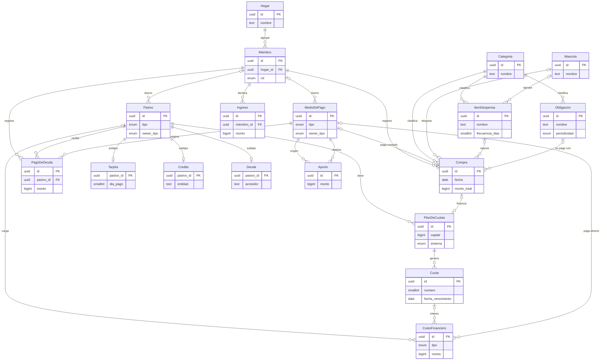

# Modelo de datos

Entidades, campos, relaciones e invariantes del hogar. Es la referencia para las migraciones SQL del servidor y para los tipos del dominio. El contexto está en `docs/architecture.md` y el negocio en `docs/domain.md`; aquí solo se traduce ese negocio a estructura. Los nombres de entidades (`PascalCase`) y de campos (`snake_case` sin tildes) son exactos: cambiarlos obliga a cambiar migraciones, tipos y sincronización a la vez.

## 1. Propósito y convenciones

El modelo guarda **hechos**, no resultados. Un consumo, un pago o un costo ocurrieron en una fecha y se registran una vez; saldos, estados de cuota y totales del mes se derivan en el dispositivo (§8). Eso permite que dos miembros trabajen sin conexión y reconcilien sin discutir cifras guardadas.

### 1.1 Tipos lógicos

| Tipo | Uso |
| --- | --- |
| `uuid` | Identificadores UUIDv7 generados en el cliente: crear nunca choca |
| `text` | Texto libre o patrón validado con CHECK (`moneda`, `periodo`, `mes_inicio`) |
| `date` | Fecha civil `YYYY-MM-DD`, sin hora ni zona. Base del mes contable |
| `timestamptz` | Solo columnas de sincronización. Nunca define el mes de un movimiento |
| `bigint` | Pesos enteros. En TypeScript, entero seguro con el tipo de marca `Pesos` |
| `smallint` | Días `1..31`, número de cuota, frecuencias cortas |
| `integer` | Órdenes de presentación y tasas en partes por millón |
| `boolean` | Banderas de vigencia (`activo`, `activa`) |
| `enum(...)` | Conjuntos cerrados; `enum` de Postgres o `text` con CHECK |

- Todo monto es un entero en COP, sin centavos. Formato `$300.000`. Se redondea solo al multiplicar por una tasa: `redondear(x)` = peso más cercano, mitades hacia arriba, una vez por cuota.
- Porcentajes con coma decimal (`56,7 %`), redondeados solo al mostrarse. Fechas civiles en `America/Bogota`; el mes contable sale de la fecha civil, nunca de un `timestamptz`.

### 1.2 Columnas de sincronización

Presentes en **toda tabla replicada**; no se repiten en las tablas de §3.

| Columna | Tipo | Nulo | Regla / notas |
| --- | --- | --- | --- |
| `id` | `uuid` | no | PK. UUIDv7 del cliente |
| `hogar_id` | `uuid` | no | FK → `Hogar(id)`. Ausente solo en `Hogar` |
| `creado_en` | `timestamptz` | no | Reloj del cliente. Informativo |
| `actualizado_en` | `timestamptz` | no | Reloj del cliente. Informativo, no ordena nada |
| `eliminado_en` | `timestamptz` | sí | Tombstone. `null` = vigente |
| `actualizado_por` | `uuid` | no | FK → `Miembro(id)` del mismo hogar |
| `seq` | `bigint` | no | Asignado por el servidor, monotónico **por hogar** |

Excepción: los subtipos `Tarjeta`, `Credito` y `Deuda` no tienen `id` propio; su PK es `pasivo_id` (FK → `Pasivo(id)`) y llevan el resto de columnas de sincronización. Se crean en el mismo lote que su `Pasivo`.

`seq` sale de la tabla solo-servidor `hogar_seq(hogar_id, ultimo_seq)`: un trigger `BEFORE INSERT/UPDATE` incrementa y bloquea la fila del hogar hasta el commit, así el orden de `seq` coincide con el de commit y un pull no se salta filas confirmadas. El cliente envía por registro un `base_seq` (el `seq` que vio, `null` si es nuevo) y por lote un `lote_id` (UUIDv7 del cliente) y un `schema_version`; ninguno es columna de las tablas replicadas. El servidor guarda cada `lote_id` aplicado con su resultado en la tabla solo-servidor `lote_aplicado`; reenviar un lote ya aplicado (por ejemplo, tras perder la respuesta) devuelve el resultado guardado sin volver a evaluar `base_seq`, así un reintento de una actualización no se confunde con un conflicto.

### 1.3 Tombstones y tablas solo-servidor

Nada se borra físicamente: eliminar es escribir `eliminado_en`. El pull transporta esas filas y el cliente las aplica; un registro eliminado no cuenta en totales, saldos ni unicidad funcional. Tres tablas no se replican: `hogar_seq` (`hogar_id`, `ultimo_seq`, infraestructura de orden del servidor), `lote_aplicado` (`hogar_id`, `lote_id`, resultado; idempotencia de reintentos) e `invitacion` (token de un solo uso guardado como hash, vencimiento a 7 días; es un secreto, el cliente nunca lo lee).

## 2. Glosario corto

| Término | Significado |
| --- | --- |
| **Pasivo** | Supertipo de todo lo que se debe: `Tarjeta`, `Credito`, `Deuda`. `PagoDeDeuda` abona a cualquiera |
| **Deuda** | Pasivo informal o no bancario (almacén, familiar). Su `acreedor` es siempre texto externo |
| **Consumo** | El gasto real. Lo registra `Compra`, una vez, por `monto_total` |
| **aporte** (minúscula) | Concepto: toda salida de dinero desde un medio de un miembro con destino al hogar |
| **Aporte** (entidad) | Una de las cuatro fuentes del concepto: la transferencia de un miembro a un medio del hogar |

## 3. Entidades

Cada entidad lleva las columnas de §1.2. Los campos listados son canónicos: no se agregan, renombran ni eliminan.

### 3.1 Hogar

Raíz de tenencia y frontera de aislamiento entre hogares. **No es** presupuesto ni contabilidad: solo el contenedor.

| Campo | Tipo | Nulo | Regla / notas |
| --- | --- | --- | --- |
| `id` | `uuid` | no | PK. Única entidad sin `hogar_id` |
| `nombre` | `text` | no | Nombre visible |
| `moneda` | `text` | no | CHECK `moneda = 'COP'` |
| `zona_horaria` | `text` | no | CHECK `zona_horaria = 'America/Bogota'` |

### 3.2 Miembro

Persona del hogar, con o sin cuenta de autenticación. **No es** un usuario de Auth: puede existir con `usuario_id` nulo y vincularse después.

| Campo | Tipo | Nulo | Regla / notas |
| --- | --- | --- | --- |
| `id` | `uuid` | no | PK |
| `hogar_id` | `uuid` | no | FK → `Hogar(id)` |
| `nombre` | `text` | no | Nombre visible |
| `usuario_id` | `uuid` | sí | Id de Auth. `null` = miembro sin cuenta |
| `rol` | `enum('admin','miembro')` | no | Solo `admin` invita, desactiva y renombra el hogar |
| `activo` | `boolean` | no | Desactivar no borra sus registros |

Único parcial `(hogar_id, usuario_id)` donde `usuario_id IS NOT NULL AND eliminado_en IS NULL`.

### 3.3 Ingreso

Ingreso declarado de un miembro, fijo o variable, en una tabla con discriminador. **No es** gasto ni aporte: solo alimenta el denominador de "% de su ingreso".

| Campo | Tipo | Nulo | Regla / notas |
| --- | --- | --- | --- |
| `miembro_id` | `uuid` | no | FK → `Miembro(id)` |
| `tipo` | `enum('fijo','variable')` | no | Discriminador |
| `descripcion` | `text` | no | "Salario", "Freelance", "Arriendo recibido" |
| `monto` | `bigint` | no | CHECK `monto > 0` |
| `dia_esperado` | `smallint` | sí | `1..31`. Obligatorio si `tipo='fijo'` |
| `vigente_desde` | `date` | sí | Obligatorio si `tipo='fijo'` |
| `vigente_hasta` | `date` | sí | `fijo`; si existe, `≥ vigente_desde` |
| `fecha` | `date` | sí | Obligatorio si `tipo='variable'`; `null` si `fijo` |

CHECK compuesto: `fijo` exige `dia_esperado` y `vigente_desde` no nulos y `fecha` nula; `variable` exige `fecha` no nula y los campos de fijo nulos. Cambiar un salario es cerrar `vigente_hasta` y crear otro registro.

### 3.4 Categoria

Clasificación de consumos; se siembran Mercado, Servicios, Arriendo, Transporte, Salud, Mascotas, Hogar y electrodomésticos, Entretenimiento y Otros. **No** agrupa deudas ni obligaciones: solo clasifica `Compra` y etiqueta `ItemDespensa` y `Obligacion`.

| Campo | Tipo | Nulo | Regla / notas |
| --- | --- | --- | --- |
| `nombre` | `text` | no | Único `(hogar_id, lower(nombre))` entre no eliminadas |
| `icono` | `text` | sí | Identificador de ícono |
| `orden` | `integer` | no | Orden de presentación |
| `activa` | `boolean` | no | Se archiva, no se borra si está en uso |

### 3.5 MedioDePago

De dónde sale dinero de contado: efectivo, ahorros, corriente, débito, Nequi, Daviplata. **No es** un pasivo: una tarjeta de crédito es deuda; la UI los muestra juntos.

| Campo | Tipo | Nulo | Regla / notas |
| --- | --- | --- | --- |
| `nombre` | `text` | no | Nombre visible |
| `tipo` | `enum('efectivo','cuenta')` | no | `cuenta` cubre ahorros, corriente, débito y billeteras |
| `owner_tipo` | `enum('miembro','hogar')` | no | Ver §4 |
| `owner_miembro_id` | `uuid` | sí | FK → `Miembro(id)`. Coherencia con `owner_tipo` (I8) |
| `activo` | `boolean` | no | Se archiva para retirarlo de la UI |

### 3.6 Pasivo (supertipo)

Todo lo que se debe. Herencia por tabla de clase: `Pasivo` guarda lo común y cada subtipo guarda lo suyo con `pasivo_id` como PK y FK. **No** guarda saldo (es derivado, §8) ni "saldo inicial" (entra como un `PlanDeCuotas` con `origen='saldo_inicial'`, de cualquier `sistema`). CHECK de tasa: `(tasa_tipo IS NULL) = (tasa_ppm IS NULL)`; `tasa_ppm` es la tasa por defecto de planes nuevos y cada plan copia la vigente al crearse.

| Campo | Tipo | Nulo | Regla / notas |
| --- | --- | --- | --- |
| `tipo` | `enum('tarjeta','credito','deuda')` | no | Exige exactamente una fila de subtipo coherente |
| `nombre` | `text` | no | "Visa Ana", "Préstamo nevera" |
| `owner_tipo` | `enum('miembro','hogar')` | no | Ver §4 |
| `owner_miembro_id` | `uuid` | sí | FK → `Miembro(id)`. Coherencia con `owner_tipo` (I8) |
| `tasa_tipo` | `enum('EA','MV')` | sí | Sin tasa no se calculan intereses |
| `tasa_ppm` | `integer` | sí | Partes por millón: 28 % E.A. = `280000` |
| `activo` | `boolean` | no | Archivar no borra historia |

#### 3.6.1 Tarjeta

Subtipo con ciclo de facturación. **No** es un medio de pago ni tiene saldo propio: su deuda vive en planes y cuotas.

| Campo | Tipo | Nulo | Regla / notas |
| --- | --- | --- | --- |
| `pasivo_id` | `uuid` | no | PK y FK → `Pasivo(id)` con `tipo='tarjeta'` |
| `franquicia` | `text` | sí | Visa, Mastercard, etc. |
| `ultimos_4` | `text` | sí | Últimos cuatro dígitos |
| `dia_corte` | `smallint` | no | `1..31` |
| `dia_pago` | `smallint` | no | `1..31`; determina el vencimiento de cuotas (§9) |
| `cupo` | `bigint` | sí | Informativo; no se valida contra saldo |

#### 3.6.2 Credito

Subtipo bancario. **No** distingue consumo de capital: la compra se registra aparte, como `Compra` financiada o plan `saldo_inicial`.

| Campo | Tipo | Nulo | Regla / notas |
| --- | --- | --- | --- |
| `pasivo_id` | `uuid` | no | PK y FK → `Pasivo(id)` con `tipo='credito'` |
| `entidad` | `text` | no | Banco o financiera |
| `referencia` | `text` | sí | Número de obligación |

#### 3.6.3 Deuda

Pasivo informal o no bancario. **No** es una relación entre miembros: aunque sea de Ana, Beto puede pagarla y solo sube el aporte de Beto.

| Campo | Tipo | Nulo | Regla / notas |
| --- | --- | --- | --- |
| `pasivo_id` | `uuid` | no | PK y FK → `Pasivo(id)` con `tipo='deuda'` |
| `acreedor` | `text` | no | Nombre externo. Nunca un `Miembro` (I7) |

### 3.7 Compra (Consumo)

El gasto real: una vez, en la fecha de la compra, por su valor total, sea de contado o financiada. **No** se atribuye a un miembro (salvo `registrado_por`) ni sabe cuánto se ha pagado.

| Campo | Tipo | Nulo | Regla / notas |
| --- | --- | --- | --- |
| `fecha` | `date` | no | Fecha civil del consumo |
| `descripcion` | `text` | no | Texto libre |
| `monto_total` | `bigint` | no | CHECK `monto_total > 0` |
| `categoria_id` | `uuid` | no | FK → `Categoria(id)` |
| `pago_tipo` | `enum('contado','financiado')` | no | Discriminador del plan |
| `medio_de_pago_id` | `uuid` | sí | FK → `MedioDePago(id)`. Obligatorio si `contado`, `null` si `financiado` |
| `registrado_por` | `uuid` | no | FK → `Miembro(id)`. Quien digitó, no quien consume |
| `mascota_id` | `uuid` | sí | FK → `Mascota(id)`. Etiqueta para filtros |
| `item_despensa_id` | `uuid` | sí | FK → `ItemDespensa(id)` |
| `obligacion_id` | `uuid` | sí | FK → `Obligacion(id)` |
| `periodo` | `text` | sí | `'YYYY-MM'`; presente si y solo si hay `obligacion_id`. Es el mes de la instancia de la obligación, no el del pago: el recibo de noviembre pagado el 2 de diciembre lleva `periodo='2026-11'` y cuenta en el gasto de diciembre (por `fecha`) |
| `cufe` | `text` | sí | CUFE/CUDE de la factura electrónica DIAN si se escaneó. Único `(hogar_id, cufe)` entre no eliminadas: escanear dos veces la misma factura no crea dos consumos. Si una factura se reparte en varias compras (una por categoría), solo la de mayor `monto_total` lleva el `cufe`; las demás quedan en `null` |
| `nit_comercio` | `text` | sí | NIT del emisor tal como viene en el QR (`NitFac`), sin normalizar el dígito de verificación. `null` si la compra no viene de una factura. Nunca se guarda `DocAdq`: el documento del adquiriente es dato personal |
| `iva` | `bigint` | sí | CHECK `iva >= 0`. IVA incluido en `monto_total` (`ValIva`), informativo: nunca se suma aparte (I2, I4). `null` si no se conoce o si la compra no lleva el `cufe` de la factura |
| `origen` | `enum('manual','qr','ocr','correo')` | no | Procedencia del registro: digitado, escaneado del QR, leído por OCR del tiquete o ingestado desde un correo de factura (fase 2). Default `'manual'` |

Una categoría por compra en fase 1: un tiquete mixto se registra como dos compras. Coherencia de mascota: si el `ItemDespensa` tiene `mascota_id`, la compra lleva ese mismo `mascota_id` (el caso de uso lo copia; trigger diferido lo valida); si el ítem es de todas las mascotas, `mascota_id` es libre. `financiado` ⇔ exactamente un `PlanDeCuotas`; `contado` ⇔ sin plan y con medio (I3).

**Ítems de factura: fase 2.** `Compra` no guarda líneas de detalle en fase 1. El QR de la DIAN nunca las trae ([architecture.md](architecture.md) §8) y el detalle solo aparece cuando la factura llega a nombre del miembro: la entidad `ItemCompra` (una línea por producto, con su propio monto dentro de `monto_total`) entra junto con la ingesta de correos de factura (ZIP con XML UBL y PDF). Hasta entonces, un tiquete mixto se resuelve partiéndolo en varias `Compra` por categoría, sin detalle de producto.

### 3.8 PlanDeCuotas

Calendario de capital de un pasivo. Todo capital que un pasivo debe viene de exactamente un plan. **No** es un pasivo: es parte de uno; una tarjeta puede tener varios planes más un `saldo_inicial`.

| Campo | Tipo | Nulo | Regla / notas |
| --- | --- | --- | --- |
| `pasivo_id` | `uuid` | no | FK → `Pasivo(id)` |
| `origen` | `enum('compra','saldo_inicial')` | no | Procedencia del capital |
| `compra_id` | `uuid` | sí | FK → `Compra(id)`. Único entre no eliminadas |
| `fecha_inicio` | `date` | no | Fecha de la compra, o fecha desde la que se registra el saldo |
| `capital` | `bigint` | no | CHECK `capital > 0` |
| `sistema` | `enum('capital_fijo','cuota_fija','sin_calendario')` | no | Ver §9 |
| `n_cuotas` | `smallint` | sí | `> 0`. Nulo si y solo si `sin_calendario` |
| `fecha_primera_cuota` | `date` | sí | Nulo si y solo si `sin_calendario` |
| `tasa_tipo` | `enum('EA','MV')` | sí | Copia de la tasa vigente al crear |
| `tasa_ppm` | `integer` | sí | `null` = sin intereses calculados |

CHECK de origen: `compra` exige `compra_id` no nulo; `saldo_inicial` lo exige nulo. CHECK de calendario: `n_cuotas` y `fecha_primera_cuota` ambos nulos o ambos presentes. `origen='compra'` implica `capital = Compra.monto_total` y `fecha_inicio = Compra.fecha` (trigger diferido). `sin_calendario` vale con cualquier origen: una compra financiada por una deuda sin calendario (por ejemplo, un préstamo familiar que se abona cuando se puede) tiene plan y cero cuotas.

### 3.9 Cuota

Porción de capital con vencimiento. **No** guarda intereses (su interés es un `CostoFinanciero` con `cuota_id`) ni estado (se deriva por FIFO). Regla por plan, validada con trigger diferido (abarca varias filas): si `sistema='sin_calendario'`, el plan tiene cero cuotas; en los demás sistemas, tiene cuotas contiguas `1..n_cuotas` cuya suma de `capital` es `plan.capital`.

| Campo | Tipo | Nulo | Regla / notas |
| --- | --- | --- | --- |
| `plan_id` | `uuid` | no | FK → `PlanDeCuotas(id)` |
| `numero` | `smallint` | no | `1..n` contiguo. Único `(plan_id, numero)` |
| `fecha_vencimiento` | `date` | no | Fecha civil de pago |
| `capital` | `bigint` | no | CHECK `capital > 0` |

### 3.10 PagoDeDeuda

Salida de dinero que abona a un pasivo. **No** apunta a cuotas ni es consumo: la asignación a cuotas es FIFO derivada y un pago nunca suma al gasto.

| Campo | Tipo | Nulo | Regla / notas |
| --- | --- | --- | --- |
| `pasivo_id` | `uuid` | no | FK → `Pasivo(id)` |
| `medio_de_pago_id` | `uuid` | no | FK → `MedioDePago(id)`. De dónde salió el dinero |
| `monto` | `bigint` | no | CHECK `monto > 0` |
| `fecha` | `date` | no | Fecha civil del pago |
| `nota` | `text` | sí | Texto libre |
| `registrado_por` | `uuid` | no | FK → `Miembro(id)` |

El aportante es el dueño del medio cuando es un miembro; si el medio es del hogar, la salida es del fondo común y no es aporte de nadie.

### 3.11 CostoFinanciero

Intereses, cuota de manejo, seguros, mora, comisiones, GMF: gasto en un balde separado del consumo. **No** es una categoría de consumo y no se suma a `monto_total` (I4).

| Campo | Tipo | Nulo | Regla / notas |
| --- | --- | --- | --- |
| `tipo` | `enum('interes','cuota_manejo','seguro','mora','comision','gmf','otro')` | no | Clasificación |
| `monto` | `bigint` | no | CHECK `monto > 0` |
| `fecha_causacion` | `date` | no | Fecha en que se causa; ordena el gasto del mes |
| `pasivo_id` | `uuid` | sí | FK → `Pasivo(id)`. Costo cargado a la deuda |
| `medio_de_pago_id` | `uuid` | sí | FK → `MedioDePago(id)`. Costo pagado directo |
| `cuota_id` | `uuid` | sí | FK → `Cuota(id)`. Exige `pasivo_id` = pasivo del plan de esa cuota |
| `origen` | `enum('calculado','manual')` | no | `calculado` = lo generó la app; `manual` = lo dicta el extracto |
| `descripcion` | `text` | sí | Texto libre |
| `registrado_por` | `uuid` | no | FK → `Miembro(id)`. Quien lo digitó o quien creó el lote que lo calculó |

CHECK: exactamente uno de `pasivo_id` / `medio_de_pago_id` (I5). Único `(cuota_id)` para `tipo='interes' AND origen='calculado'`. La coherencia `cuota_id` ↔ `pasivo_id` se valida con trigger diferido. Un costo cargado al pasivo se paga luego con `PagoDeDeuda`; los intereses calculados son estimación editable y al corregirlos pasan a `origen='manual'`.

### 3.12 Aporte (entidad)

Transferencia de un miembro a un medio del hogar, por ejemplo a la cuenta común; origen con dueño miembro y destino con dueño hogar (I17, validado con trigger diferido o función de dominio porque depende de filas de `MedioDePago`). **No** es la única forma de aportar: es una de cuatro fuentes (con compras de contado, pagos de deuda y costos pagados directo desde medios del miembro).

| Campo | Tipo | Nulo | Regla / notas |
| --- | --- | --- | --- |
| `medio_origen_id` | `uuid` | no | FK → `MedioDePago(id)` con dueño `miembro` |
| `medio_destino_id` | `uuid` | no | FK → `MedioDePago(id)` con dueño `hogar` |
| `monto` | `bigint` | no | CHECK `monto > 0` |
| `fecha` | `date` | no | Fecha civil |
| `nota` | `text` | sí | Texto libre |
| `registrado_por` | `uuid` | no | FK → `Miembro(id)`. Quien lo digitó; el aportante es el dueño de `medio_origen_id` |

### 3.13 Mascota

Animal del hogar; agrupa compras y recordatorios de despensa. **No** tiene gasto propio: su gasto son las compras etiquetadas con `mascota_id`.

| Campo | Tipo | Nulo | Regla / notas |
| --- | --- | --- | --- |
| `nombre` | `text` | no | Nombre de la mascota |
| `especie` | `enum('perro','gato','otro')` | no | |
| `fecha_nacimiento` | `date` | sí | Informativa |
| `activa` | `boolean` | no | |

### 3.14 ItemDespensa

Artículo de reposición periódica (concentrado, aseo). **No** es gasto ni obligación: no tiene vencimiento, no suma al mes y no se paga; solo produce la "próxima compra estimada" (§8).

| Campo | Tipo | Nulo | Regla / notas |
| --- | --- | --- | --- |
| `mascota_id` | `uuid` | sí | FK → `Mascota(id)`. `null` = sirve a todas las mascotas |
| `nombre` | `text` | no | "Concentrado 15 kg" |
| `categoria_id` | `uuid` | no | FK → `Categoria(id)`. Categoría sugerida |
| `frecuencia_dias` | `smallint` | sí | `> 0`. Nulo = sin recordatorio |
| `monto_habitual` | `bigint` | sí | Referencia de precio, no gasto |
| `activo` | `boolean` | no | |

### 3.15 Obligacion

Plantilla de cobro recurrente que no es deuda: servicios, arriendo, suscripciones. **No** es un pasivo: no genera saldo ni intereses. Pagarla es crear una `Compra` con `obligacion_id` y `periodo`; único `(obligacion_id, periodo)` entre compras no eliminadas (I11).

| Campo | Tipo | Nulo | Regla / notas |
| --- | --- | --- | --- |
| `nombre` | `text` | no | "Energía", "Arriendo" |
| `categoria_id` | `uuid` | no | FK → `Categoria(id)` |
| `monto_estimado` | `bigint` | sí | Referencia para la agenda |
| `dia_vencimiento` | `smallint` | no | `1..31` |
| `periodicidad` | `enum('mensual','bimestral','trimestral','anual')` | no | Genera las instancias esperadas |
| `mes_inicio` | `text` | no | `'YYYY-MM'`, primer periodo |
| `medio_sugerido_id` | `uuid` | sí | FK → `MedioDePago(id)`. Solo sugerencia |
| `activa` | `boolean` | no | |

## 4. Propiedad (owner polimórfico)

`Pasivo` y `MedioDePago` tienen dueño polimórfico con `owner_tipo` y `owner_miembro_id`: el dueño puede ser un miembro o el hogar completo.

**Coherencia estructural (I8).** El esquema impone siempre y sin excepciones `(owner_tipo = 'miembro' AND owner_miembro_id IS NOT NULL) OR (owner_tipo = 'hogar' AND owner_miembro_id IS NULL)`.

La FK de `owner_miembro_id` es compuesta por `(hogar_id, owner_miembro_id)` hacia `Miembro(hogar_id, id)`, de modo que un dueño nunca pertenece a otro hogar (I14). Este CHECK dice **cómo se representa** el dueño, no qué dueños son válidos por tipo.

**Política de fase 1.** "Qué dueño admite cada tipo" vive en la función de dominio `ownersPermitidos(tipo)` y en la validación de `sync_push`:

| Entidad / tipo | Dueños permitidos en fase 1 |
| --- | --- |
| `Tarjeta` | `miembro` |
| `Credito` | `miembro` |
| `Deuda` | `miembro` u `hogar` |
| `MedioDePago` (cualquier tipo) | `miembro` u `hogar` |

Habilitar tarjetas o créditos compartidos es un cambio de código en `ownersPermitidos(tipo)`: sin migración, sin reescritura de datos y sin columnas nuevas, porque `owner_tipo` ya acepta `'hogar'` y solo la política lo impide hoy. Un CHECK de esquema no podría hacerlo sin una migración cada vez que la política cambie, y mezclaría representación con decisión de producto; por eso la política se valida en el servidor (autoridad) y en el dominio (falla temprano en la UI).

**Inmutabilidad del dueño de un medio (I9).** Los aportes históricos se derivan del medio (§8): si el dueño cambiara, los aportes de meses pasados cambiarían retroactivamente y dos miembros verían balances distintos según cuándo abrieron la app. Para "cambiar de dueño" se crea otro medio y se archiva el viejo. Como un CHECK no puede comparar con la fila anterior, I9 se valida en `sync_push` (rechazo si `owner_tipo` u `owner_miembro_id` difieren del valor guardado) y opcionalmente con un trigger `BEFORE UPDATE`.

El dueño de un **`Pasivo` sí puede cambiar**: el saldo no depende de quién figura como dueño y los aportes se derivan del medio con que se paga, no del pasivo. Corregir un dueño mal asignado no reescribe historia de aportes.

## 5. Aporte libre

El modelo no puede expresar deuda entre miembros; la propiedad (`owner_*`) describe de quién es el pasivo, no quién debe cubrirlo. Se sostiene en tres piezas:

1. **Ninguna entidad referencia a un miembro como acreedor.** `Deuda.acreedor` es texto externo ("Almacén El Hogar"), no un `Miembro`. No hay tabla de préstamos entre miembros ni saldos por pareja ni fila de compensación.
2. **Ningún cálculo devuelve montos adeudados entre miembros.** El balance de pareja muestra pesos y porcentajes por miembro; no hay diferencia, compensación ni "X le debe a Y" (I7).
3. **Pagar el pasivo de otro solo mueve dos cifras.** Si Beto paga la tarjeta de Ana, sube el aporte de Beto y baja el saldo del pasivo de Ana. Ana no queda debiendo nada; el gasto del mes no cambia (I2, I6).

Como el aporte es libre, la app registra lo que cada uno puso y nunca lo que cada uno "debería" poner.

## 6. Relaciones

| Relación | Cardinalidad | Notas |
| --- | --- | --- |
| `Hogar` → `Miembro` | 1 : N | Todo miembro pertenece a un hogar |
| `Miembro` → `Ingreso` | 1 : N | Cada ingreso declara su miembro |
| `Miembro` → `MedioDePago` | 0..1 : N | Solo si `owner_tipo='miembro'` |
| `Miembro` → `Pasivo` | 0..1 : N | Solo si `owner_tipo='miembro'` |
| `Miembro` → `Compra` / `PagoDeDeuda` / `CostoFinanciero` / `Aporte` | 1 : N | Vía `registrado_por` |
| `Pasivo` → `Tarjeta` / `Credito` / `Deuda` | 1 : 0..1 | Exactamente un subtipo, el que indica `tipo` |
| `Pasivo` → `PlanDeCuotas` | 1 : N | Puede tener varios planes (una compra cada uno) |
| `Compra` → `PlanDeCuotas` | 1 : 0..1 | Una compra financiada tiene exactamente un plan |
| `PlanDeCuotas` → `Cuota` | 1 : N | `0..N` si `sin_calendario`; `1..n` en los demás |
| `Pasivo` → `PagoDeDeuda` | 1 : N | El pago abona al pasivo, no a una cuota |
| `Pasivo` → `CostoFinanciero` | 0..1 : N | Costos cargados a la deuda |
| `Cuota` → `CostoFinanciero` | 0..1 : N | Interés calculado (máximo uno) o ajustes manuales |
| `MedioDePago` → `Compra` | 0..1 : N | Solo compras de contado |
| `MedioDePago` → `PagoDeDeuda` | 1 : N | Origen del dinero |
| `MedioDePago` → `CostoFinanciero` | 0..1 : N | Costos pagados directo |
| `MedioDePago` → `Aporte` | 1 : N | Dos roles: `medio_origen_id` y `medio_destino_id` |
| `Categoria` → `Compra` / `ItemDespensa` / `Obligacion` | 1 : N | Clasificación y categoría sugerida |
| `Mascota` → `Compra` | 0..1 : N | Etiqueta opcional |
| `Mascota` → `ItemDespensa` | 0..1 : N | Nulo si el ítem sirve a todas las mascotas |
| `ItemDespensa` → `Compra` | 0..1 : N | Reposición del artículo |
| `Obligacion` → `Compra` | 1 : N | Máximo una compra por `(obligacion_id, periodo)` |

## 7. Diagrama

Los atributos del diagrama son ilustrativos (solo claves y campos principales); la lista completa y canónica está en §3.



El diagrama omite la relación `hogar_id → Hogar` de cada entidad y solo dibuja la de `Miembro`. Esa relación existe en todas las tablas replicadas (I14) y se documenta en §6; dibujarla 17 veces haría el diagrama ilegible sin agregar información.

## 8. Datos derivados (nunca guardados)

Todo esto se calcula en el dispositivo a partir de los hechos. No existe columna, tabla ni caché persistente: guardarlos abriría la puerta a que dos dispositivos muestren cifras distintas.

**Saldo de un pasivo a la fecha `d`.** Puede ser negativo (saldo a favor). Es el "saldo según la app", no el extracto del banco.

```
saldo(d) = Σ capital de planes (fecha_inicio ≤ d) + Σ CostoFinanciero cargados (fecha_causacion ≤ d) − Σ PagoDeDeuda (fecha ≤ d)
```

**Estado de cada cuota (FIFO).** Los pagos acumulados del pasivo cubren los cargos exigibles en orden cronológico estricto: cada cuota como `capital + sus costos con cuota_id` (fecha = `fecha_vencimiento`) y cada costo cargado sin `cuota_id` (fecha = `fecha_causacion`). Desempate en la misma fecha: primero los costos sin cuota, luego las cuotas por `fecha_inicio` de su plan y por `numero`; a igualdad total, por `id`. Al final, el capital de los planes `sin_calendario` por `fecha_inicio`. Cada cuota queda `pagada`, `parcial` (con su restante), `pendiente` o `vencida` según `fecha_vencimiento` frente a la fecha de consulta.

**Gasto del mes.** Desglose: por categoría (compras) más el balde fijo "Costo financiero". Nunca incluye `PagoDeDeuda` ni `Aporte`.

```
gasto(mes) = Σ Compra.monto_total (fecha en el mes) + Σ CostoFinanciero.monto (fecha_causacion en el mes)
```

**Aportes del mes del miembro `M`.** Financiar no es aportar; lo que sale de medios del hogar es "salidas del fondo común", informativo, y no es aporte de nadie.

```
aportes(M) = Σ compras de contado desde medios de M + Σ PagoDeDeuda desde medios de M + Σ CostoFinanciero pagados directo desde medios de M + Σ Aporte con origen en medios de M
```

**Ingreso del mes de `M`.**

```
ingreso(M) = Σ ingresos fijos vigentes en el mes + Σ ingresos variables con fecha en el mes

"Vigente en el mes" significa: la fecha esperada de ese mes (`dia_esperado`, ajustado al último día si el mes es más corto) cae dentro de `[vigente_desde, vigente_hasta]`. Así, si el salario cambia a mitad de mes, cuenta una sola fila: la vigente el día de pago.
```

**Obligaciones del mes.** Cuotas con `fecha_vencimiento` en el mes (capital más sus costos con `cuota_id`) y costos cargados **sin `cuota_id`** causados en el mes, con su estado FIFO, más las instancias de `Obligacion` del mes (pagada si existe una `Compra` con su `obligacion_id` y `periodo`). Es una agenda: no se suma al gasto.

**Próxima compra de despensa.** Para un `ItemDespensa` con `frecuencia_dias`: fecha de la última `Compra` no eliminada con ese `item_despensa_id` más `frecuencia_dias`. Sin compras previas no hay estimación.

**Identidad de conservación** (base de los tests de propiedades). "Salidas externas" = compras de contado + `PagoDeDeuda` + costos pagados directo, desde cualquier medio.

```
Σ gasto(≤ d) = Σ salidas externas(≤ d) + Σ saldo de pasivos(d) − Σ capital de planes saldo_inicial(≤ d)
Σ_M aportes(M) = salidas externas desde medios de miembros + Σ Aporte
```

## 9. Reglas de cálculo

**Tasas.** `MV = (1 + EA)^(1/12) − 1` y `EA = (1 + MV)^12 − 1`. 28 % E.A. equivale a 0,0207847 M.V. (2,0785 %). Se calcula en coma flotante y se redondea solo el interés final.

**Reparto de capital (`capital_fijo`).** Con `C` capital y `n` cuotas: `base = floor(C / n)` y `r = C mod n`; las primeras `r` cuotas llevan `base + 1` y el resto `base`. La suma es exactamente `C`.

**Interés de la cuota `k`.** `interes_k = redondear(saldo_capital_{k−1} × i)` con `saldo_capital_0 = C`. Sin tasa no se crean costos: el usuario los registra a mano. El default de la UI es compra a 1 cuota sin tasa.

**`cuota_fija` (sistema francés).** `A = C·i / (1 − (1+i)^−n)`; `interes_k = redondear(saldo_{k−1} × i)`; `capital_k = redondear(A) − interes_k` para `k < n`; la última cuota lleva todo el capital restante. Con `i = 0` se usa el reparto de `capital_fijo`. El modelo está listo; la UI de fase 2 puede exponer solo `capital_fijo` y `sin_calendario`.

**Fechas de cuotas en tarjeta.** `corte_1` = primera fecha con día `dia_corte` mayor o igual a la fecha de compra (el mismo mes si el día de la compra es menor o igual a `dia_corte`; si no, el mes siguiente). `pago_1` = primera fecha con día `dia_pago` estrictamente posterior a `corte_1`. Cuota `k` = `pago_1` más `(k − 1)` meses. Los días 29 a 31 se ajustan al último día del mes. En `Credito` y `Deuda` la `fecha_primera_cuota` se ingresa, no se calcula.

**Edición de una compra financiada.** Cambiar monto, `n_cuotas` o tasa regenera el plan en un solo lote: tombstone de cuotas y costos calculados viejos, creación de los nuevos. Solo se permite mientras la primera cuota no haya vencido; después la historia de pagos ya existe y el ajuste se hace con `CostoFinanciero` manual o con un plan nuevo. Un plan `sin_calendario` (sin primera cuota) se puede editar mientras su pasivo no tenga ningún `PagoDeDeuda` con `fecha ≥ fecha_inicio` del plan.

## 10. Invariantes

| ID | Invariante | Dónde se hace cumplir | Test de fase 2 |
| --- | --- | --- | --- |
| I1 | Todo monto es entero seguro en COP y `> 0` (los saldos derivados pueden ser `≤ 0`) | Tipo `Pesos` + CHECK `> 0` en cada monto | Propiedad: todo monto generado es entero y positivo; ningún cálculo produce fracciones |
| I2 | Una `Compra` suma al gasto una vez, en su fecha, por `monto_total`, sea de contado o financiada; cuotas y `PagoDeDeuda` no suman | Función de dominio de totales | Compra a 3 cuotas: gasto del mes = `monto_total`; agregar pagos no lo cambia |
| I3 | Financiada ⇔ exactamente un plan con `compra_id`; contado ⇔ sin plan y con medio; `plan.capital = compra.monto_total`; si el plan no es `sin_calendario`, Σ `cuota.capital` = `plan.capital` y números 1..n contiguos; si es `sin_calendario`, cero cuotas | Único parcial `compra_id` + trigger diferido | Lote con Σ cuotas ≠ capital se rechaza; compra financiada sin plan se rechaza |
| I4 | El costo financiero suma al balde "Costo financiero" en su `fecha_causacion`; nunca a `monto_total` ni a una categoría | Función de dominio de totales | Compra con interés: categoría = `monto_total`; balde = interés; sin doble conteo |
| I5 | Exactamente uno de `pasivo_id` / `medio_de_pago_id`; `cuota_id` coherente con el pasivo de su plan | CHECK + trigger diferido | Costo con ambos destinos o con ninguno se rechaza |
| I6 | Aporte = salida de caja de un medio del miembro; financiar no es aportar, pagar sí | Función de dominio de aportes | Compra financiada no genera aporte; su pago sí, por el monto pagado |
| I7 | Sin deuda entre miembros: ningún campo referencia a un miembro como acreedor; ningún cálculo devuelve montos adeudados entre miembros | Esquema (sin FK de acreedor) + función de dominio | `Deuda.acreedor` es texto; ninguna función devuelve un par acreedor/deudor |
| I8 | `owner_tipo='miembro'` ⇔ `owner_miembro_id` no nulo y del mismo hogar; `'hogar'` ⇔ nulo | CHECK + FK compuesta `(hogar_id, owner_miembro_id)` | Dueño de otro hogar se rechaza; `miembro` sin id se rechaza |
| I9 | El dueño de un `MedioDePago` es inmutable | Validación en `sync_push` (+ trigger `BEFORE UPDATE` opcional) | Update que cambia el dueño se rechaza y no altera aportes pasados |
| I10 | Saldos y estados derivados, nunca guardados; asignación de pagos FIFO | Tipos (no existen esos campos) + función FIFO pura | No hay columna de saldo/estado; FIFO reparte un pago parcial correctamente |
| I11 | Una obligación por periodo: único `(obligacion_id, periodo)` entre compras no eliminadas | Índice único parcial | Dos compras con la misma obligación y periodo: la segunda se rechaza |
| I12 | Fechas civiles en `America/Bogota`; el mes sale de la fecha civil | Tipo `FechaCivil` + CHECK de formato `'YYYY-MM'` | Un `timestamptz` de las 23:30 del último día no mueve el mes |
| I13 | Sync idempotente y atómico: ids del cliente; reenviar un lote no duplica; entra completo o no entra; sin sobrescritura silenciosa | RPC `sync_push` (transacción + `base_seq` + `lote_aplicado` por `lote_id`) | Reenviar el mismo lote dos veces (creación o actualización) deja el mismo estado y devuelve el mismo resultado; lote con un registro inválido no aplica nada |
| I14 | Tenencia: todo registro tiene `hogar_id` y toda FK apunta dentro del mismo hogar | RLS de membresía + FKs compuestas por `hogar_id` | Insertar una FK de otro hogar se rechaza; RLS oculta datos ajenos |
| I15 | Tombstones: nada se borra físicamente; los eliminados no cuentan en ningún total | `eliminado_en` + RLS sin `DELETE` | Tras eliminar, la fila llega por pull y no aparece en totales ni unicidad |
| I16 | Conservación (identidad de §8) | Función de dominio + test de propiedades | `Σ gasto = Σ salidas externas + Σ saldo − Σ capital saldo_inicial` con datos generados |
| I17 | `Aporte`: origen con dueño miembro, destino con dueño hogar | Trigger diferido / función de dominio | Aporte con destino de dueño miembro se rechaza; con origen del hogar también |
