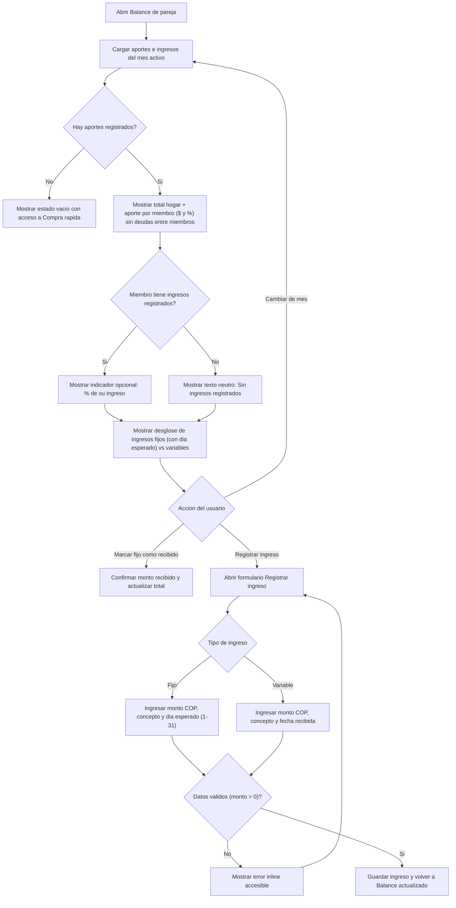

# Flujo: Balance de pareja

Mostrar de forma transparente cuánto aportó cada miembro al hogar durante el mes (en pesos y porcentaje) junto con sus ingresos fijos y variables, bajo el principio estricto de **aporte libre**: la app informa, nunca calcula ni insinúa que un miembro le debe dinero a otro.

## Objetivo

- Dar visibilidad clara del aporte real de cada persona al hogar (`$`, `% del total del hogar` y `% opcional de su propio ingreso`).
- Distinguir **ingresos fijos** (monto y día esperado) de **ingresos variables** (registrados cuando llegan).
- Eliminar fricción emocional: **nunca** mostrar textos como *"X le debe a Y"*, *"diferencia para empatar 50/50"* ni saldos a favor/en contra entre miembros.

## Pantallas

| Pantalla | Propósito | Mockup |
| --- | --- | --- |
| **Balance de pareja** | Resumen mensual de aporte libre por miembro (pesos, % del hogar, % de su ingreso), bloque de ingresos fijos vs variables y movimientos recientes por miembro. | [balance-de-pareja.html](../../design/mockups/balance-de-pareja.html) |
| **Registrar ingreso** | Alta de ingreso fijo (con día esperado del mes) o variable (registrado al recibirlo) para un miembro del hogar. | [registrar-ingreso.html](../../design/mockups/registrar-ingreso.html) |

## Flujo paso a paso

### 1. Consultar el balance mensual de pareja

1. El usuario toca **Balance** en la barra de navegación inferior.
2. En la cabecera selecciona o confirma el mes activo (ej. `Noviembre 2026`, con navegación `< Mes anterior` / `Mes siguiente >`).
3. El bloque principal **Aportes al hogar** muestra:
   - **Total aportado en el mes:** `$3.600.000` (suma de gastos directos pagados + pagos de deudas/costos financieros hechos al hogar).
   - Tarjeta y barra proporcional para cada miembro (diferenciada con color, patrón/borde y etiqueta textual):
     - **Santiago:** `$2.088.000` · **58%** del hogar · *41% de su ingreso del mes*.
     - **Camila:** `$1.512.000` · **42%** del hogar · *36% de su ingreso del mes*.
   - Nota permanente y sobria de **Aporte libre**: *"Cada quien aporta lo que quiere o puede. No se generan saldos ni deudas entre ustedes."*
4. El segundo bloque **Ingresos del mes (Fijos vs Variables)** desglosa para cada miembro:
   - **Fijos:** monto y día esperado (ej. `Salario Santiago · $4.500.000 · día 30 · ✓ Recibido`).
   - **Variables:** lista de entradas registradas al llegar (ej. `Consultoría diseño · $600.000 · 12 nov`).
   - Totales separados de ingresos fijos (`$8.300.000`) y variables (`$1.050.000`) del hogar.
5. Un control permite activar u ocultar la vista de `% sobre ingreso propio` (es opcional según el dominio, para respetar hogares que prefieren solo ver pesos y `%` del total).

### 2. Registrar un ingreso (fijo o variable)

1. Desde **Balance de pareja**, el usuario toca **`+ Registrar ingreso`**.
2. Selecciona a qué **miembro** corresponde (`Santiago` o `Camila`).
3. Elige el tipo de ingreso:
   - **Fijo (recurrente):** habilita el campo `Día esperado del mes` (1–31) y marca si ya se recibió este mes.
   - **Variable (cuando llega):** muestra el campo `Fecha recibido` (`Hoy` por defecto) y no exige recurrencia.
4. Ingresa la descripción (ej. `Comisión ventas`, `Arriendo recibido`, `Freelance`) y el monto entero en COP (ej. `$600.000`).
5. Toca **`Guardar ingreso`**.
6. La app actualiza el total de ingresos del miembro y recalcula automáticamente el indicador opcional `% de su ingreso` en *Balance de pareja*.

## Casos borde y manejo de errores

| Caso borde / error | Comportamiento esperado |
| --- | --- |
| **Un miembro aún no ha registrado ingresos este mes** | Se muestran sus aportes en `$` y `% del total del hogar` normalmente. En lugar de dividir por cero en `% de su ingreso`, muestra `"Sin ingresos registrados este mes"` con enlace `+ Registrar ingreso`. |
| **Un miembro aportó `$0` en el mes (por desempleo, licencia o acuerdo)** | Muestra `$0 (0% del hogar)` de forma neutra, sin alertas rojas, sin signos negativos y sin sugerir transferencia al otro miembro. |
| **Un miembro pagó una deuda que pertenecía al otro miembro** | Ese pago aparece explícitamente en el desglose de aportes de **quien pagó** (ej. `"Santiago · Cuota Mastercard Camila · $234.500"`), manteniendo la regla de cero deuda entre miembros. |
| **Ingreso fijo esperado aún no llega (ej. hoy es 22 y salario entra el 30)** | Aparece en la lista con etiqueta `◷ Esperado día 30` y botón rápido `Marcar recibido` (editable si llegó un valor distinto ese mes). El cálculo de `% de ingreso` puede distinguir entre *recibido* y *esperado*. |
| **Hogar de un solo miembro o de 3+ miembros** | El diseño escala dinámicamente: con 1 miembro muestra solo su resumen de aportes vs ingresos sin sección comparativa; con 3+ miembros apila una fila por persona sumando 100%. |
| **Mes sin aportes registrados todavía (inicio de mes)** | Estado vacío claro: `"Todavía no hay aportes en diciembre 2026"` con CTA directo a *Compra rápida* y *Obligaciones del mes*. |
| **Monto de ingreso vacío o `<= $0`** | Validación inline accesible: `"Ingresa un monto en pesos mayor a $0"`. |
| **Día esperado 31 en meses de 28/30 días** | La app ajusta automáticamente la fecha esperada al último día hábil/calendario del mes (ej. 30 en noviembre, 28/29 en febrero) y lo aclara al usuario. |

## Diagrama de flujo

## Datos del dominio que toca

| Entidad / Concepto (`docs/domain.md`) | Operación | Campos principales | Regla aplicada |
| --- | --- | --- | --- |
| **Miembro (`member`)** | Lectura | `id`, `household_id`, `name` | Un hogar tiene uno o más miembros. |
| **Ingreso (`income`)** | Lectura / Escritura | `id`, `member_id`, `kind` (`fixed` \| `variable`), `label`, `amount_cop`, `expected_day` (solo `fixed`), `received_at`, `status` (`expected` \| `received`) | Fijos tienen monto y día esperado; variables se registran cuando llegan. Todo en enteros COP. |
| **Aporte mensual (`contribution_summary`)** | Lectura agregada | `member_id`, `month`, `total_contributed_cop`, `share_of_household_pct`, `share_of_income_pct` (opcional) | Suma lo efectivamente pagado por cada miembro (consumo directo + pagos de deuda + costo financiero). **Prohibido** derivar saldos o deudas entre miembros. |
| **Pago de deuda / Consumo (`debt_payment`, `expense`)** | Lectura agregada | `paid_by_member_id`, `amount_cop`, `date` | Fuente auditable de cada aporte mostrado en el balance; evita doble conteo al distinguir pago de deuda de compra a cuotas aún no desembolsada. |
