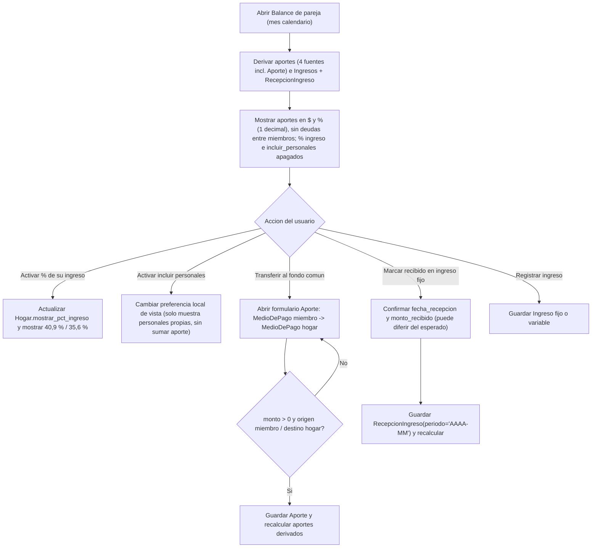

# Flujo: Balance de pareja

Mostrar de forma transparente cuánto aportó cada `Miembro` al hogar durante el **mes calendario** (`1` al último día del mes, fecha civil `America/Bogota`) junto con sus `Ingreso` fijos y variables, bajo el principio estricto de **aporte libre**: la app informa con totales **DERIVADOS**, nunca guarda resúmenes y nunca calcula ni insinúa que un miembro le debe dinero a otro.

## Objetivo

- Dar visibilidad clara del aporte real de cada persona al hogar (`$` enteros COP y `%` del total del hogar con **un decimal**, ej. `58,0 %`), incluyendo las **transferencias al fondo común (`Aporte`)**.
- Mantener la vista **`% de su ingreso` APAGADA por defecto** (`Hogar.mostrar_pct_ingreso = false`) con un interruptor para activarla cuando el hogar lo desee.
- Excluir las compras personales (`Compra.ambito = 'personal'`) del balance del hogar por defecto, con interruptor local `incluir_personales` apagado.
- Permitir confirmar ingresos fijos con **`Marcar recibido`** (`RecepcionIngreso`), aceptando un `monto_recibido` distinto al monto base cuando corresponda, y manteniendo visibles los ingresos de ambos miembros.
- Eliminar fricción emocional: **nunca** mostrar textos como *"X le debe a Y"*, *"diferencia para empatar 50/50"* ni saldos entre miembros.

## Pantallas

| Pantalla | Propósito | Mockup |
| --- | --- | --- |
| **Balance de pareja** | Resumen por **mes calendario** de aporte libre (pesos y `%` con 1 decimal), interruptores `Mostrar % de su ingreso` (apagado por defecto) e `Incluir personales` (apagado por defecto), acción `Transferir al fondo común`, desglose de ingresos fijos (con `Marcar recibido`) vs variables y acceso a Ajustes/exportación. | [balance-de-pareja.html](../../design/mockups/balance-de-pareja.html) |
| **Transferir al fondo común** | Registrar una entidad `Aporte` desde un `MedioDePago` de un `Miembro` hacia un `MedioDePago` del `Hogar` (cuenta común o caja común), sin contarla como consumo. | [transferir-fondo-comun.html](../../design/mockups/transferir-fondo-comun.html) |
| **Registrar ingreso** | Alta de `Ingreso` fijo (`dia_esperado`, `vigente_desde`) o variable (`fecha`) para un miembro del hogar. | [registrar-ingreso.html](../../design/mockups/registrar-ingreso.html) |
| **Ajustes y exportación** | Estado de la exportación automática semanal (JSON + CSV en Storage), descarga manual, botón `Exportar ahora` y estado de la copia local en IndexedDB. | [ajustes-exportar.html](../../design/mockups/ajustes-exportar.html) |

## Flujo paso a paso

### 1. Consultar el balance del mes calendario

1. El usuario toca **Balance** en la barra de navegación inferior.
2. En la cabecera selecciona o confirma el **mes calendario** activo (`Noviembre 2026 · 1–30 nov`, navegación `< Mes anterior` / `Mes siguiente >`).
3. El bloque **Aportes del mes al hogar** (todo **DERIVADO** en el dispositivo, nunca guardado) suma exactamente las 4 fuentes de aporte por miembro `M`:
   - `Compra` de contado con `ambito = 'hogar'` desde `MedioDePago` de `M` (excluye compras personales y compras con `financiada_por_pasivo_id`).
   - `PagoDeDeuda` desde `MedioDePago` de `M`.
   - `CostoFinanciero` pagado directo desde `MedioDePago` de `M`.
   - **`Aporte`** (transferencias desde `MedioDePago` de `M` hacia `MedioDePago` del `Hogar`, ej. cuenta común).
   - *(Nota: lo que sale luego desde un `MedioDePago` del hogar son "salidas del fondo común", informativas, y no vuelven a sumarse como aporte de nadie).*
4. Muestra el resumen con **porcentajes a un decimal**:
   - **Total aportado en el mes:** `$3.600.000`.
   - **Santiago:** `$2.088.000` · **`58,0 %`** del total (incluye arriendo `$1.800.000`, cuota Mastercard Camila `$234.500` y transferencia al fondo común `$53.500`).
   - **Camila:** `$1.512.000` · **`42,0 %`** del total (incluye transferencia al fondo común `$500.000`, servicios EPM `$285.000`, compras de mascotas `$245.000` y compras diarias del hogar `$482.000`).
   - Nota permanente de **Aporte libre**: *"Cada quien aporta lo que quiere o puede. Nunca se generan saldos ni deudas entre ustedes."*
5. **Controles de vista (ambos APAGADOS por defecto):**
   - **Interruptor `Mostrar % de su ingreso` (`Hogar.mostrar_pct_ingreso`, default `false`):** apagado por defecto para evitar comparaciones innecesarias. Al encenderlo muestra `40,9 %` de sus ingresos para Santiago (`$2.088.000 / $5.100.000`) y `35,6 %` para Camila (`$1.512.000 / $4.250.000`).
   - **Interruptor `Incluir mis gastos personales` (`incluir_personales`, preferencia local, default `false`):** apagado por defecto; los gastos con `Compra.ambito = 'personal'` quedan excluidos del balance del hogar y nunca cuentan como aporte.
6. **Bloque `Ingresos del mes` (visible para ambos miembros):**
   - Muestra todos los `Ingreso` fijos y variables de ambos miembros del hogar (`$9.350.000`: fijos `$8.300.000 · 88,8 %`, variables `$1.050.000 · 11,2 %`).
   - Para cada `Ingreso` fijo del periodo `'AAAA-MM'`, consulta `RecepcionIngreso`:
     - Si `recibido = true`: muestra `✓ Recibido` y usa **`monto_recibido`** (si difiere del monto base pactado, muestra ambos con claridad: ej. *pactado `$3.750.000`, recibido `$3.800.000`*).
     - Si aún no se recibe (ej. `Salario Santiago · día 30` estando a 22 nov): muestra `◷ Esperado día 30` y la acción inline **`Marcar recibido`**, donde el usuario confirma `fecha_recepcion` y puede editar `monto_recibido` si llegó un valor distinto ese mes.

### 2. Transferir al fondo común (`Aporte`)

1. Desde **Balance de pareja**, el usuario toca **`Transferir al fondo común`**.
2. Se abre [transferir-fondo-comun.html](../../design/mockups/transferir-fondo-comun.html):
   - Selecciona **`MedioDePago` de origen** (solo medios con `owner_tipo = 'miembro'`, ej. `Nequi · Camila`).
   - Selecciona **`MedioDePago` de destino** (solo medios con `owner_tipo = 'hogar'`, ej. `Cuenta común del hogar`).
   - Ingresa `monto` en COP enteros (ej. `$500.000`), `fecha` civil (`2026-11-22`) y `nota` opcional.
3. Toca **`Registrar transferencia ($500.000)`**.
4. La app crea un registro **`Aporte`** (el aportante se deriva del dueño de `medio_origen_id`, nunca de quién digitó): suma al aporte de ese miembro en *Balance de pareja* y **no** suma al consumo ni a pagos de deuda.

### 3. Registrar un ingreso (`Ingreso`)

1. Desde **Balance de pareja**, el usuario toca **`+ Ingreso`** / **`+ Registrar ingreso`**.
2. Selecciona `miembro_id` (`Santiago` o `Camila`) y `tipo`:
   - **`fijo`:** habilita `dia_esperado` (`1..31`), `vigente_desde` y opción de crear inmediatamente `RecepcionIngreso` del mes actual si ya llegó (incluso con `monto_recibido` distinto).
   - **`variable`:** habilita `fecha` (`Hoy` por defecto) y no exige recurrencia.
3. Ingresa `descripcion` y `monto` entero en COP y toca **`Guardar ingreso`**.

### 4. Exportación automática y respaldo (Ajustes)

1. Desde **Ajustes y exportación** ([ajustes-exportar.html](../../design/mockups/ajustes-exportar.html)), el usuario ve la **última exportación automática semanal** (función programada que genera JSON + CSV del hogar en Storage de Supabase), los botones **`Descargar JSON`** y **`Descargar CSV`**, el botón **`Exportar ahora`** y el estado de la **copia local completa en IndexedDB** del dispositivo.

## Casos borde y manejo de errores

| Caso borde / error | Comportamiento esperado |
| --- | --- |
| **Ingreso fijo recibido por un monto distinto al esperado** | `RecepcionIngreso` guarda el `monto_recibido` real del periodo `'AAAA-MM'` sin alterar el `Ingreso.monto` base de los demás meses. El balance usa `monto_recibido`. |
| **Ingreso fijo aún no recibido en el mes** | Si no existe `RecepcionIngreso` con `recibido = true`, se muestra como `◷ Esperado día N` con botón `Marcar recibido`. |
| **Un miembro aún no tiene ingresos registrados en el mes** | Sus aportes en `$` y `%` del hogar se muestran normal (`58,0 %`). Si `Hogar.mostrar_pct_ingreso` está activo, muestra `"Sin ingresos registrados este mes"` en lugar de dividir por cero. |
| **Un miembro aportó `$0` en el mes** | Muestra `$0 (0,0 % del total)` en tono neutro, sin alertas rojas ni sugerencia de compensación. |
| **Intento de crear `Aporte` entre dos medios de miembros** | Rechazado por la invariante I17: `medio_origen_id` debe tener `owner_tipo = 'miembro'` y `medio_destino_id` debe tener `owner_tipo = 'hogar'` (las transferencias entre miembros no crean deuda ni aporte). |
| **Compra financiada con préstamo en efectivo (`financiada_por_pasivo_id`)** | No aparece como aporte al comprarse; el aporte del miembro aparece en el mes en que registre el `PagoDeDeuda` del préstamo. |
| **Compra personal (`ambito = 'personal'`)** | Nunca suma al aporte del hogar; excluida de la vista por defecto salvo el interruptor local `incluir_personales` (solo muestra las del propio miembro). |
| **Cambio de salario a mitad de vigencia** | Se cierra `Ingreso.vigente_hasta` del anterior y se crea un nuevo `Ingreso` con `vigente_desde`, conservando la historia de meses pasados. |
| **Día esperado 31 en mes de 28/30 días** | Se ajusta automáticamente al último día del mes calendario (`30` en noviembre, `28/29` en febrero). |

## Diagrama de flujo

## Datos del dominio que toca

Nombres canónicos alineados con `docs/data-model.md` y [docs/decisiones-2026-11-22.md](../decisiones-2026-11-22.md).

| Entidad / Concepto | Tipo | Operación | Campos principales | Regla aplicada |
| --- | --- | --- | --- | --- |
| **`Hogar`** | Hecho (tabla replicada) | Lectura / Escritura | `id`, `nombre`, `moneda` (`'COP'`), `zona_horaria` (`'America/Bogota'`), `mostrar_pct_ingreso` (`boolean`, default `false`) | Controla si el hogar muestra la vista `% de su ingreso` (apagada por defecto). |
| **`Miembro`** | Hecho (tabla replicada) | Lectura | `id`, `hogar_id`, `nombre`, `rol`, `activo` | Cada miembro ve los ingresos del otro. Nunca se modela deuda entre miembros. |
| **`Ingreso`** | Hecho (tabla replicada) | Lectura / Escritura | `id`, `miembro_id`, `tipo` (`'fijo' \| 'variable'`), `descripcion`, `monto`, `dia_esperado`, `vigente_desde`, `vigente_hasta`, `fecha` | Fijos guardan día esperado y vigencia; variables se registran con `fecha` al llegar. Todo en COP enteros. |
| **`RecepcionIngreso`** | Hecho (tabla replicada) | Lectura / Escritura | `id`, `ingreso_id`, `periodo` (`'AAAA-MM'`), `recibido` (`boolean`), `monto_recibido` (`bigint` nullable), `fecha_recepcion` (`date` nullable) | Registra si un ingreso fijo del periodo llegó y por qué monto real. El balance usa `monto_recibido` si existe; si no, lo muestra como `esperado`. |
| **`Aporte`** | Hecho (tabla replicada) | Lectura / Escritura | `id`, `medio_origen_id` (`owner_tipo = 'miembro'`), `medio_destino_id` (`owner_tipo = 'hogar'`), `monto`, `fecha`, `nota`, `registrado_por` | Transferencia de un miembro al fondo común del hogar. Una de las 4 fuentes del aporte derivado; no es consumo. |
| **`Compra` / `PagoDeDeuda` / `CostoFinanciero` / `MedioDePago`** | Hecho (tablas replicadas) | Lectura | `Compra` (`ambito`, `monto_total`, `pago_tipo`, `medio_de_pago_id`, `financiada_por_pasivo_id`, `fecha`); `PagoDeDeuda` (`monto`, `medio_de_pago_id`, `fecha`); `CostoFinanciero` (`monto`, `medio_de_pago_id`, `fecha_causacion`) | Fuentes auditables del cálculo derivado de aportes por mes calendario. Lo personal (`ambito = 'personal'`) nunca suma como aporte. |
| **Resumen de aportes, porcentajes (`58,0 %`, `40,9 %`), totales de ingresos** | **DERIVADO (nunca guardado)** | Solo lectura calculada | `aportes(M, mes)`, `pct_hogar(M)`, `pct_ingreso(M)`, `ingreso(M, mes)` | Siempre calculados en el dispositivo. **Prohibido** persistir resúmenes o calcular saldos/deudas entre miembros. `incluir_personales` es preferencia LOCAL de vista (apagada por defecto). |
