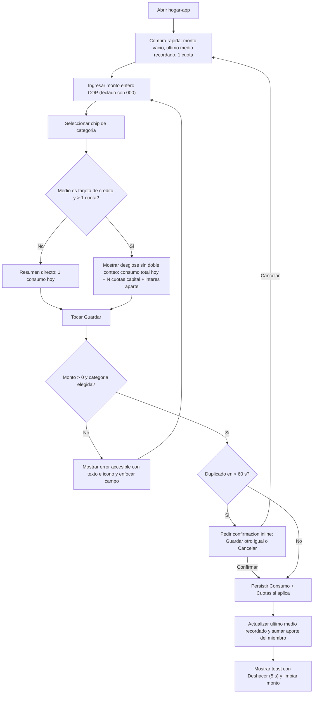

# Flujo: Compra rápida

Registrar un gasto del hogar en COP en la menor cantidad de toques posible desde el instante en que se abre la app, evitando formularios largos y garantizando que una compra a cuotas nunca se cuente dos veces.

## Objetivo

- **Meta principal:** registrar `"mercado $85.000 con mi tarjeta Visa"` en **3 acciones (<= 3 toques de control)** desde abrir la PWA.
- **Regla financiera crítica:** una compra a cuotas registra el **consumo una sola vez** por el total el día de la compra; sus cuotas futuras pasan a *Obligaciones del mes* como **pagos de deuda** y los intereses como **costo financiero** aparte (ver [docs/domain.md](../domain.md)).

## Pantallas

| Pantalla | Propósito | Mockup |
| --- | --- | --- |
| **Compra rápida (inicio)** | Pantalla por defecto al abrir la app. Teclado numérico COP visible, chips de categorías frecuentes, último medio de pago recordado y botón de guardado fijo. | [compra-rapida.html](../../design/mockups/compra-rapida.html) |
| **Compra rápida a cuotas** | Variante inline cuando el usuario elige `> 1 cuota` con tarjeta de crédito. Muestra el desglose inmediato sin doble conteo (consumo hoy, cuotas de capital e intereses aparte). | [compra-cuotas.html](../../design/mockups/compra-cuotas.html) |

## Conteo de toques

### Escenario objetivo: "mercado $85.000 con mi tarjeta Visa"

La app abre directamente en **Compra rápida** (`0` toques para entrar), con el **teclado numérico COP ya visible** (`0` toques para enfocar), el **miembro activo** preseleccionado (`Santiago`), la fecha en **Hoy**, **1 cuota** por defecto y el **último medio de pago recordado** (`Visa ••4521 · Santiago`).

| # | Acción del usuario | Interacción en pantalla | Toques de decisión | Pulsaciones físicas |
| --- | --- | --- | --- | --- |
| 0 | Abrir la PWA | Abre directo en Compra rápida con `Visa ••4521` recordada | 0 | 0 |
| 1 | Ingresar monto `$85.000` | Teclado numérico grande con tecla rápida `000` (`8` → `5` → `000`) o chip de monto frecuente | 1 (monto) | 3 con tecla `000` (o 1 si usa chip frecuente) |
| 2 | Elegir categoría `Mercado` | Tocar chip `Mercado` en la fila de categorías más usadas | 1 | 1 |
| 3 | Guardar gasto | Tocar botón primario `Guardar $85.000` | 1 | 1 |
| **Total** | **Gasto registrado** | Toast de confirmación con botón `Deshacer` (5 s) | **3 acciones (2 toques de control + monto)** | **5 pulsaciones (o 3 con chip frecuente)** |

> **Por qué la tecla `000` importa en COP:** en Colombia la gran mayoría de montos cotidianos son múltiplos de mil (`$85.000`, `$12.000`, `$300.000`). Incluir `000` junto al `0` ahorra 2 toques por compra respecto a un teclado numérico genérico.

### Escenario a cuotas: "mercado $300.000 a 3 cuotas con mi tarjeta Visa"

Solo suma **+1 toque** respecto al flujo base:

| # | Acción | Toques de decisión |
| --- | --- | --- |
| 1 | Ingresar `$300.000` (`3` → `0` → `0` → `000`) | 1 (monto) |
| 2 | Tocar chip `Mercado` | 1 |
| 3 | Tocar chip `3 cuotas` en la barra de cuotas inline | 1 |
| 4 | Revisar el aviso inline sin doble conteo y tocar `Guardar $300.000` | 1 |
| **Total** | **Consumo + 3 obligaciones de deuda creadas** | **4 acciones** |

## Flujo paso a paso

### Camino principal (compra de contado o a 1 cuota)

1. El usuario abre `hogar-app`. La pantalla inicial es **Compra rápida**.
2. La pantalla precarga en silencio:
   - **Quién paga:** miembro autenticado en el dispositivo (ej. `Santiago`).
   - **Medio de pago:** último medio usado por ese miembro (ej. `Visa ••4521 · Santiago`).
   - **Cuotas:** `1 cuota` (oculto si el medio seleccionado es efectivo o débito).
   - **Fecha:** `Hoy`.
3. El usuario ingresa el monto en pesos enteros COP usando el teclado numérico grande (sin decimales ni centavos). El visor formatea en tiempo real como `$85.000`.
4. El usuario toca un chip de **categoría** de la grilla de las 6 más usadas (ej. `Mercado`, `Mascotas`, `Transporte`, `Comida fuera`, `Servicios`, `Hogar`) o toca `Más` para ver el catálogo completo.
5. *(Opcional, 0 toques si no cambia)* El usuario puede tocar la píldora de medio de pago para cambiar de tarjeta/cuenta, tocar `Nota` para agregar descripción (ej. `"Éxito"`), o tocar la fecha si es un gasto de ayer.
6. El usuario toca **`Guardar $85.000`**.
7. La app guarda el registro en modo **consumo**, actualiza el último medio de pago recordado, limpia el monto para una posible segunda compra y muestra un aviso no bloqueante (`"Guardado: Mercado $85.000 · Visa ••4521"`) con acción **`Deshacer`** durante 5 segundos.

### Variante: compra a cuotas con tarjeta de crédito

1. Con un monto ingresado (ej. `$300.000`) y una tarjeta de crédito seleccionada (`Visa ••4521`), el usuario toca `3 cuotas` (u otra cantidad: `2`, `3`, `6`, `12` o `Otro`).
2. La app muestra en línea, sin abrir un modal bloqueante, el resumen de separación contable:
   - **Consumo hoy:** `$300.000` en `Mercado` (una sola vez).
   - **Obligaciones del mes:** `3 cuotas de $100.000` (capital = pago de deuda, **no** suma al consumo).
   - **Costo financiero estimado:** si la tarjeta tiene tasa (ej. `28,32% E.A. / 2,10% M.V.`), muestra el interés estimado de la primera cuota (`$6.300`) como referencia; si no tiene tasa, indica `"Sin tasa: registrarás intereses a mano"`.
3. Al tocar **`Guardar $300.000`**, se crea **1 consumo** de `$300.000` hoy y **3 cuotas programadas** de `$100.000` en *Obligaciones del mes*.

### Variante: entrada desde Despensa de mascotas ("Recomprar")

1. Desde *Despensa de mascotas*, el usuario toca `Recomprar $165.000` en un insumo (ej. `Concentrado adulto 12 kg`).
2. Se abre **Compra rápida** con el monto (`$165.000`), la categoría (`Mascotas`) y la nota (`Concentrado adulto 12 kg · Luna`) prellenados.
3. El usuario confirma con **1 toque** (`Guardar $165.000`), lo que además marca el insumo como repuesto en la despensa.

## Casos borde y manejo de errores

| Caso borde / error | Comportamiento esperado |
| --- | --- |
| **Monto vacío o `$0`** | El botón `Guardar` permanece deshabilitado visual y semánticamente (`aria-disabled="true"`). Si el usuario intenta enviarlo, el anuncio en región viva (`aria-live="polite"`) indica: `"Ingresa un monto mayor a $0"`. |
| **Sin categoría seleccionada** | Al tocar `Guardar`, se resalta la sección de categorías con mensaje textual e icono (`"Elige una categoría para guardar"`) y se mueve el foco al primer chip. |
| **Intento de poner cuotas en efectivo o débito** | Los chips de cuotas solo aparecen cuando el medio de pago seleccionado es una tarjeta de crédito. Si el usuario cambia de tarjeta a débito/efectivo después de elegir `3 cuotas`, las cuotas vuelven a `1` con aviso breve: `"Débito no maneja cuotas; cambiado a 1 pago"`. |
| **División no exacta en cuotas (ej. `$100.000` en 3 cuotas)** | Todos los montos son enteros COP sin centavos. Se distribuyen los pesos residuales en la primera cuota (`$33.334`, `$33.333`, `$33.333`) para que la suma de capital sea exactamente igual al total (`$100.000`). |
| **Tarjeta sin tasa E.A./M.V. configurada** | La app **no** inventa ni calcula intereses. Muestra solo las cuotas de capital y aclara: `"Intereses: se registran manualmente en Obligaciones como costo financiero"`. |
| **Error de dedo / registro duplicado** | Toast con botón `Deshacer` visible 5 segundos tras guardar. Además, si en menos de 60 segundos se intenta guardar el mismo monto, categoría y medio de pago, muestra confirmación inline: `"Ya registraste Mercado $85.000 hace un momento. ¿Guardar otro igual?"`. |
| **Sin conexión (PWA offline)** | El gasto se guarda localmente en cola offline y se confirma al usuario con etiqueta `"Guardado en el dispositivo · se sincronizará al volver la conexión"` (icono + texto). |
| **Miembro sin medios de pago registrados** | `Efectivo` existe siempre como medio base disponible desde el primer día; debajo aparece el enlace directo `+ Agregar tarjeta o cuenta`. |

## Diagrama de flujo

## Datos del dominio que toca

| Entidad / Concepto (`docs/domain.md`) | Operación | Campos principales | Regla aplicada |
| --- | --- | --- | --- |
| **Consumo (`expense`)** | Escritura | `id`, `amount_cop` (entero > 0), `category_id`, `paid_by_member_id`, `payment_method_id`, `date`, `note`, `installments_count` | Se registra **una sola vez** por el valor total en la fecha de compra. |
| **Obligación / Cuota (`debt_installment`)** | Escritura (solo si `installments_count > 1`) | `expense_id`, `debt_id`, `installment_number`, `total_installments`, `principal_cop`, `due_date`, `status` | Cada cuota representa **pago de deuda** (capital), nunca consumo nuevo. Suma exacta en COP enteros. |
| **Medio de pago (`payment_method`)** | Lectura / actualización de preferencia | `id`, `name`, `type` (`credit_card`, `debit`, `cash`), `owner` (`miembro` en fase 1, extensible a `hogar`), `rate_ea`, `rate_mv`, `is_last_used` | Recuerda el último medio usado por miembro. Tasas E.A./M.V. son opcionales. |
| **Miembro (`member`)** | Lectura | `id`, `name` | Quien registra el pago suma a su aporte del mes en *Balance de pareja* sin crear deuda con otros miembros. |
| **Insumo mascota (`pet_supply`)** | Escritura opcional (si viene de *Recomprar*) | `id`, `last_price_cop`, `last_restocked_at` | Actualiza fecha de reposición y último precio pagado. |
