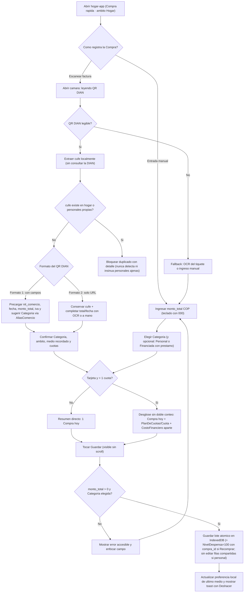

# Flujo: Compra rápida

Registrar una `Compra` del hogar (o personal) en COP enteros en la menor cantidad de toques posible desde el instante en que se abre la app, evitando formularios largos y garantizando que una compra financiada o a cuotas nunca se cuente dos veces.

## Objetivo

- **Meta principal (manual):** registrar `"mercado $85.000 con mi tarjeta Visa"` en **3 acciones (<= 3 toques de control)** desde abrir la PWA, con `Compra.ambito = 'hogar'` preseleccionado (`0` toques extra).
- **Meta con factura electrónica (QR DIAN):** abrir, escanear, confirmar categoría (sugerida por `AliasComercio`) y guardar en **<= 3 toques**, precargando `nit_comercio`, `fecha`, `monto_total`, `iva` informativo y `cufe` **sin depender nunca de consultar la DIAN** (ver [docs/dian-qr.md](../dian-qr.md)).
- **Regla financiera crítica:** una `Compra` registra el **consumo una sola vez** por `monto_total` en `fecha`, sea de contado o financiada; sus cuotas futuras viven en `PlanDeCuotas` y `Cuota` (en *Obligaciones del mes* como **pagos de deuda** cuando se paguen) y los intereses en `CostoFinanciero` como **balde aparte**, nunca como categoría de consumo (ver [docs/domain.md](../domain.md)).

## Pantallas

| Pantalla | Propósito | Mockup |
| --- | --- | --- |
| **Compra rápida (inicio)** | Pantalla por defecto al abrir la app. Selector `Hogar \| Personal` (default `Hogar`), teclado numérico COP visible, chips de categorías frecuentes, último medio recordado (preferencia local), chips de cuotas `1 / 3 / 6 / 12 / Otro`, opción `Financiada con préstamo`, acceso directo `Escanear` y CTA `Guardar` visible sin scroll. | [compra-rapida.html](../../design/mockups/compra-rapida.html) |
| **Compra rápida a cuotas** | Variante inline cuando el usuario elige `> 1 cuota` con una `Tarjeta`. Muestra el desglose inmediato sin doble conteo (`Compra` hoy, `PlanDeCuotas`/`Cuota` en fechas reales de corte/pago y `CostoFinanciero` con interés exacto E.A.→M.V.). | [compra-cuotas.html](../../design/mockups/compra-cuotas.html) |
| **Escanear factura (QR DIAN)** | Visor de cámara para QR DIAN en sus dos formatos (con campos o solo URL), confirmación precargada con sugerencia por `AliasComercio`, fallback OCR/manual, enlace opcional `Verificar en la DIAN` y bloqueo de duplicados por `Compra.cufe`. | [escanear-factura.html](../../design/mockups/escanear-factura.html) |

## Conteo de toques

### Escenario objetivo: "mercado $85.000 con mi tarjeta Visa"

La app abre directamente en **Compra rápida** (`0` toques para entrar), con el **ámbito `Hogar`** activo por defecto (`0` toques), el **teclado numérico COP visible** (`0` toques para enfocar), el **miembro activo** (`registrado_por`), `fecha = Hoy`, **1 cuota** por defecto y el **último medio recordado en el dispositivo** (`Visa ••4521 · Santiago`).

| # | Acción del usuario | Interacción en pantalla | Toques de decisión | Pulsaciones físicas |
| --- | --- | --- | --- | --- |
| 0 | Abrir la PWA | Abre directo en Compra rápida (`Hogar`, `Visa ••4521` recordada en el dispositivo) | 0 | 0 |
| 1 | Ingresar monto `$85.000` | Teclado numérico grande con tecla rápida `000` (`8` → `5` → `000`) | 1 (monto) | 3 con tecla `000` |
| 2 | Elegir categoría `Mercado` | Tocar chip `Mercado` en la fila de categorías frecuentes | 1 | 1 |
| 3 | Guardar gasto | Tocar CTA fijo `Guardar $85.000` (visible sin scroll a 390×844) | 1 | 1 |
| **Total** | **`Compra` registrada** | Toast de confirmación con botón `Deshacer` (5 s) | **3 acciones (2 toques de control + monto)** | **5 pulsaciones** |

> **Por qué la tecla `000` importa en COP:** en Colombia la gran mayoría de montos cotidianos son múltiplos de mil (`$85.000`, `$12.000`, `$300.000`). Incluir `000` junto al `0` ahorra 2 toques por compra respecto a un teclado numérico genérico.

### Escenario a cuotas: "mercado $300.000 a 3 cuotas con mi tarjeta Visa"

Solo suma **+1 toque** respecto al flujo base:

| # | Acción | Toques de decisión |
| --- | --- | --- |
| 1 | Ingresar `$300.000` (`3` → `0` → `0` → `000`) | 1 (monto) |
| 2 | Tocar chip `Mercado` | 1 |
| 3 | Tocar chip `3` en la fila de cuotas (`1 / 3 / 6 / 12 / Otro`) | 1 |
| 4 | Revisar el desglose sin doble conteo y tocar `Guardar $300.000 en 3 cuotas` | 1 |
| **Total** | **`Compra` + `PlanDeCuotas` + 3 `Cuota` creadas** | **4 acciones** |

### Escenario con factura electrónica (QR DIAN con campos)

Meta: **abrir → escanear → confirmar categoría → guardar** (sin escribir dígitos y sin consultar el portal de la DIAN).

| # | Acción del usuario | Interacción en pantalla | Toques |
| --- | --- | --- | --- |
| 0 | Abrir la PWA | Abre directo en Compra rápida (`Hogar`, `Visa ••4521` recordada localmente) | 0 |
| 1 | Abrir escáner | Tocar botón `Escanear` en la cabecera | 1 |
| — | Apuntar al QR DIAN | Lectura local en cámara (0 toques): precarga `nit_comercio`, `fecha`, `monto_total`, `iva` informativo y `cufe`; consulta `AliasComercio` y verifica dedupe dentro de su alcance de visibilidad (`(hogar_id, cufe)` en hogar o `(hogar_id, miembro_id, cufe)` en personales propias) | 0 |
| 2 | Confirmar categoría | Tocar chip `Mercado` (o 0 toques si `AliasComercio.categoria_sugerida_id` ya sugirió `Mercado`) | 1 (0 si sugerida) |
| 3 | Guardar gasto | Tocar botón primario `Guardar $85.000` | 1 |
| **Total** | **`Compra` precargada desde factura registrada** | Toast con `Deshacer` (5 s) y `cufe` único por alcance (hogar o personal propio) | **3 toques (2 si `AliasComercio` sugiere categoría)** |

> **Si el QR solo trae URL (Formato 2):** el escáner extrae `cufe` de la URL y ofrece **OCR del tiquete** (`+1 toque`) o **completar a mano** `monto_total`, `nit_comercio` y `fecha`. Nunca intenta consultar la DIAN en segundo plano.

## Flujo paso a paso

### Camino principal (compra del hogar de contado o a 1 cuota)

1. El usuario abre `hogar-app`. La pantalla inicial es **Compra rápida**.
2. La pantalla precarga en silencio:
   - **Ámbito (`Compra.ambito`):** `Hogar` por defecto (`0` toques extra). Puede cambiarse en 1 toque a `Personal`.
   - **Quién registra (`Compra.registrado_por`):** miembro autenticado en el dispositivo (ej. `Santiago`).
   - **Medio / pasivo:** último medio o tarjeta usado por ese miembro (**preferencia local del dispositivo**, no sincronizada; ej. `Visa ••4521 · Santiago`).
   - **Cuotas:** chip `1` activo en la barra `1 / 3 / 6 / 12 / Otro` (solo visible cuando el medio seleccionado es una `Tarjeta`).
   - **Fecha (`Compra.fecha`):** fecha civil de hoy en `America/Bogota`.
3. El usuario ingresa `monto_total` en pesos enteros COP usando el teclado numérico grande (sin decimales ni centavos). El visor formatea en tiempo real como `$85.000`.
4. El usuario toca un chip de `Categoria` de la grilla de frecuentes (`Mercado`, `Mascotas`, `Transporte`, `Arriendo`, `Servicios`, `Hogar`) o despliega el catálogo completo (categorías sembradas: Mercado, Servicios, Arriendo, Transporte, Salud, Mascotas, Hogar y electrodomésticos, Entretenimiento, Otros).
5. *(Opcional, 0 toques si no cambia)* El usuario puede cambiar a `Personal`, cambiar de `MedioDePago` / `Pasivo`, marcar **`Financiada con préstamo`**, agregar `descripcion` o cambiar `fecha`.
6. El usuario toca **`Guardar $85.000`** en la barra fija inferior (siempre visible sin scroll a 390×844).
7. La app guarda la `Compra` (y `PlanDeCuotas` + `Cuota` si aplica), actualiza la preferencia local de último medio usado en el dispositivo, limpia el monto y muestra un aviso no bloqueante (`"Guardado: Mercado $85.000 · Visa ••4521"`) con acción **`Deshacer`** durante 5 segundos.

### Variante: compra personal (`Compra.ambito = 'personal'`)

1. El usuario cambia el selector superior de `Hogar` a **`Personal`** (`+1 toque`).
2. La pantalla muestra una etiqueta clara (`Solo visible para Santiago · Excluida del balance del hogar`) y guarda `Compra.ambito = 'personal'` con `Compra.miembro_id = miembro_activo`.
3. Reglas de visibilidad, privacidad y balance:
   - Una compra personal solo la ve su `miembro_id` dueño.
   - Los reportes y el *Balance de pareja* del hogar la excluyen por defecto, salvo que el propio miembro active el interruptor local `incluir_personales` (apagado por defecto, que solo muestra **sus propias** compras personales).
   - **Nunca cuenta como aporte al hogar**, incluso si se pagó con un `MedioDePago` del miembro.
   - **Deduplicación de CUFE por alcance de visibilidad:** existen dos índices únicos parciales entre no eliminadas —`(hogar_id, cufe)` para compras del hogar y `(hogar_id, miembro_id, cufe)` para compras personales—. El escaneo solo detecta duplicados entre compras del hogar y compras personales del mismo dueño; una compra personal ajena **no se detecta ni se insinúa** (ni siquiera con un aviso de «ya está registrada»).
   - **Sin escritura en filas compartidas:** guardar una compra con `ambito = 'personal'` **nunca** crea ni actualiza filas compartidas del hogar —ni `AliasComercio` ni `ItemDespensa.monto_habitual`—, y tampoco liquida una `Obligacion` compartida.
   - **Exportación separada por alcance:** en *Ajustes*, cada miembro tiene dos descargas separadas: **«Hogar (compartido)»** (sin ninguna fila personal) y **«Mis personales»** (solo las propias, nunca las del otro miembro).

### Variante: compra financiada con préstamo en efectivo (`Compra.financiada_por_pasivo_id`)

1. El capital del préstamo en efectivo ya se registró una única vez en un `Pasivo` tipo `Credito` o `Deuda` (en fase 1 nunca `Tarjeta`) mediante un **`PlanDeCuotas` con `origen = 'desembolso'`** y su fecha de giro `fecha_inicio`. Un pasivo que solo tiene `PlanDeCuotas(origen = 'saldo_inicial')` corresponde a deuda previa y **no** sirve para vincular compras nuevas.
2. En el selector de medio de pago, el usuario elige **`Financiada con préstamo`** y selecciona ese `Pasivo` con desembolso disponible (`Compra.fecha >= fecha_inicio` del desembolso y suma acumulada de compras vinculadas `<=` capital desembolsado a esa fecha; todas las compras vinculadas a un mismo pasivo deben compartir un único `ambito`).
3. La app muestra un aviso breve: *"Esta compra registra el consumo hoy usando el capital del desembolso, sin crear otro plan de cuotas ni sumar aporte todavía; el aporte aparecerá completo cuando se registre cada `PagoDeDeuda(tipo = 'abono')` sobre un pasivo con `ambito = 'hogar'` (en un pasivo personal aporta `$0`)."*
4. Al guardar, persiste la `Compra` con `pago_tipo = 'contado'`, `medio_de_pago_id = null` y `financiada_por_pasivo_id = pasivo.id`, **sin crear un segundo `PlanDeCuotas`**, sin aumentar el saldo del pasivo y sin sumar al aporte del mes.

### Variante: compra a cuotas con tarjeta de crédito

1. *(Ejemplo de simulación en el mockup [compra-cuotas.html](../../design/mockups/compra-cuotas.html), borrador aún sin guardar, distinto de la compra ya guardada del `10 nov` que aparece en Obligaciones del mes).* Con un monto ingresado (ej. `$300.000` el **22 nov 2026**) y una `Tarjeta` seleccionada (`Visa ••4521`, corte día `15`, pago día `25`), el usuario toca `3` en los chips **`1 / 3 / 6 / 12 / Otro`** (si toca `Otro`, aparece un campo numérico entero para ingresar cualquier número de cuotas `>= 2`).
2. La app muestra en línea, sin abrir un modal bloqueante, el resumen de separación contable:
   - **Consumo hoy (`Compra`):** `$300.000` en `Mercado` (una sola vez).
   - **Obligaciones (`PlanDeCuotas` + `Cuota`):** `3 cuotas` de `$100.000` con fechas calculadas según `dia_corte = 15` y `dia_pago = 25` (compra simulada 22 nov → corte 15 dic → primera cuota **25 dic 2026**, segunda **25 ene 2027**, tercera **25 feb 2027**).
   - **Costo financiero estimado (`CostoFinanciero`):** si la tarjeta tiene tasa (ej. `28,32 % E.A.`, convertida exactamente a `i = (1 + 0,2832)^(1/12) − 1 ≈ 2,0997 % M.V.`, redondeando solo el interés final al peso), muestra los intereses estimados **`$6.299`** (cuota 1), **`$4.199`** (cuota 2) y **`$2.100`** (cuota 3) en el balde aparte *Costo financiero*. Si la tarjeta está en `Sin tasa`, indica `"Sin tasa: registrarás intereses a mano"`.
3. Al tocar **`Guardar $300.000 en 3 cuotas`**, se crean en un solo lote atómico `1 Compra` (`pago_tipo = 'financiado'`), `1 PlanDeCuotas` (`origen = 'compra'`, `capital = 300000`, `n_cuotas = 3`), `3 Cuota` (`25 dic`, `25 ene`, `25 feb`) y los `CostoFinanciero` calculados (`origen = 'calculado'`) si la tarjeta tiene tasa.

### Variante: escanear factura electrónica (QR DIAN, OCR y manual)

Basado en el Anexo Técnico FEV 1.9 (num. 11.7) documentado en [docs/dian-qr.md](../dian-qr.md). **La app nunca consulta el catálogo de la DIAN** (bloqueado por captcha y validación de NIT) ni requiere conexión a internet para leer el QR.

1. Desde **Compra rápida**, el usuario toca **`Escanear`**.
2. Se abre el visor de cámara en estado **Leyendo QR**, con acciones visibles de fallback (`Tomar foto (OCR)` e `Ingresar manual`).
3. Al detectar un código QR DIAN, la app extrae localmente el `cufe`:
   - **Deduplicación por alcance de visibilidad:** verifica unicidad de `cufe` entre compras no eliminadas únicamente dentro del alcance visible del actor: compras del hogar `(hogar_id, cufe)` y compras personales del mismo dueño `(hogar_id, miembro_id, cufe)`.
     - Si ya existe una compra del hogar (`ambito = 'hogar'`) o personal del mismo miembro (`miembro_id = miembro_activo`): bloquea el duplicado y muestra **"Esta factura ya está registrada"** junto con el detalle del registro existente.
     - Si existe una compra **personal de otro miembro** (`ambito = 'personal'` y `miembro_id != miembro_activo`): **no se detecta, no se bloquea ni se insinúa** su existencia (ni siquiera con un aviso de «ya está registrada»).
4. Si el `cufe` no existe en ese alcance, bifurca según el formato del QR:
   - **Formato 1 — QR con campos (`NumFac`, `FecFac`, `NitFac`, `ValIva`, `ValTolFac`, `CUFE`/`CUDE` + URL `catalogo-vpfe`):**
     - Precarga `nit_comercio` (sin guardar nunca `DocAdq`), `fecha`, `monto_total` en COP enteros (ej. `$85.000`), `iva` informativo (ej. `$13.571` para IVA 19 % incluido en `$85.000`, nunca sumado aparte) y `cufe`.
     - Consulta `AliasComercio` por `(hogar_id, nit_comercio)`: si existe (ej. `890900608 → Almacenes Éxito`), rellena el nombre y sugiere `categoria_sugerida_id` (`Mercado`). Si el comercio es nuevo y la compra es del hogar (`ambito = 'hogar'`), permite guardar el alias al confirmar; una compra personal puede leer `AliasComercio`, pero **nunca** lo crea ni lo actualiza.
     - El QR nunca trae líneas de producto (en Fase 2 entran desde el ZIP XML+PDF por correo).
     - El usuario confirma `Categoria`, `ambito` (`Hogar` por defecto), medio recordado y cuotas (`1 / 3 / 6 / 12 / Otro`), y toca **`Guardar`**.
   - **Formato 2 — QR solo con URL (`catalogo-vpfe` con `cufe` embebido):**
     - Conserva el `cufe` de la URL y ofrece **`Leer total y fecha con OCR del tiquete`** o edición manual en la misma pantalla.
5. En todos los estados con URL válida, ofrece el botón opcional **`Verificar en la DIAN (opcional) ↗`**, que abre el navegador externo sin bloquear el guardado.
6. Al tocar **`Guardar`**, persiste la `Compra` (`origen = 'qr'` u `'ocr'`, `cufe`, `nit_comercio`, `iva`) y, **solo si `ambito = 'hogar'`**, crea o actualiza `AliasComercio` cuando el usuario asoció nombre/categoría (si la compra es `personal`, no modifica ninguna fila compartida).

### Variante: entrada desde Despensa de mascotas ("Recomprar")

1. Desde *Despensa de mascotas*, el usuario toca `Recomprar $165.000` en un `ItemDespensa` (ej. `Concentrado adulto 12 kg`).
2. Se abre **Compra rápida** prellenada con `monto_total = $165.000`, `categoria_id = Mascotas`, `mascota_id = Luna`, `item_despensa_id`, `ambito = 'hogar'` y `descripcion = "Concentrado adulto 12 kg · Luna"`.
3. El usuario confirma con **1 toque** (`Guardar $165.000`). En el mismo lote atómico la app crea la `Compra` y un hecho `NivelDespensa(item_despensa_id, compra_id = Compra.id, fecha = Compra.fecha, nivel_pct = 100, origen = 'compra')`. Solo si `ambito = 'hogar'`, actualiza `ItemDespensa.monto_habitual` si cambió el precio (una compra con `ambito = 'personal'` **nunca** actualiza `ItemDespensa.monto_habitual` ni otras filas compartidas).

## Casos borde y manejo de errores

| Caso borde / error | Comportamiento esperado |
| --- | --- |
| **Monto vacío o `$0`** | El CTA `Guardar` permanece deshabilitado (`aria-disabled="true"`). Si se intenta enviar, el anuncio (`aria-live="polite"`) indica: `"Ingresa un monto mayor a $0"`. |
| **Sin categoría seleccionada** | Se resalta la sección de categorías con mensaje textual e icono (`"Elige una categoría para guardar"`) y el foco pasa al primer chip. |
| **Cuotas con `MedioDePago` de contado o préstamo en efectivo** | Los chips `1 / 3 / 6 / 12 / Otro` solo aparecen con una `Tarjeta`. Al cambiar a débito, efectivo o préstamo en efectivo, se ocultan con aviso breve. |
| **Chip `Otro` en cuotas** | Abre un campo numérico entero (`>= 2`, ej. `2`, `4`, `18`, `24`) y recalcula el desglose al instante sin doble conteo. |
| **División no exacta en cuotas (`capital_fijo`, ej. `$100.000` en 3)** | Pesos enteros sin centavos: los pesos residuales van a las primeras `r` cuotas (`$33.334`, `$33.333`, `$33.333`) para que `Σ Cuota.capital = PlanDeCuotas.capital`. |
| **Tarjeta sin tasa configurada (`tasa_tipo = null`)** | La app **no** inventa ni calcula `CostoFinanciero`. Muestra solo las cuotas de capital y aclara: `"Sin tasa: registrarás intereses a mano en Obligaciones"`. |
| **Error de dedo / registro duplicado manual** | Toast con `Deshacer` durante 5 s. Si en `< 60 s` se repite monto, categoría y medio, muestra confirmación inline antes de duplicar. |
| **Sin conexión (PWA offline)** | La `Compra` se guarda en la copia local de **IndexedDB** con UUIDv7 y cola de sincronización; se confirma con `"Guardado en el dispositivo · se sincronizará al volver la conexión"`. |
| **Factura ya registrada (`cufe` duplicado en tu alcance)** | Dos índices únicos parciales entre no eliminadas: `(hogar_id, cufe)` para compras del hogar y `(hogar_id, miembro_id, cufe)` para personales. Solo bloquea duplicados dentro de compras del hogar y personales del mismo dueño (muestra `▲ Esta factura ya está registrada` con su detalle). Una compra personal de otro miembro **no se detecta ni se insinúa** (ni siquiera «ya está registrada»). |
| **Total DIAN con centavos (`ValTolFac: 85000.40`)** | Se redondea al peso entero COP más cercano (`$85.000`), editable antes de guardar. |
| **QR dañado, sin cámara o no DIAN** | Aviso claro con salidas inmediatas a `Tomar foto (OCR)` o `Ingresar manual`. Nunca bloquea el registro. |

## Diagrama de flujo

## Datos del dominio que toca

Nombres canónicos alineados con `docs/data-model.md` y [docs/decisiones-2026-11-22.md](../decisiones-2026-11-22.md).

| Entidad / Concepto | Tipo | Operación | Campos principales | Regla aplicada |
| --- | --- | --- | --- | --- |
| **`Compra`** | Hecho (tabla replicada) | Escritura / Lectura (dedupe) | `id`, `hogar_id`, `fecha`, `descripcion`, `monto_total`, `categoria_id`, `ambito` (`'hogar' \| 'personal'`, default `'hogar'`), `miembro_id`, `pago_tipo` (`'contado' \| 'financiado'`), `medio_de_pago_id`, `financiada_por_pasivo_id`, `registrado_por`, `mascota_id`, `item_despensa_id`, `cufe`, `nit_comercio`, `iva`, `origen` | Se registra **una sola vez** por `monto_total` en `fecha`. Dos únicos parciales entre no eliminadas: `(hogar_id, cufe)` para compras del hogar y `(hogar_id, miembro_id, cufe)` para personales; una compra personal ajena nunca se detecta ni se insinúa. `ambito = 'personal'` solo la ve `miembro_id`, nunca suma aporte al hogar y nunca actualiza filas compartidas (`AliasComercio`, `ItemDespensa.monto_habitual`). Con `financiada_por_pasivo_id`, usa `pago_tipo = 'contado'`, `medio_de_pago_id = null`, apunta a un `Pasivo` (`Credito`/`Deuda`) con `PlanDeCuotas(origen = 'desembolso')` sin crear otro plan, y no suma aporte hasta pagar el préstamo. |
| **`PlanDeCuotas`** | Hecho (tabla replicada) | Escritura (si `pago_tipo = 'financiado'`) | `id`, `pasivo_id`, `origen` (`'compra' \| 'saldo_inicial' \| 'desembolso'`), `compra_id`, `fecha_inicio`, `capital`, `sistema`, `n_cuotas`, `fecha_primera_cuota`, `tasa_tipo`, `tasa_ppm` | Este flujo crea planes con `origen = 'compra'` (`capital = Compra.monto_total`; en tarjeta, `fecha_primera_cuota` = primer `dia_pago` posterior al `dia_corte` siguiente a `fecha`). Cuando la compra usa `financiada_por_pasivo_id`, **no** crea plan: el capital ya vive en el plan `origen = 'desembolso'` del pasivo. |
| **`Cuota`** | Hecho (tabla replicada) | Escritura (si `sistema != 'sin_calendario'`) | `id`, `plan_id`, `numero`, `fecha_vencimiento`, `capital` | `Σ capital = PlanDeCuotas.capital` en COP enteros. Nunca suma al consumo. Su **estado** es siempre DERIVADO. |
| **`CostoFinanciero`** | Hecho (tabla replicada) | Escritura opcional (si la tarjeta tiene tasa) | `id`, `tipo` (`'interes'`), `monto`, `fecha_causacion`, `pasivo_id`, `cuota_id`, `origen` (`'calculado'`), `registrado_por` | Balde aparte (no es una `Categoria`). Conversión exacta E.A.→M.V., redondeando solo el interés al peso. |
| **`MedioDePago` / `Pasivo`** | Hecho (tabla replicada) | Lectura | `MedioDePago` (`id`, `nombre`, `tipo`, `owner_tipo`, `owner_miembro_id`); `Pasivo` (`id`, `tipo`, `nombre`, `owner_tipo`, `tasa_tipo`, `tasa_ppm`) + `Tarjeta` (`dia_corte`, `dia_pago`) | `MedioDePago` paga de contado; `Tarjeta` (subtipo de `Pasivo`) genera plan de cuotas. El **último medio usado** es una **preferencia LOCAL del dispositivo por miembro** (no se sincroniza ni es columna). |
| **`AliasComercio`** | Hecho (tabla replicada) | Lectura / Escritura (solo si `ambito = 'hogar'`) | `id`, `hogar_id`, `nit_comercio`, `nombre`, `categoria_sugerida_id` | Sincronizado por hogar; único `(hogar_id, nit_comercio)`. Traduce `nit_comercio` del QR y sugiere `categoria_sugerida_id`. Una compra personal nunca crea ni actualiza `AliasComercio`. |
| **`ItemDespensa` / `NivelDespensa`** | Hecho (tabla replicada) | Escritura opcional (si viene de *Recomprar*) | `ItemDespensa.monto_habitual`; `NivelDespensa` (`item_despensa_id`, `compra_id`, `fecha`, `nivel_pct = 100`, `origen = 'compra'`) | Recomprar registra un hecho `NivelDespensa(origen = 'compra', compra_id = Compra.id)` al `100 %`; el nivel actual y la próxima compra se **DERIVAN**, nunca se guardan. Solo una compra con `ambito = 'hogar'` puede actualizar `ItemDespensa.monto_habitual`. |
| **Totales del mes / Aportes / Saldos** | **DERIVADO (nunca guardado)** | Solo lectura calculada | `gasto(mes)`, `aportes(M)`, `saldo(Pasivo)` | Calculados en el dispositivo a partir de los hechos; nunca existen columnas ni tablas de saldos o totales persistidos. |
