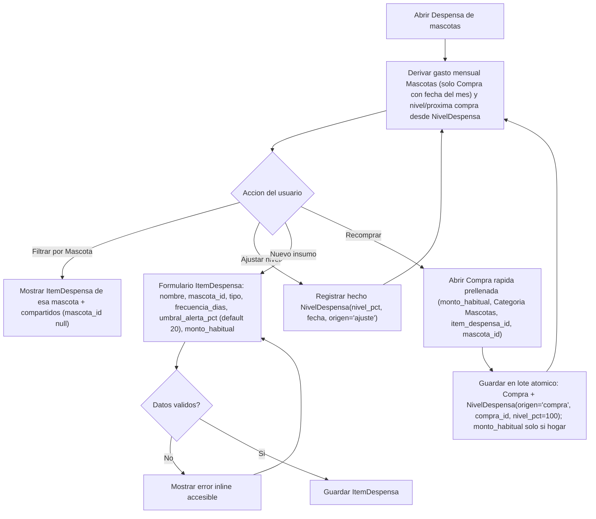

# Flujo: Despensa de mascotas

Controlar comida, higiene, salud y otros insumos recurrentes de cada `Mascota` del hogar registrando hechos de compra y ajuste (`NivelDespensa`), para **derivar** el nivel restante, los días restantes y la próxima compra estimada, recomprar en un toque y mostrar un total mensual **100 % reconciliable** con las compras fechadas en el mes.

## Objetivo

- Anticipar cuándo se acaba un insumo mediante nivel restante **DERIVADO**, umbral de alerta configurable (`ItemDespensa.umbral_alerta_pct`, default `20 %`) y próxima compra estimada.
- Permitir registrar ajustes manuales de inventario (`Ajustar nivel` → nuevo hecho `NivelDespensa` con `origen = 'ajuste'`) sin guardar columnas mutables de saldo.
- Conectar la reposición directamente con **Compra rápida** (`Recomprar` en 1 toque), generando en un lote atómico la `Compra` y un hecho `NivelDespensa(origen = 'compra', compra_id = Compra.id, fecha = Compra.fecha, nivel_pct = 100)`.
- Mostrar un **Gasto en Mascotas del mes** reconciliable peso a peso: suma únicamente las `Compra` con `categoria = Mascotas` (o etiquetadas con `mascota_id`) cuya `fecha` cae dentro del mes calendario en curso.

## Pantallas

| Pantalla | Propósito | Mockup |
| --- | --- | --- |
| **Despensa de mascotas** | Resumen reconciliable del gasto mensual en Mascotas (solo compras con fecha del mes), filtro por `Mascota`, nivel restante **derivado**, próxima compra estimada, alerta cuando `nivel_derivado <= umbral_alerta_pct`, acción inline `Ajustar nivel` y `Recomprar`. | [despensa-mascotas.html](../../design/mockups/despensa-mascotas.html) |
| **Nuevo insumo o recurrente** | Alta de `ItemDespensa` con `mascota_id` (o compartido `null`), `tipo` (`comida \| higiene \| salud \| otro`), `frecuencia_dias`, `umbral_alerta_pct` (0..100, default `20`) y `monto_habitual`. | [nuevo-insumo-mascota.html](../../design/mockups/nuevo-insumo-mascota.html) |

## Flujo paso a paso

### 1. Revisar la despensa, alertas y total reconciliable del mes

1. El usuario toca **Mascotas** en la barra de navegación inferior.
2. En la parte superior ve el **Gasto en Mascotas (noviembre 2026)** (valor **DERIVADO**), con desglose reconciliable de **solo las compras con `fecha` dentro de noviembre**:
   - `15 nov · Concentrado gato esterilizado 3 kg (Milo)`: `$68.000`
   - `11 nov · Arena sanitaria 10 kg (Milo)`: `$42.000`
   - `08 nov · Consulta veterinaria vacuna (Luna, gasto puntual)`: `$135.000`
   - **Total noviembre:** **`$245.000`** (`$68.000 + $42.000 + $135.000`).
   - Las compras de insumos hechas en **octubre** (ej. concentrado de Luna del `22 oct · $165.000` o antipulgas del `29 oct · $95.000`) se muestran en cada tarjeta como referencia de última compra (`monto_habitual`), dejando explícito que **no suman a noviembre**.
3. Debajo aparecen los chips de filtro por `Mascota`: `Todas`, `Luna (perra)`, `Milo (gato)`.
4. La lista prioriza automáticamente los `ItemDespensa` donde **`nivel_derivado <= umbral_alerta_pct`** arriba (alerta), seguidos por nivel medio y bien.
5. Cada tarjeta de `ItemDespensa` comunica el estado sin depender solo del color:
   - Nombre, `Mascota` (o `Compartido · todas las mascotas`), `tipo` (`Comida`, `Higiene`, `Salud`, `Otro`) y `monto_habitual` + fecha de última compra.
   - **Nivel restante derivado** (barra accesible con porcentaje y patrón), **días restantes derivados** con la fórmula `dias_restantes = floor(nivel_pct / 100 × frecuencia_dias)`, **próxima compra estimada** (`fecha_observacion + dias_restantes`) y **umbral de alerta** (ej. `Alerta <= 20 %`). Con observaciones del `22 nov`: `15 %` de `35` días = `5` días (`27 nov`), `20 %` de `30` días = `6` días (`28 nov`), `45 %` de `25` días = `11` días (`3 dic`) y `75 %` de `30` días = `22` días (`14 dic`).
   - Etiqueta con icono + texto: **`▲ Por acabarse`** **siempre** que `nivel_derivado <= umbral_alerta_pct` (incluido cuando iguala el umbral, ej. `20 % <= 20 %`), `● Media` (por encima del umbral hasta `60 %`) o `✓ Bien` (`> 60 %`).
   - Dos acciones directas: **`Recomprar`** y **`Ajustar nivel`**.

### 2. Ajustar nivel observado (`NivelDespensa` con `origen = 'ajuste'`)

1. Si el usuario revisa físicamente el bulto o la arena y nota que queda más o menos de lo estimado, toca **`Ajustar nivel`** en la tarjeta del ítem.
2. Selecciona o ingresa el porcentaje observado (`0..100 %`, ej. `15 %`, `0 % agotado`, `50 %`) y confirma.
3. La app registra un nuevo hecho inmutable **`NivelDespensa`** (`item_despensa_id`, `fecha = hoy`, `nivel_pct`, `origen = 'ajuste'`) —nunca edita ni guarda una columna de saldo en `ItemDespensa`.
4. A partir del último hecho `NivelDespensa` y `frecuencia_dias`, la app **re-deriva** al instante el nivel actual, los días restantes, la próxima compra estimada y si dispara alerta (`nivel_derivado <= umbral_alerta_pct`).

### 3. Recomprar un insumo en 1 toque (conexión con Compra rápida)

1. El usuario toca **`Recomprar $165.000`** en `Concentrado adulto 12 kg`.
2. Se abre **Compra rápida** prellenada con:
   - `monto_total`: `$165.000` (editable si cambió el precio).
   - `categoria_id`: `Mascotas`.
   - `mascota_id`: `Luna` (heredada de `ItemDespensa.mascota_id`; libre si es compartido `null`).
   - `item_despensa_id`: id del insumo.
   - `ambito`: `'hogar'` (por defecto).
   - `descripcion`: `Concentrado adulto 12 kg · Luna`.
3. Al tocar **`Guardar`**, la app ejecuta en un solo lote atómico:
   - Crea la `Compra` (respetando la regla de consumo y cuotas sin doble conteo).
   - Crea un hecho **`NivelDespensa`** (`item_despensa_id`, `compra_id = Compra.id`, `fecha = Compra.fecha`, `nivel_pct = 100`, `origen = 'compra'`), vinculado al ciclo de vida y visibilidad de esa compra (si la compra se edita o elimina, la observación se edita o elimina en el mismo lote).
   - **Solo si `Compra.ambito = 'hogar'`**, actualiza `ItemDespensa.monto_habitual` si el precio cambió. Si el usuario cambia el ámbito a `personal`, la app **nunca** actualiza `ItemDespensa.monto_habitual` ni otras filas compartidas, y la observación `NivelDespensa` vinculada solo la ve su dueño.

### 4. Agregar un nuevo insumo o gasto recurrente (`ItemDespensa`)

1. Desde **Despensa de mascotas**, el usuario toca **`+ Insumo`**.
2. Completa los campos de `ItemDespensa`:
   - `nombre` (ej. `Concentrado adulto 12 kg`, `Arena sanitaria 10 kg`).
   - `mascota_id`: `Luna`, `Milo` o `Compartido (todas)` (`mascota_id = null`).
   - `tipo`: **`Comida`** (`comida`), **`Higiene`** (`higiene`), **`Salud`** (`salud`) u **`Otro`** (`otro`).
   - `frecuencia_dias`: duración estimada en días (ej. `35`).
   - `umbral_alerta_pct`: porcentaje `0..100` para activar alerta (default **`20`**).
   - `monto_habitual`: precio de referencia en COP enteros (opcional, ej. `$165.000`).
3. Toca **`Guardar insumo`** y el ítem aparece en la despensa (sin estimación de próxima compra hasta que exista una primera `Compra` o un primer ajuste `NivelDespensa`).

## Casos borde y manejo de errores

| Caso borde / error | Comportamiento esperado |
| --- | --- |
| **Insumo nuevo sin compras ni ajustes previos** | No inventa fecha ni porcentaje: muestra `"Sin registros aún"` con botones `Recomprar` y `Ajustar nivel`. |
| **El insumo se acabó antes de lo estimado** | El usuario toca `Ajustar nivel` → `0 %` (`NivelDespensa(nivel_pct=0, origen='ajuste')`). El nivel derivado queda en `0 % <= umbral_alerta_pct`, activa alerta inmediata y destaca `Recomprar`. |
| **El insumo rindió más días de lo esperado** | Cuando el nivel derivado llega a `0 %` sin nueva compra, muestra `▲ Revisar nivel (0 %)` con acciones `Ajustar nivel` y `Recomprar` (nunca asume una compra automática). |
| **Compra de insumo hecha el mes anterior (ej. 22 oct)** | Muestra `Última compra: 22 oct · $165.000 (no suma a nov)` y **no** entra en el total del mes de noviembre (`$245.000`). |
| **Compra de un bulto a cuotas (ej. `$300.000` en 3 cuotas)** | Pasa por *Compra rápida*: el consumo de `$300.000` suma una sola vez a `Mascotas` en la fecha de compra y sus cuotas van a *Obligaciones del mes*. |
| **Insumo compartido (`mascota_id = null`)** | Se etiqueta `Compartido (todas las mascotas)` y aparece al filtrar por Luna o por Milo sin duplicar su monto en el gasto del mes. |
| **Gasto eventual de veterinario (sin `ItemDespensa`)** | Se registra desde *Compra rápida* con `categoria_id = Mascotas` y `mascota_id = Luna`; suma automáticamente al total reconciliable del mes (`$135.000`). |
| **Compra de un ítem marcada como personal (`ambito = 'personal'`)** | Nunca actualiza filas compartidas (`ItemDespensa.monto_habitual` permanece intacto). Su `NivelDespensa(origen = 'compra', compra_id = Compra.id)` hereda la visibilidad privada de la compra y no altera el cálculo compartido del hogar. |
| **Umbral fuera de rango (`< 0` o `> 100`) o `frecuencia_dias <= 0`** | Validación inline accesible junto al campo afectado antes de guardar. |

## Diagrama de flujo

## Datos del dominio que toca

Nombres canónicos alineados con `docs/data-model.md` y [docs/decisiones-2026-11-22.md](../decisiones-2026-11-22.md).

| Entidad / Concepto | Tipo | Operación | Campos principales | Regla aplicada |
| --- | --- | --- | --- | --- |
| **`Mascota`** | Hecho (tabla replicada) | Lectura / Escritura | `id`, `hogar_id`, `nombre`, `especie` (`'perro' \| 'gato' \| 'otro'`), `fecha_nacimiento`, `activa` | Pertenece al hogar. No guarda gasto propio; su gasto se deriva de `Compra.mascota_id`. |
| **`ItemDespensa`** | Hecho (tabla replicada) | Lectura / Escritura | `id`, `hogar_id`, `mascota_id` (`null` = todas), `nombre`, `tipo` (`'comida' \| 'higiene' \| 'salud' \| 'otro'`), `categoria_id`, `frecuencia_dias`, `umbral_alerta_pct` (`0..100`, default `20`), `monto_habitual`, `activo` | Define el producto, tipo, frecuencia y umbral de alerta. Nunca guarda nivel restante ni fecha de próxima compra. `monto_habitual` es fila compartida del hogar: una compra con `ambito = 'personal'` nunca la modifica. |
| **`NivelDespensa`** | Hecho (tabla replicada) | Lectura / Escritura | `id`, `hogar_id`, `item_despensa_id`, `compra_id` (nullable), `fecha`, `nivel_pct` (`0..100`), `origen` (`'compra' \| 'ajuste'`) | Registra observaciones como hechos inmutables. Toda compra del ítem crea en el mismo lote atómico `NivelDespensa(origen = 'compra', compra_id = Compra.id, fecha = Compra.fecha, nivel_pct = 100)` (`compra_id` único entre activas; enlaza ciclo de vida y visibilidad); `Ajustar nivel` crea `origen = 'ajuste'` con `compra_id = null`. |
| **`Compra`** | Hecho (tabla replicada) | Lectura / Escritura (vía *Compra rápida*) | `id`, `fecha`, `monto_total`, `categoria_id`, `ambito`, `mascota_id`, `item_despensa_id`, `pago_tipo`, `medio_de_pago_id`, `registrado_por` | Solo las compras con `fecha` dentro del mes calendario suman al gasto mensual de Mascotas (reconciliable). |
| **Nivel actual, días restantes, alerta (`<= umbral_alerta_pct`), próxima compra estimada, gasto mensual Mascotas** | **DERIVADO (nunca guardado)** | Solo lectura calculada | `nivel_actual_pct`, `dias_restantes`, `en_alerta`, `proxima_compra_estimada`, `gasto_mascotas(mes)` | Siempre calculados en el dispositivo desde `ItemDespensa`, `NivelDespensa` y `Compra`. Nunca se almacenan en base de datos. |
