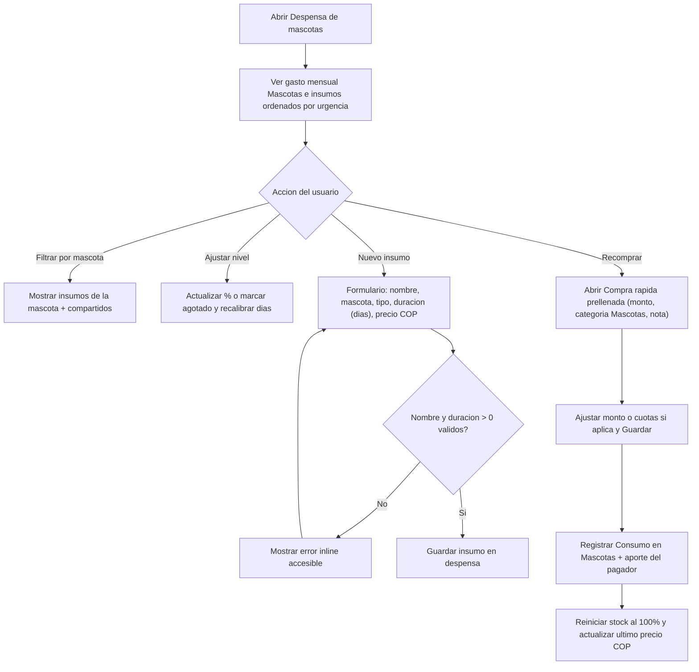

# Flujo: Despensa de mascotas

Controlar comida, insumos y gastos recurrentes de las mascotas del hogar para anticipar cuándo se acaba un producto, recomprarlo en un toque sin duplicar registro y conocer el gasto real mensual dedicado a mascotas.

## Objetivo

- Evitar quedarse sin comida, arena o antipulgas de imprevisto mediante estimación simple de duración restante.
- Conectar directamente la reposición de un insumo con **Compra rápida** (1 toque en `Recomprar`, con monto, categoría `Mascotas` y nota prellenados).
- Mantener el gasto real de mascotas integrado al **Consumo del mes** y al **Aporte libre** de quien compró el insumo.

## Pantallas

| Pantalla | Propósito | Mockup |
| --- | --- | --- |
| **Despensa de mascotas** | Resumen de gasto mensual en mascotas, filtro por mascota, estado visual y textual de cada insumo (días restantes) y botón de recompra rápida. | [despensa-mascotas.html](../../design/mockups/despensa-mascotas.html) |
| **Nuevo insumo o recurrente** | Registrar un producto de despensa o gasto periódico de salud/higiene asignado a una mascota o compartido entre varias. | [nuevo-insumo-mascota.html](../../design/mockups/nuevo-insumo-mascota.html) |

## Flujo paso a paso

### 1. Revisar la despensa y alertas de reposición

1. El usuario toca **Mascotas** en la barra de navegación inferior.
2. En la parte superior ve el **Gasto del mes en Mascotas** (ej. `$245.000` en noviembre) y chips para filtrar: `Todas`, `Luna` y `Milo`.
3. La lista prioriza automáticamente los insumos **Por acabarse** o **Próximos** arriba, seguidos por `Media` y `Bien`.
4. Cada tarjeta de insumo comunica el estado sin depender solo del color:
   - Nombre y mascota asignada (ej. `Concentrado adulto 12 kg · Luna` o `Antipulgas mensual · Luna y Milo`).
   - Etiqueta con icono y texto: `▲ Por acabarse (~4 días)`, `◷ Próximo (6 días)`, `● Media (~12 días)` o `✓ Bien (~22 días)`.
   - Barra de nivel con porcentaje visible (`15%`) y último precio pagado en COP (`$165.000`).
   - Dos acciones directas: **`Recomprar $165.000`** y **`Ajustar nivel`**.

### 2. Recomprar un insumo en 1 toque (conexión con Compra rápida)

1. El usuario toca **`Recomprar $165.000`** en `Concentrado adulto 12 kg`.
2. Se abre **Compra rápida** prellenada con:
   - Monto: `$165.000` (editable si subió de precio).
   - Categoría: `Mascotas`.
   - Nota: `Concentrado adulto 12 kg · Luna`.
   - Medio de pago: último recordado del miembro activo.
3. El usuario ajusta el precio si cambió (opcional) y toca **`Guardar`**.
4. La app realiza tres acciones atómicas:
   - Registra el **Consumo** en categoría `Mascotas` (una sola vez, respetando cuotas si pagó con tarjeta a plazos).
   - Suma el gasto al **aporte** del miembro que pagó.
   - Reinicia el nivel del insumo al `100%` (con nueva fecha de reposición) y guarda el nuevo último precio COP.

### 3. Agregar un nuevo insumo o gasto recurrente

1. Desde **Despensa de mascotas**, el usuario toca **`+ Nuevo insumo`**.
2. Completa los campos:
   - **Nombre del producto o gasto** (ej. `Arena sanitaria 10 kg`, `Antipulgas mensual`).
   - **Mascota:** `Luna`, `Milo` o `Compartido (todas)`.
   - **Tipo:** `Comida`, `Higiene` o `Salud / Veterinario`.
   - **Duración estimada (días):** ej. `30 días` (usado para calcular cuándo avisar).
   - **Último precio estimado en COP (opcional):** ej. `$42.000`.
   - **Recordarme cuando falten:** ej. `5 días`.
3. Toca **`Guardar insumo`** y el ítem aparece inmediatamente en la despensa.

## Casos borde y manejo de errores

| Caso borde / error | Comportamiento esperado |
| --- | --- |
| **El insumo se acabó antes de lo estimado** | El usuario toca `Ajustar nivel` → `Se acabó hoy (0%)`. La app ofrece opcionalmente recalibrar la duración estimada (ej. de 35 a 28 días) para futuras alertas y muestra el botón `Recomprar`. |
| **El insumo rindió más días de lo esperado** | Al llegar a `0 días estimados` sin recompra, el estado pasa a `▲ Revisar stock` (no asume automáticamente que se compró) con dos acciones: `Aún queda (+7 días)` o `Recomprar`. |
| **Compra de un bulto a cuotas (ej. `$300.000` en comida a 3 cuotas)** | Como pasa por *Compra rápida*, aplica la misma regla de `docs/domain.md`: el consumo de `$300.000` entra una vez a `Mascotas` hoy, y las 3 cuotas de `$100.000` aparecen en *Obligaciones del mes* como pago de deuda. |
| **Insumo compartido entre varias mascotas (ej. antipulgas o arena)** | Se etiqueta `Compartido (Luna y Milo)` y aparece visible al filtrar por cualquiera de las mascotas involucradas, sin duplicar el gasto en el total mensual. |
| **Cambio de precio al recomprar** | El usuario edita el monto prellenado en *Compra rápida* (ej. de `$165.000` a `$172.000`). El consumo queda por `$172.000` y el insumo actualiza su precio de referencia a `$172.000`. |
| **Gasto eventual de veterinario (no recurrente)** | Se registra directamente desde *Compra rápida* en categoría `Mascotas` sin obligar a crear un ítem en la despensa; aun así suma al resumen mensual de Mascotas. |
| **Hogar sin mascotas registradas** | Estado vacío amable: `"Aún no has agregado mascotas"` con botón `+ Agregar primera mascota` y la opción de ocultar la pestaña si el hogar no tiene mascotas. |
| **Duración estimada `<= 0` o nombre vacío** | Validación inline clara junto al campo afectado antes de guardar. |

## Diagrama de flujo

## Datos del dominio que toca

| Entidad / Concepto (`docs/domain.md`) | Operación | Campos principales | Regla aplicada |
| --- | --- | --- | --- |
| **Mascota (`pet`)** | Lectura / Escritura | `id`, `household_id`, `name`, `species` | Pertenece al hogar (compartida por los miembros). |
| **Insumo de despensa (`pet_supply`)** | Lectura / Escritura | `id`, `household_id`, `pet_ids[]` (una o varias), `name`, `kind` (`food`, `hygiene`, `health`), `estimated_days`, `alert_before_days`, `last_price_cop`, `last_restocked_at`, `remaining_pct` | Permite insumos individuales o compartidos sin duplicar montos. Precios siempre enteros en COP. |
| **Consumo (`expense`)** | Lectura / Escritura (vía *Compra rápida*) | `id`, `amount_cop`, `category_id` (`mascotas`), `paid_by_member_id`, `payment_method_id`, `pet_supply_id` (opcional), `installments_count` | Toda compra (recompra o gasto puntual) sigue la regla única de consumo y cuotas sin doble conteo. |
| **Aporte (`contribution`)** | Escritura derivada | `member_id`, `month`, `amount_cop` | Quien paga el insumo suma a su aporte libre en *Balance de pareja*. |
