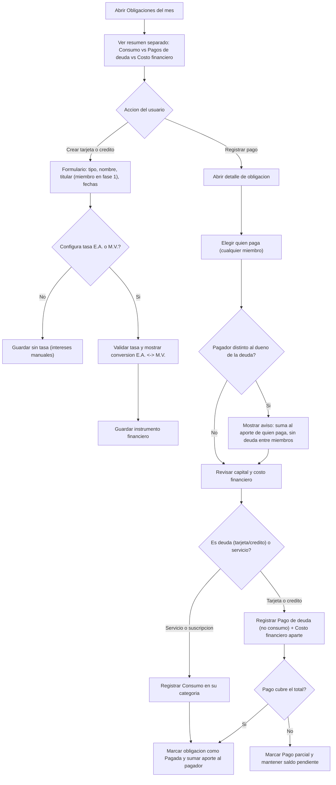

# Flujo: Obligaciones del mes

Concentrar en una sola vista todo lo que hay que pagar en el mes en curso —cuotas de tarjetas, créditos, servicios públicos y suscripciones— separando estrictamente **consumo**, **pagos de deuda** y **costo financiero** para que nunca exista doble conteo.

## Objetivo

- Responder de un vistazo: *"¿Qué falta pagar este mes, cuánto es, cuándo vence y a quién pertenece la deuda?"*.
- Permitir que **cualquier miembro** pague una obligación (incluso si la tarjeta o deuda pertenece a otro miembro), registrándolo como **aporte de quien pagó** y **sin generar deuda entre miembros**.
- Permitir crear tarjetas y créditos (titular = un miembro en fase 1) con **tasas E.A. o M.V. opcionales**.

## Pantallas

| Pantalla | Propósito | Mockup |
| --- | --- | --- |
| **Obligaciones del mes** | Resumen separado de Consumo / Pagos de deuda / Costo financiero + lista priorizada de obligaciones pendientes y pagadas del mes. | [obligaciones-del-mes.html](../../design/mockups/obligaciones-del-mes.html) |
| **Registrar pago de obligación** | Confirmar quién paga, ajustar capital (pago de deuda) e intereses/comisiones (costo financiero) antes de marcar pagada. | [registrar-pago-obligacion.html](../../design/mockups/registrar-pago-obligacion.html) |
| **Nueva tarjeta o crédito** | Alta de tarjeta o crédito asignada a un miembro, con fechas de corte/pago y tasa E.A./M.V. opcional con conversión automática. | [nueva-tarjeta-credito.html](../../design/mockups/nueva-tarjeta-credito.html) |

## Flujo paso a paso

### 1. Consultar obligaciones y verificar que no hay doble conteo

1. El usuario toca **Obligaciones** en la barra de navegación inferior.
2. En la parte superior aparecen tres tarjetas diferenciadas (nunca sumadas entre sí):
   - **Consumo del mes:** gastos reales registrados una sola vez (ej. `$3.145.000`, incluye los `$300.000` completos del mercado a cuotas).
   - **Pagos de deuda:** capital que sale este mes para abonar tarjetas y créditos (ej. `$670.000`, marcado explícitamente como *"No suma al consumo"*).
   - **Costo financiero:** intereses, cuota de manejo, seguros y mora del mes (ej. `$68.800`, categoría aparte).
3. Debajo se muestra la lista de obligaciones del mes ordenadas por urgencia: **Vencidas**, **Pendientes por vencer** y **Pagadas**.
4. Cada tarjeta de obligación muestra:
   - Nombre y tipo (ej. `Cuota 1/3 · Mercado Éxito`, `Crédito remodelación cocina`, `Servicios EPM`).
   - **Propiedad de la deuda** con etiqueta clara: `Deuda de Santiago`, `Deuda de Camila`, `Deuda del hogar` o `Servicio del hogar`.
   - Desglose en COP enteros: capital (`$100.000`) + costo financiero si aplica (`$6.300`), fecha límite y estado con icono + texto (`◷ Pendiente`, `▲ Vence pronto`, `✓ Pagado`).

### 2. Registrar el pago de una obligación (incluyendo pago por otro miembro)

1. El usuario toca **`Registrar pago`** en una obligación pendiente (ej. `Cuota 1/3 · Mercado Éxito` en `Visa ••4521`, deuda de Santiago).
2. Se abre **Registrar pago de obligación** con los montos precargados:
   - **Capital (Pago de deuda):** `$100.000` (editable si hace abono parcial o extraordinario).
   - **Intereses / seguros (Costo financiero):** `$6.300` si la tarjeta tiene tasa configurada (editable contra el extracto real), o campo vacío opcional si la tarjeta no tiene tasa.
3. El usuario elige **Quién realiza el pago** (`Santiago` o `Camila`).
   - Si elige un miembro distinto al dueño de la deuda (por ejemplo, **Camila** paga una cuota de la **Visa de Santiago**), aparece un aviso informativo claro: *"Esta deuda es de Santiago. Al pagarla Camila, cuenta como aporte de Camila al hogar y no genera deuda entre ustedes."*
4. El usuario selecciona el medio de origen (ej. `Cuenta Bancolombia` o `Nequi`) y la fecha de pago (`Hoy`).
5. El usuario toca **`Confirmar pago ($106.300)`**.
6. La app registra:
   - Un movimiento de **Pago de deuda** por `$100.000` (descuenta saldo de la deuda, **no** incrementa el consumo del mes).
   - Un movimiento de **Costo financiero** por `$6.300` (solo si el campo es `> $0`).
   - El monto total desembolsado (`$106.300`) como **aporte al hogar** de quien pagó en *Balance de pareja*.
7. La obligación pasa a sección **Pagadas** con etiqueta `✓ Pagado por [Miembro]`.

### 3. Crear una nueva tarjeta o crédito (con tasa opcional)

1. Desde **Obligaciones del mes**, el usuario toca **`+ Tarjeta / Crédito`**.
2. Selecciona el tipo: **Tarjeta de crédito** o **Crédito / préstamo**.
3. Ingresa el nombre (ej. `Visa ••4521`) y selecciona el **Titular** entre los miembros del hogar (`Santiago` o `Camila`). *(Nota de diseño: en fase 1 la UI solo ofrece miembros individuales; el modelo almacena `owner = miembro | hogar` para habilitar titulares compartidos en fases futuras).*
4. Configura día de corte y día límite de pago (y cupo o saldo actual opcional).
5. En **Tasa de interés (opcional)** elige una de tres opciones:
   - **Sin tasa (registrar intereses a mano):** opción válida por defecto; la app no calcula intereses.
   - **Tasa E.A. (Efectiva Anual):** al escribir ej. `28,32`, muestra automáticamente la equivalencia `2,10% M.V.` usando `MV = (1 + EA)^(1/12) - 1`.
   - **Tasa M.V. (Mes Vencido):** al escribir ej. `2,10`, muestra automáticamente la equivalencia `28,32% E.A.` usando `EA = (1 + MV)^12 - 1`.
6. Toca **`Guardar tarjeta`** y regresa a *Obligaciones del mes*.

## Casos borde y manejo de errores

| Caso borde / error | Comportamiento esperado |
| --- | --- |
| **Pago parcial de una cuota (ej. paga `$60.000` de `$100.000`)** | La obligación queda en estado `◐ Pago parcial ($60.000 de $100.000)` y mantiene un saldo pendiente de `$40.000` en la lista del mes hasta completarse. |
| **Pago mayor al capital esperado (abono a capital)** | Se permite; la app informa que el excedente abona al saldo de la deuda y recalcula las cuotas restantes sin tocar el consumo original. |
| **Tarjeta sin tasa configurada** | En *Registrar pago*, el campo `Intereses / costo financiero` aparece vacío con ayuda contextual: `"Esta tarjeta no tiene tasa guardada. Si tu extracto cobra intereses o cuota de manejo, ingrésalos aquí"`. Si queda vacío o `$0`, solo registra el pago de deuda. |
| **Servicio recurrente con valor variable (ej. EPM agua/luz)** | Muestra el valor estimado del mes anterior (`~$285.000`) editable al momento de registrar el pago. Al pagarse, un servicio público SÍ registra **Consumo** (en categoría `Servicios`), no pago de deuda. |
| **Obligación vencida** | Sube al primer bloque con badge `▲ Vencida hace N días` (icono + color de alto contraste + texto). Si el extracto incluyó mora, se captura en el campo **Costo financiero**. |
| **Tasa fuera de rango o negativa** | Validación inline antes de guardar: `"Ingresa una tasa positiva (ej. 28,32% E.A.) o selecciona Sin tasa"`. |
| **Interés estimado difiere del extracto del banco** | El campo de intereses siempre es editable al confirmar el pago; prevalece el valor real del extracto en pesos enteros COP. |
| **Deuda general del hogar vs deuda de un miembro** | Una deuda del hogar (ej. crédito remodelación) se etiqueta `Deuda del hogar` y nunca fuerza un titular individual; una tarjeta/crédito en fase 1 siempre tiene un miembro titular. |

## Diagrama de flujo

## Datos del dominio que toca

| Entidad / Concepto (`docs/domain.md`) | Operación | Campos principales | Regla aplicada |
| --- | --- | --- | --- |
| **Tarjeta / Crédito (`credit_instrument`)** | Lectura / Escritura | `id`, `name`, `kind` (`credit_card`, `loan`), `owner_type` (`member` en UI fase 1; esquema soporta `household`), `owner_id`, `rate_ea`, `rate_mv`, `cutoff_day`, `due_day` | En fase 1 pertenece a un miembro; el esquema soporta `owner = miembro \| hogar`. Tasa E.A./M.V. opcional. |
| **Deuda (`debt`)** | Lectura / Escritura | `id`, `title`, `owner_type` (`member` \| `household`), `owner_id`, `remaining_principal_cop` | Una deuda puede ser de un miembro o del hogar. |
| **Obligación mensual (`monthly_obligation`)** | Lectura / Actualización | `id`, `month`, `kind` (`debt_installment`, `recurring_bill`), `due_date`, `expected_principal_cop`, `estimated_interest_cop`, `status` (`pending`, `partial`, `paid`) | Separa claramente abono de deuda de servicios de consumo. |
| **Pago de deuda (`debt_payment`)** | Escritura | `id`, `obligation_id`, `paid_by_member_id`, `principal_cop`, `paid_at` | **Nunca** se suma al total de Consumo del mes. Cuenta como aporte de `paid_by_member_id`. |
| **Costo financiero (`financial_cost`)** | Escritura | `id`, `obligation_id`, `paid_by_member_id`, `amount_cop`, `subtype` (`interest`, `fee`, `insurance`, `late_fee`), `paid_at` | Gasto separado en categoría `"Costo financiero"`, nunca mezclado con el consumo original (ej. Mercado). |
| **Aporte (`contribution`)** | Escritura derivada | `member_id`, `month`, `amount_cop`, `source_type` | Pagar la deuda de otro miembro suma al aporte de quien pagó y **nunca** crea deuda entre miembros. |
