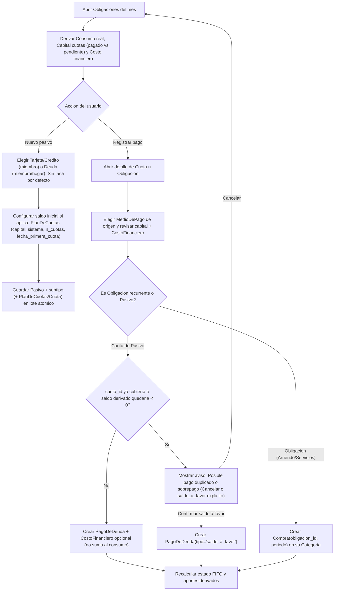

# Flujo: Obligaciones del mes

Concentrar en una sola vista todo lo que hay que pagar en el mes calendario en curso —`Cuota` de tarjetas, créditos y deudas, más instancias de `Obligacion` recurrente (arriendo, servicios, suscripciones)— separando estrictamente **consumo**, **capital de cuotas (pagado vs pendiente)** y **costo financiero** para que nunca exista doble conteo.

## Objetivo

- Responder de un vistazo: *"¿Qué falta pagar este mes, cuánto ya se pagó de deuda, cuánto sigue pendiente, cuándo vence y a quién pertenece cada pasivo?"*.
- Permitir que **cualquier miembro** registre un `PagoDeDeuda` (incluso si el `Pasivo` pertenece a otro miembro), contándolo como **aporte libre de quien pagó** y **sin generar deuda entre miembros**.
- Distinguir la política de propiedad de fase 1: **`Tarjeta` y `Credito` pertenecen solo a un `Miembro`**; una **`Deuda` (informal o no bancaria) puede pertenecer a un `Miembro` o al `Hogar`** (ej. el préstamo de la remodelación de la cocina es `Pasivo` tipo `deuda` del hogar, no un crédito bancario).
- Permitir crear tarjetas, créditos y deudas con **`Sin tasa` preseleccionado por defecto** y alta de **saldo inicial** mediante `PlanDeCuotas(origen='saldo_inicial')`.

## Pantallas

| Pantalla | Propósito | Mockup |
| --- | --- | --- |
| **Obligaciones del mes** | Resumen separado de Consumo real / Capital de cuotas (separado en **pagado** como `PagoDeDeuda` y **pendiente**) / Costo financiero (balde aparte) + lista de obligaciones pendientes y pagadas del mes. | [obligaciones-del-mes.html](../../design/mockups/obligaciones-del-mes.html) |
| **Registrar pago de obligación** | Confirmar quién paga, editar capital (`PagoDeDeuda`) e intereses/comisiones (`CostoFinanciero`), validar aviso de **posible pago duplicado o sobrepago** y confirmar el abono. | [registrar-pago-obligacion.html](../../design/mockups/registrar-pago-obligacion.html) |
| **Nueva tarjeta, crédito o deuda** | Alta de `Pasivo` (`Tarjeta` o `Credito` de un miembro; `Deuda` de miembro u hogar), tasa opcional con **`Sin tasa` preseleccionada** y conversión exacta E.A.⇄M.V., más bloque de **saldo inicial** (`PlanDeCuotas` con `n_cuotas` y `fecha_primera_cuota`). | [nueva-tarjeta-credito.html](../../design/mockups/nueva-tarjeta-credito.html) |

## Flujo paso a paso

### 1. Consultar obligaciones y verificar que no hay doble conteo

1. El usuario toca **Obligaciones** en la barra de navegación inferior.
2. En la parte superior aparecen tres tarjetas diferenciadas (todos valores **DERIVADOS**, nunca guardados ni sumados entre sí):
   - **Consumo real:** `Σ Compra.monto_total` con fecha en noviembre (ej. `$3.145.000`, incluye compras a cuotas una sola vez y excluye pagos de deuda).
   - **Capital de cuotas del mes:** muestra explícitamente el desglose **Pagado (`PagoDeDeuda`)** vs **Pendiente** (ej. **`$220.000` pagado** · `$450.000` pendiente; total cuotas del mes `$670.000`). **Solo lo pagado (`$220.000`) es `PagoDeDeuda` real**; el capital pendiente es agenda y aún no ha salido de caja.
   - **Costo financiero:** `Σ CostoFinanciero.monto` del mes (ej. `$68.799` = `$14.500` pagado + `$54.299` estimado pendiente), en su **balde aparte** (no es una `Categoria` de consumo).
3. Debajo se muestra la lista de obligaciones del mes (estado **DERIVADO** por FIFO para `Cuota`, y derivado por existencia de `Compra(obligacion_id, periodo)` para `Obligacion`): **Vencidas**, **Pendientes este mes** y **Pagadas en noviembre**.
4. Cada tarjeta muestra:
   - Nombre y tipo (ej. `Cuota 1/3 · Mercado Éxito` en `Visa ••4521`, `Préstamo remodelación cocina` como **`Deuda del hogar`**, `Arriendo apartamento` en categoría **`Arriendo`**, `Servicios públicos EPM` en categoría `Servicios`).
   - **Propiedad del pasivo:** `Deuda de Santiago`, `Deuda de Camila`, `Deuda del hogar` (`Pasivo.tipo = 'deuda'`, `owner_tipo = 'hogar'`) u `Obligación del hogar`.
   - Desglose en COP enteros: capital + costo financiero exacto (ej. `$100.000 cap. + $6.299 int. = $106.299`), fecha límite y estado con icono + texto (`◷ Pendiente`, `▲ Vence pronto`, `✓ Pagado`).

### 2. Registrar el pago de una obligación (y control de pago duplicado)

1. El usuario toca **`Registrar pago`** en una `Cuota` pendiente (ej. `Cuota 1/3 · Mercado Éxito` en `Visa ••4521`, deuda de Santiago, vencimiento 25 nov por compra del 10 nov).
2. Se abre **Registrar pago de obligación** con los montos precargados:
   - **Capital (`PagoDeDeuda`):** `$100.000` (editable si hace abono parcial o extraordinario).
   - **Intereses / seguros (`CostoFinanciero`):** `$6.299` (estimado exacto con `28,32 % E.A. → 2,0997 % M.V.`, editable contra el extracto real) o campo vacío si el pasivo está en `Sin tasa`.
3. El usuario elige el `MedioDePago` de origen (y quién realiza el pago).
   - Si el dueño del medio difiere del dueño del `Pasivo` (ej. **Camila** paga desde `Nequi · Camila` una cuota de la **Visa de Santiago**), aparece el aviso de **Aporte libre**: *"Esta deuda es de Santiago. Al pagarla Camila, los `$106.299` cuentan como aporte de Camila al hogar y no generan deuda entre ustedes."*
4. **Control de posible pago duplicado o sobrepago (invariante de saldo nunca negativo):**
   - Si la `Cuota` ya tiene un `PagoDeDeuda` con ese `cuota_id` cubriendo la cuota completa (índice único parcial `(cuota_id)` cuando cubre la cuota completa), o si el pago dejaría el **saldo derivado** del `Pasivo` en `< $0`, la app **rechaza el guardado automático** y muestra un aviso accesible: **`▲ Posible pago duplicado o sobrepago`**.
   - El usuario puede **Cancelar** (si fue un doble toque o el otro miembro ya pagó esa cuota) o confirmar explícitamente **`Registrar como saldo a favor`** (`PagoDeDeuda.tipo = 'saldo_a_favor'`, nunca como `CostoFinanciero`).
5. Al confirmar un pago válido (`Confirmar pago ($106.299)`), la app persiste en un lote atómico:
   - `PagoDeDeuda` (`pasivo_id`, `cuota_id`, `medio_de_pago_id`, `monto = 100000`, `fecha`, `registrado_por`): baja el saldo derivado del pasivo y **nunca** suma al consumo.
   - `CostoFinanciero` (`tipo = 'interes'`, `monto = 6299`, `origen = 'manual'` si se editó): suma al balde aparte *Costo financiero*.
   - El total desembolsado desde un medio de un miembro (`$106.299`) se refleja en el cálculo **DERIVADO** de *Balance de pareja* como aporte de ese miembro.

### 3. Crear una nueva tarjeta, crédito o deuda (con tasa opcional y saldo inicial)

1. Desde **Obligaciones del mes**, el usuario toca **`+ Tarjeta`** / **`+ Agregar tarjeta, crédito o deuda`**.
2. Selecciona `Pasivo.tipo`:
   - **Tarjeta de crédito (`tarjeta`):** titular obligatorio = un `Miembro` (fase 1). Pide `dia_corte`, `dia_pago`, `cupo` informativo opcional y saldo inicial opcional.
   - **Crédito bancario (`credito`):** titular obligatorio = un `Miembro` (fase 1). Pide `entidad`, `referencia` opcional y **saldo inicial obligatorio** para generar el calendario de cuotas.
   - **Deuda (`deuda`):** pasivo informal o no bancario (ej. `Préstamo remodelación cocina`, acreedor externo texto libre). Permite elegir dueño **`Miembro` u `Hogar`**.
3. En **Tasa de interés (opcional)** viene **`Sin tasa` preseleccionado por defecto** (`tasa_tipo = null, tasa_ppm = null`).
   - Si el usuario cambia a **`% E.A.`** o **`% M.V.`**, muestra la equivalencia exacta (`MV = (1 + EA)^(1/12) − 1`, `EA = (1 + MV)^12 − 1`), guardando la tasa en `tasa_ppm` (partes por millón) y redondeando solo el interés final al peso.
4. En **Saldo inicial (`PlanDeCuotas` con `origen = 'saldo_inicial'`)**:
   - Ingresa `capital` (saldo inicial en COP), `sistema` (`capital_fijo`, `cuota_fija` o `sin_calendario`), **`n_cuotas`** (número de cuotas restantes) y **`fecha_primera_cuota`**.
   - Si el crédito o deuda ya tiene cuotas en curso, este plan crea las cuotas futuras sin duplicar consumos históricos.
5. Al tocar **`Guardar`**, crea el `Pasivo`, su subtipo (`Tarjeta`/`Credito`/`Deuda`) y el `PlanDeCuotas(origen='saldo_inicial')` con sus `Cuota` en un solo lote atómico.

## Casos borde y manejo de errores

| Caso borde / error | Comportamiento esperado |
| --- | --- |
| **Intento de pagar dos veces la misma cuota** | Al detectar un `PagoDeDeuda` previo con el mismo `cuota_id` que cubre la cuota completa, bloquea el alta normal con alerta **`▲ Posible pago duplicado`**: muestra fecha, monto y quién la pagó. |
| **Pago que dejaría el saldo derivado del `Pasivo` < `$0`** | Regla de saldo nunca negativo: se rechaza con aviso **`▲ Posible pago duplicado o sobrepago`**; solo permite continuar si el usuario elige explícitamente registrarlo como **`PagoDeDeuda.tipo = 'saldo_a_favor'`** (nunca como `CostoFinanciero`). |
| **Pago parcial de una cuota (ej. `$60.000` de `$100.000`)** | El estado derivado por FIFO queda en `◐ Parcial ($60.000 de $100.000)` y mantiene `$40.000` pendientes en la agenda del mes. |
| **Pago mayor al capital de la cuota (abono extraordinario sin sobrepasar saldo total)** | Permitido: reduce el saldo derivado del `Pasivo` y el reparto FIFO cubre cuotas pendientes siguientes sin tocar la `Compra` original. |
| **Pasivo sin tasa (`Sin tasa`, opción por defecto)** | En *Registrar pago*, `CostoFinanciero` aparece vacío con ayuda: `"Este pasivo está en Sin tasa. Ingresa intereses o comisiones solo si tu extracto los cobra"`. |
| **Obligación recurrente (ej. Arriendo o EPM)** | Al pagarla se crea una `Compra` con `obligacion_id` y `periodo = 'AAAA-MM'` en su categoría (`Arriendo` o `Servicios`). Único `(obligacion_id, periodo)` impide pagarla dos veces en el mismo mes. |
| **Deuda del hogar vs crédito bancario** | Un crédito bancario en fase 1 siempre tiene `owner_tipo = 'miembro'`. El préstamo de la cocina del hogar se crea como `Pasivo.tipo = 'deuda'` con `owner_tipo = 'hogar'` y `Deuda.acreedor` en texto externo. |
| **Obligación vencida** | Sube al bloque superior con badge `▲ Vencida hace N días` (icono + contraste AA + texto). La mora real se registra como `CostoFinanciero(tipo='mora')`. |

## Diagrama de flujo

## Datos del dominio que toca

Nombres canónicos alineados con `docs/data-model.md` y [docs/decisiones-2026-11-22.md](../decisiones-2026-11-22.md).

| Entidad / Concepto | Tipo | Operación | Campos principales | Regla aplicada |
| --- | --- | --- | --- | --- |
| **`Pasivo`** (+ `Tarjeta` / `Credito` / `Deuda`) | Hecho (tabla replicada) | Lectura / Escritura | `id`, `tipo` (`'tarjeta' \| 'credito' \| 'deuda'`), `nombre`, `owner_tipo` (`'miembro' \| 'hogar'`), `owner_miembro_id`, `tasa_tipo` (`null` default), `tasa_ppm`, `activo`; `Tarjeta` (`dia_corte`, `dia_pago`, `cupo`); `Credito` (`entidad`, `referencia`); `Deuda` (`acreedor`) | Fase 1: `Tarjeta` y `Credito` solo `owner_tipo = 'miembro'`; `Deuda` admite `'miembro'` u `'hogar'`. `Sin tasa` es el default. Nunca guarda saldo. |
| **`PlanDeCuotas`** | Hecho (tabla replicada) | Lectura / Escritura | `id`, `pasivo_id`, `origen` (`'compra' \| 'saldo_inicial'`), `compra_id`, `fecha_inicio`, `capital`, `sistema`, `n_cuotas`, `fecha_primera_cuota`, `tasa_tipo`, `tasa_ppm` | Alta de crédito/deuda con deuda previa crea un plan `origen = 'saldo_inicial'` con `n_cuotas` y `fecha_primera_cuota`. |
| **`Cuota`** | Hecho (tabla replicada) | Lectura / Escritura | `id`, `plan_id`, `numero`, `fecha_vencimiento`, `capital` | No guarda intereses ni estado. Su estado se deriva por FIFO. |
| **`PagoDeDeuda`** | Hecho (tabla replicada) | Lectura / Escritura | `id`, `pasivo_id`, `medio_de_pago_id`, `cuota_id` (nullable), `tipo` (normal \| `'saldo_a_favor'`), `monto`, `fecha`, `nota`, `registrado_por` | Nunca suma al consumo. Único parcial `(cuota_id)` cuando cubre cuota completa; saldo del pasivo nunca `< 0` (sobrepago solo explícito como `tipo = 'saldo_a_favor'`). |
| **`CostoFinanciero`** | Hecho (tabla replicada) | Lectura / Escritura | `id`, `tipo` (`'interes' \| 'cuota_manejo' \| 'seguro' \| 'mora' \| 'comision' \| 'gmf' \| 'otro'`), `monto`, `fecha_causacion`, `pasivo_id`, `medio_de_pago_id`, `cuota_id`, `origen` (`'calculado' \| 'manual'`), `registrado_por` | Balde aparte (no es una `Categoria`). Interés exacto E.A.→M.V., redondeado solo al peso. |
| **`Obligacion`** | Hecho (tabla replicada) | Lectura / Escritura | `id`, `nombre`, `categoria_id` (ej. `Arriendo`, `Servicios`), `monto_estimado`, `dia_vencimiento`, `periodicidad`, `mes_inicio`, `medio_sugerido_id`, `activa` | Plantilla de cobro recurrente que no es deuda. Al pagarla se crea `Compra(obligacion_id, periodo)` con único `(obligacion_id, periodo)`. |
| **Saldos, estado de cuotas, estado de obligaciones, capital pagado vs pendiente, totales del mes** | **DERIVADO (nunca guardado)** | Solo lectura calculada | `saldo(Pasivo)`, `estado_fifo(Cuota)`, `estado_mes(Obligacion)`, `capital_cuotas_pagado`, `capital_cuotas_pendiente`, `costo_financiero(mes)` | Siempre calculados en el dispositivo desde los hechos. Ninguna columna ni tabla persiste saldos, totales ni estados. |
