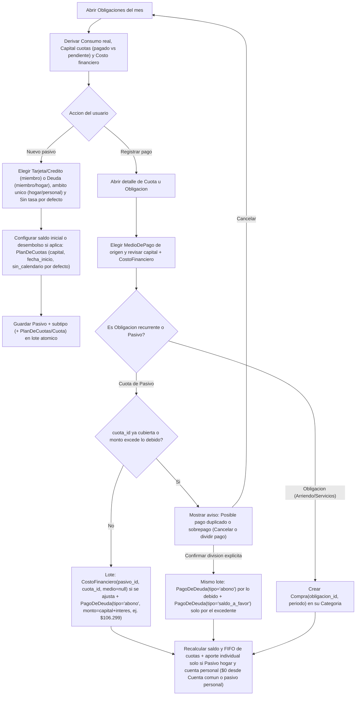

# Flujo: Obligaciones del mes

Concentrar en una sola vista todo lo que hay que pagar en el mes calendario en curso —`Cuota` de tarjetas, créditos y deudas, más instancias de `Obligacion` recurrente (arriendo, servicios, suscripciones)— separando estrictamente **consumo**, **capital de cuotas (pagado vs pendiente)** y **costo financiero** para que nunca exista doble conteo.

## Objetivo

- Responder de un vistazo: *"¿Qué falta pagar este mes, cuánto ya se pagó de deuda, cuánto sigue pendiente, cuándo vence y a quién pertenece cada pasivo?"*.
- Permitir que **cualquier miembro** registre un `PagoDeDeuda` (incluso si el `Pasivo` pertenece a otro miembro): si el pasivo tiene `ambito = 'hogar'`, el abono aporta **completo** a quien pagó **sin generar deuda entre miembros**; si tiene `ambito = 'personal'`, aporta **`$0`**.
- Distinguir la política de propiedad de fase 1: **`Tarjeta` y `Credito` pertenecen solo a un `Miembro`**; una **`Deuda` (informal o no bancaria) puede pertenecer a un `Miembro` o al `Hogar`** (ej. el préstamo de la remodelación de la cocina es `Pasivo` tipo `deuda` del hogar, no un crédito bancario).
- Permitir crear tarjetas, créditos y deudas con **`Sin tasa` preseleccionado por defecto**, alta de deuda previa mediante `PlanDeCuotas(origen='saldo_inicial')` y alta de préstamos en efectivo mediante `PlanDeCuotas(origen='desembolso')` (en `Credito` o `Deuda`, nunca `Tarjeta`).

## Pantallas

| Pantalla | Propósito | Mockup |
| --- | --- | --- |
| **Obligaciones del mes** | Resumen separado de Consumo real (hogar, con desglose verificable) / Capital pagado (cuotas, separado en **pagado** como `PagoDeDeuda` y **pendiente**) / Costo financiero (balde aparte) + lista de obligaciones pendientes y pagadas del mes. | [obligaciones-del-mes.html](../../design/mockups/obligaciones-del-mes.html) |
| **Registrar pago de obligación** | Confirmar `MedioDePago` de origen, revisar o ajustar el desglose del abono (`PagoDeDeuda` con `tipo = 'abono'` por `$106.299` = capital aplicado `$100.000` + `CostoFinanciero` `$6.299` cargado al pasivo ligado a `cuota_id`), validar aviso de **posible pago duplicado o sobrepago** (dividiendo en `abono` por lo debido + `saldo_a_favor` solo por el excedente con confirmación explícita) y confirmar el pago. | [registrar-pago-obligacion.html](../../design/mockups/registrar-pago-obligacion.html) |
| **Nueva tarjeta, crédito o deuda** | Alta de `Pasivo` (`Tarjeta` o `Credito` de un miembro; `Deuda` de miembro u hogar), tasa opcional con **`Sin tasa` preseleccionada** y conversión exacta E.A.⇄M.V., más bloque de plan de capital (`origen = 'saldo_inicial'` para deuda previa o `origen = 'desembolso'` para préstamo en efectivo). | [nueva-tarjeta-credito.html](../../design/mockups/nueva-tarjeta-credito.html) |

## Flujo paso a paso

### 1. Consultar obligaciones y verificar que no hay doble conteo

1. El usuario toca **Obligaciones** en la barra de navegación inferior.
2. En la parte superior aparecen tres tarjetas diferenciadas (todos valores **DERIVADOS**, nunca guardados ni sumados entre sí):
   - **Consumo real (hogar):** `Σ Compra.monto_total` filtrando **`Compra.ambito = 'hogar'`** con `fecha` en noviembre (salvo que el usuario encienda su preferencia local `incluir_personales`, que suma únicamente sus propias compras personales sin alterar aportes). Incluye compras a cuotas guardadas una sola vez y excluye pagos de deuda y borradores sin guardar. Desglose verificable de noviembre (**`$3.112.000`**):
     - `05 nov` · Arriendo apartamento (obligación · Santiago): `$1.800.000`
     - `10 nov` · Mercado Éxito a 3 cuotas (**compra guardada** en `Visa ••4521`, corte 15 nov, cuota 1 vence 25 nov): `$300.000`
     - `18 nov` · Servicios públicos EPM (obligación · Camila): `$285.000`
     - `08–15 nov` · Compras de Mascotas (`$115.000 + $20.000 + $42.000 + $68.000` · Camila, ámbito hogar y categoría `Mascotas`): `$245.000`
     - `Noviembre` · Compras diarias del hogar de contado (Camila): `$482.000`
     - *(Nota: la compra de Mercado Éxito por `$300.000` del **22 nov** en [compra-cuotas.html](../../design/mockups/compra-cuotas.html) —con primera cuota el `25 dic`— es una **simulación sin guardar** del flujo de cuotas y por eso no suma al `$3.112.000` de noviembre; las compras personales de `$140.000` también quedan fuera por defecto).*
   - **Capital pagado (cuotas):** el título distingue explícitamente que el valor destacado (**`$220.000`**) es únicamente el **capital pagado (`PagoDeDeuda`)**, separado del **capital pendiente (`$450.000`)** de la agenda del mes (total cuotas del mes `$670.000`). **Solo lo pagado (`$220.000`) es `PagoDeDeuda` real**; el capital pendiente aún no ha salido de caja.
   - **Costo financiero:** `Σ CostoFinanciero.monto` (`ambito = 'hogar'`) del mes (ej. `$68.799` = `$14.500` pagado + `$54.299` estimado pendiente), en su **balde aparte** (no es una `Categoria` de consumo).
3. Junto a las métricas se aclara la diferencia entre **agenda por `periodo`** y **gasto por `fecha`**: una obligación recurrente (ej. recibo de noviembre pagado el 2 de diciembre) cierra noviembre en la agenda por su `periodo` y suma al gasto real de diciembre por su `fecha` de pago.
4. Debajo se muestra la lista de obligaciones del mes (estado **DERIVADO** por FIFO para `Cuota`, y derivado por existencia de `Compra(obligacion_id, periodo)` para `Obligacion`): **Vencidas**, **Pendientes este mes** y **Pagadas en noviembre**.
5. Cada tarjeta muestra:
   - Nombre y tipo (ej. `Cuota 1/3 · Mercado Éxito (compra guardada 10 nov)` en `Visa ••4521`, `Préstamo remodelación cocina` como **`Deuda del hogar`**, `Arriendo apartamento` en categoría **`Arriendo`**, `Servicios públicos EPM` en categoría `Servicios`).
   - **Propiedad del pasivo:** `Deuda de Santiago`, `Deuda de Camila`, `Deuda del hogar` (`Pasivo.tipo = 'deuda'`, `owner_tipo = 'hogar'`) u `Obligación del hogar`.
   - Desglose en COP enteros: capital + costo financiero exacto (ej. `$100.000 cap. + $6.299 int. = $106.299`), fecha límite y estado con icono + texto (`◷ Pendiente`, `▲ Vence pronto`, `✓ Pagado`).

### 2. Registrar el pago de una obligación (y control de pago duplicado)

1. El usuario toca **`Registrar pago`** en una `Cuota` pendiente (ej. `Cuota 1/3 · Mercado Éxito (compra guardada 10 nov)` en `Visa ••4521`, deuda de Santiago con `Pasivo.ambito = 'hogar'`, vencimiento 25 nov).
2. Se abre **Registrar pago de obligación** con el desglose precargado del cargo completo de la cuota:
   - **Capital aplicado a la cuota:** `$100.000` (editable si hace abono parcial o extraordinario; la `Cuota` guarda solo capital).
   - **Interés ligado a la cuota (`CostoFinanciero` cargado al pasivo):** `$6.299` (`pasivo_id = Visa ••4521`, `cuota_id = cuota-1`, `medio_de_pago_id = null`; calculado al crear el plan con `28,32 % E.A. → 2,0997 % M.V.`, editable contra el extracto real pasando a `origen = 'manual'`, o vacío si el pasivo está en `Sin tasa`).
   - **Total del abono (`PagoDeDeuda`, `tipo = 'abono'`):** **`$106.299`** (`$100.000` de capital + `$6.299` de interés cargado al pasivo). Como cubre el cargo completo de la cuota, lleva el enlace declarativo `cuota_id`.
3. El usuario elige el `MedioDePago` de origen (`medio_de_pago_id`), que define si existe aporte individual y de quién:
   - **Cuenta personal de un miembro (`owner_tipo = 'miembro'`, ej. `Nequi · Camila`):** como el pasivo es del hogar (`Pasivo.ambito = 'hogar'`), aparece el aviso de **Aporte libre**: *"Este pasivo del hogar es de Santiago. Al pagarlo desde una cuenta personal de Camila, el abono de `$106.299` (`$100.000` capital + `$6.299` interés) cuenta como aporte individual de Camila y no genera deuda entre ustedes."*
   - **`Cuenta común · Hogar` (`owner_tipo = 'hogar'`):** el monto pagado es exactamente el mismo (`$106.299`, cubre la misma cuota y reduce el saldo igual), pero **es una salida del fondo común y no hay aporte individual** (`$0` para Santiago y `$0` para Camila).
   - **Regla de aporte por `Pasivo.ambito` (§3.10 y §8 de `docs/data-model.md`):** cada `Pasivo` es un libro de un único ámbito (`'hogar'` o `'personal'`). Un `PagoDeDeuda(tipo = 'abono')` desde una cuenta personal de un miembro (`owner_tipo = 'miembro'`) a un pasivo con `ambito = 'hogar'` aporta **completo** (`$106.299`) al dueño del medio; a un pasivo con `ambito = 'personal'` aporta **`$0`**; y desde `Cuenta común · Hogar` (`owner_tipo = 'hogar'`) **no hay aporte individual**. El reparto FIFO solo asigna el abono a las cuotas y cargos de ese libro, **no** decide el aporte. Si una transferencia cubre un libro del hogar y uno personal de la misma tarjeta física, se registran dos `PagoDeDeuda` separados (uno por `pasivo_id`).
4. **Control de posible pago duplicado o sobrepago (invariante de saldo nunca negativo, I20):**
   - Si la `Cuota` ya tiene un `PagoDeDeuda(tipo = 'abono')` con ese `cuota_id` cubriendo la cuota completa (índice único parcial `(cuota_id)` cuando `tipo = 'abono'` y cubre la cuota completa), o si el pago excede lo debido y dejaría el **saldo derivado** del `Pasivo` en `< $0`, la app **rechaza el guardado automático** y muestra un aviso accesible: **`▲ Posible pago duplicado o sobrepago`**.
   - El usuario puede **Cancelar** (si fue un doble toque o el otro miembro ya pagó esa cuota) o confirmar explícitamente la división en el mismo lote atómico: un **`PagoDeDeuda(tipo = 'abono')` por lo debido** (si hay saldo pendiente `> $0`) y un **`PagoDeDeuda(tipo = 'saldo_a_favor')` solo por el excedente** (nunca como `CostoFinanciero`). Si el saldo ya estaba en `$0` (lo debido es `$0`), solo se crea el `saldo_a_favor` por el excedente. El `saldo_a_favor` **no reduce capital ni costos, no se aplica retroactivamente y no cuenta como aporte mientras no cubra un cargo**; en un pasivo `'hogar'`, aporta cuando cubre un cargo futuro (en el mes de ese cargo, si salió de un medio de miembro), y en un pasivo `'personal'` nunca aporta.
5. Al confirmar un pago válido (`Confirmar pago ($106.299)`), la app persiste en un lote atómico:
   - **`CostoFinanciero` cargado al pasivo ligado a la cuota:** `tipo = 'interes'`, `pasivo_id = Visa ••4521`, `cuota_id = cuota-1`, `medio_de_pago_id = null`, `monto = 6299`, `fecha_causacion = 2026-11-25` (ya existe con `origen = 'calculado'` desde el alta del plan; si el usuario editó el monto contra el extracto, se actualiza/crea en este lote con `origen = 'manual'`). Suma `$6.299` al balde aparte *Costo financiero* y carga esos `$6.299` al pasivo (`$300.000 + $6.299 = $306.299` antes del pago).
   - **`PagoDeDeuda`:** `tipo = 'abono'`, `pasivo_id = Visa ••4521`, `cuota_id = cuota-1`, `medio_de_pago_id`, **`monto = 106299`** (`$100.000` de capital + `$6.299` de interés cargado al pasivo), `fecha`, `registrado_por`. Cubre el cargo completo de la cuota, baja el saldo derivado del pasivo de `$306.299` a **`$200.000`** (el capital aplicado sigue siendo exactamente **`$100.000`**) y **nunca** suma al consumo.
   - En el cálculo **DERIVADO** de *Balance de pareja*: como el pasivo tiene `ambito = 'hogar'`, el abono de **`$106.299`** suma como aporte individual de **Camila** **solo si se paga desde una cuenta personal** (`owner_tipo = 'miembro'`, ej. `Nequi · Camila`); si se paga desde **`Cuenta común · Hogar`** (`owner_tipo = 'hogar'`), **no hay aporte individual** (salida del fondo común). FIFO actualiza el estado de `cuota-1` a `pagada`.

### 3. Crear una nueva tarjeta, crédito o deuda (con tasa opcional y plan inicial o desembolso)

1. Desde **Obligaciones del mes**, el usuario toca **`+ Pasivo`** / **`+ Agregar tarjeta, crédito o deuda`**.
2. Selecciona `Pasivo.tipo` y su único `Pasivo.ambito` (`'hogar'` por defecto; si es `'personal'`, exige `owner_tipo = 'miembro'` y queda inmutable con hechos vinculados):
   - **Tarjeta de crédito (`tarjeta`):** titular obligatorio = un `Miembro` (fase 1). Pide `dia_corte`, `dia_pago`, `cupo` informativo opcional y saldo inicial opcional (`origen = 'saldo_inicial'`). Una tarjeta **no** admite planes `origen = 'desembolso'`. Si una misma tarjeta física se usa para gastos del hogar y personales, lleva **dos libros** (dos `Pasivo` separados con los mismos últimos 4 dígitos).
   - **Crédito bancario (`credito`):** titular obligatorio = un `Miembro` (fase 1). Pide `entidad`, `referencia` opcional y plan de capital: **`saldo_inicial`** (si es deuda previa que ya existía) o **`desembolso`** (si es un préstamo en efectivo nuevo cuyo giro financiará compras vinculadas vía `Compra.financiada_por_pasivo_id`).
   - **Deuda (`deuda`):** pasivo informal o no bancario (ej. `Préstamo remodelación cocina`, acreedor externo texto libre). Permite elegir dueño **`Miembro` u `Hogar`**, con plan **`saldo_inicial`** o **`desembolso`**.
3. En **Tasa de interés (opcional)** viene **`Sin tasa` preseleccionado por defecto** (`tasa_tipo = null, tasa_ppm = null`).
   - Si el usuario cambia a **`% E.A.`** o **`% M.V.`**, muestra la equivalencia exacta (`MV = (1 + EA)^(1/12) − 1`, `EA = (1 + MV)^12 − 1`), guardando la tasa en `tasa_ppm` (partes por millón) y redondeando solo el interés final al peso.
4. En **Plan de capital (`PlanDeCuotas` con `origen = 'saldo_inicial'` o `'desembolso'`)**:
   - Elige si es **`saldo_inicial`** (deuda previa; no sirve para vincular compras nuevas) o **`desembolso`** (capital de préstamo en efectivo en `Credito`/`Deuda`; las compras que gastan ese efectivo apuntan con `Compra.financiada_por_pasivo_id` sin crear otro plan ni sumar capital).
   - Ingresa `capital` en COP, **`fecha_inicio`** (fecha del saldo inicial o del giro, hoy por defecto) y `sistema` con **`sin_calendario` preseleccionado por defecto** (sin inventar cuotas ni fecha de primera cuota; entra en FIFO en su `fecha_inicio`). Si el usuario conoce el calendario, puede elegir `capital_fijo` o `cuota_fija` y completar `n_cuotas` y `fecha_primera_cuota`.
5. Al tocar **`Guardar pasivo`**, crea el `Pasivo`, su subtipo (`Tarjeta`/`Credito`/`Deuda`) y el `PlanDeCuotas` (`saldo_inicial` o `desembolso`) con sus `Cuota` en un solo lote atómico.

## Casos borde y manejo de errores

| Caso borde / error | Comportamiento esperado |
| --- | --- |
| **Intento de pagar dos veces la misma cuota** | Al detectar un `PagoDeDeuda(tipo = 'abono')` previo con el mismo `cuota_id` que cubre la cuota completa, bloquea el alta de otro `abono` con alerta **`▲ Posible pago duplicado`**: muestra fecha, monto y quién la pagó. |
| **Sobrepago (pago que excede lo debido y dejaría el saldo derivado del `Pasivo` < `$0`)** | Regla de saldo nunca negativo (I20): se rechaza el guardado automático con aviso **`▲ Posible pago duplicado o sobrepago`**. Solo continúa con confirmación explícita dividiendo el pago en el mismo lote en **`PagoDeDeuda(tipo = 'abono')` por lo debido** (si hay saldo pendiente) y **`PagoDeDeuda(tipo = 'saldo_a_favor')` solo por el excedente** (nunca como `CostoFinanciero`). El `saldo_a_favor` no reduce capital ni costos ni suma como aporte hasta aplicarse a un cargo posterior en un pasivo `'hogar'` (en uno `'personal'` nunca aporta). |
| **Pago parcial de una cuota (ej. `$60.000` de `$100.000`)** | El estado derivado por FIFO queda en `◐ Parcial ($60.000 de $100.000)` y mantiene `$40.000` pendientes en la agenda del mes. Un pago parcial no lleva `cuota_id`. |
| **Pago mayor al capital de la cuota (abono extraordinario sin sobrepasar saldo total)** | Permitido (`tipo = 'abono'`): reduce el saldo derivado del `Pasivo` y el reparto FIFO cubre cuotas/cargos pendientes siguientes sin tocar la `Compra` original. El aporte lo define `Pasivo.ambito` (completo si es `'hogar'`, `$0` si es `'personal'`); FIFO no decide el aporte. |
| **Pasivo sin tasa (`Sin tasa`, opción por defecto)** | En *Registrar pago*, `CostoFinanciero` aparece vacío con ayuda: `"Este pasivo está en Sin tasa. Ingresa intereses o comisiones solo si tu extracto los cobra"`. |
| **Obligación recurrente (ej. Arriendo o EPM)** | Al pagarla se crea una `Compra` con `obligacion_id` y `periodo = 'AAAA-MM'` en su categoría (`Arriendo` o `Servicios`). Único `(obligacion_id, periodo)` impide pagarla dos veces en el mismo mes. |
| **Deuda del hogar vs crédito bancario** | Un crédito bancario en fase 1 siempre tiene `owner_tipo = 'miembro'`. El préstamo de la cocina del hogar se crea como `Pasivo.tipo = 'deuda'` con `owner_tipo = 'hogar'` y `Deuda.acreedor` en texto externo. |
| **Obligación vencida** | Sube al bloque superior con badge `▲ Vencida hace N días` (icono + contraste AA + texto). La mora real se registra como `CostoFinanciero(tipo='mora')`. |

## Diagrama de flujo

## Datos del dominio que toca

Nombres canónicos alineados con `docs/data-model.md` y [docs/decisiones-2026-11-22.md](../decisiones-2026-11-22.md).

| Entidad / Concepto | Tipo | Operación | Campos principales | Regla aplicada |
| --- | --- | --- | --- | --- |
| **`Pasivo`** (+ `Tarjeta` / `Credito` / `Deuda`) | Hecho (tabla replicada) | Lectura / Escritura | `id`, `tipo` (`'tarjeta' \| 'credito' \| 'deuda'`), `nombre`, `ambito` (`'hogar' \| 'personal'`, default `'hogar'`), `owner_tipo` (`'miembro' \| 'hogar'`), `owner_miembro_id`, `tasa_tipo` (`null` default), `tasa_ppm`, `activo`; `Tarjeta` (`dia_corte`, `dia_pago`, `cupo`); `Credito` (`entidad`, `referencia`); `Deuda` (`acreedor`) | Cada `Pasivo` es un libro de un único `ambito` (inmutable con hechos vinculados; `'personal'` exige `owner_tipo = 'miembro'`). Fase 1: `Tarjeta` y `Credito` solo `owner_tipo = 'miembro'`; `Deuda` admite `'miembro'` u `'hogar'`. `Sin tasa` es el default. Nunca guarda saldo. |
| **`PlanDeCuotas`** | Hecho (tabla replicada) | Lectura / Escritura | `id`, `pasivo_id`, `origen` (`'compra' \| 'saldo_inicial' \| 'desembolso'`), `compra_id`, `fecha_inicio`, `capital`, `sistema`, `n_cuotas`, `fecha_primera_cuota`, `tasa_tipo`, `tasa_ppm` | `origen = 'compra'` para consumo financiado; `'saldo_inicial'` para deuda previa; `'desembolso'` para el capital de un préstamo en efectivo en `Credito` o `Deuda` (no `Tarjeta`), al que apuntan compras vía `Compra.financiada_por_pasivo_id` sin crear otro plan. |
| **`Cuota`** | Hecho (tabla replicada) | Lectura / Escritura | `id`, `plan_id`, `numero`, `fecha_vencimiento`, `capital` | No guarda intereses ni estado. Su estado se deriva por FIFO. |
| **`PagoDeDeuda`** | Hecho (tabla replicada) | Lectura / Escritura | `id`, `pasivo_id`, `medio_de_pago_id`, `cuota_id` (nullable), `tipo` (`'abono' \| 'saldo_a_favor'`, default `'abono'`), `monto`, `fecha`, `nota`, `registrado_por` | Nunca suma al consumo. El `abono` que cubre una cuota con interés es por el cargo completo (`capital + CostoFinanciero` cargado al pasivo, ej. `$106.299 = $100.000 + $6.299`); el capital aplicado sigue siendo `$100.000`. Único parcial `(cuota_id)` cuando `tipo = 'abono'` cubre cuota completa; saldo del pasivo nunca `< 0`. Si un pago excede lo debido, con confirmación explícita se divide en `tipo = 'abono'` por lo debido y `tipo = 'saldo_a_favor'` solo por el excedente. El aporte individual es por el abono completo solo si `Pasivo.ambito = 'hogar'` y se paga desde una cuenta personal (`owner_tipo = 'miembro'`); desde `Cuenta común · Hogar` (`owner_tipo = 'hogar'`) o hacia un pasivo `'personal'` no hay aporte individual (`$0`). FIFO solo asigna cuotas/cargos. `saldo_a_favor` no aporta hasta aplicarse a un cargo posterior del hogar. |
| **`CostoFinanciero`** | Hecho (tabla replicada) | Lectura / Escritura | `id`, `tipo` (`'interes' \| 'cuota_manejo' \| 'seguro' \| 'mora' \| 'comision' \| 'gmf' \| 'otro'`), `monto`, `fecha_causacion`, `pasivo_id`, `medio_de_pago_id`, `cuota_id`, `origen` (`'calculado' \| 'manual'`), `registrado_por` | Balde aparte (no es una `Categoria`). El interés ligado a `cuota_id` siempre se carga al pasivo (`pasivo_id` presente, `medio_de_pago_id = null`) y se cubre con `PagoDeDeuda`. Interés exacto E.A.→M.V., redondeado solo al peso. |
| **`Obligacion`** | Hecho (tabla replicada) | Lectura / Escritura | `id`, `nombre`, `categoria_id` (ej. `Arriendo`, `Servicios`), `monto_estimado`, `dia_vencimiento`, `periodicidad`, `mes_inicio`, `medio_sugerido_id`, `activa` | Plantilla de cobro recurrente que no es deuda. Al pagarla se crea `Compra(obligacion_id, periodo)` con único `(obligacion_id, periodo)`. |
| **Saldos, estado de cuotas, estado de obligaciones, capital pagado vs pendiente, totales del mes** | **DERIVADO (nunca guardado)** | Solo lectura calculada | `saldo(Pasivo)`, `estado_fifo(Cuota)`, `estado_mes(Obligacion)`, `capital_cuotas_pagado`, `capital_cuotas_pendiente`, `costo_financiero(mes)` | Siempre calculados en el dispositivo desde los hechos. Ninguna columna ni tabla persiste saldos, totales ni estados. |
